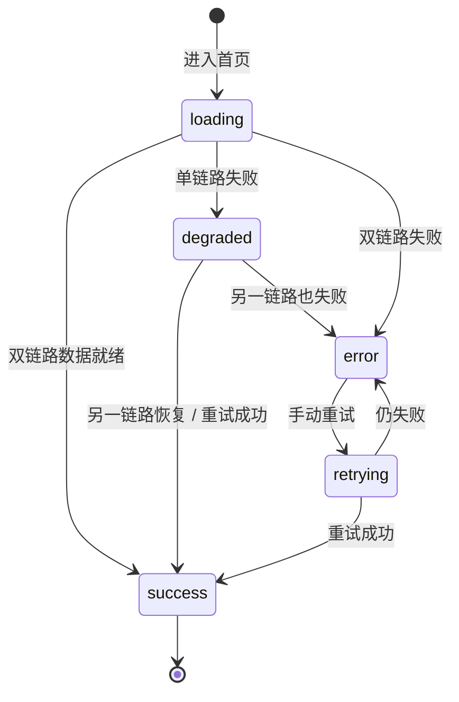

# Module 05: 自定义前端门户

> **PRD 状态**: `dev-ready`（Track B 增量 v1.12，2026-10-23 收割 dev-feedback 反馈 9~12：首页首屏改五段版式、采集健康两态收敛（决策 102 / 103）；原型验证豁免，记录见 `docs/05-execution-records/module-05/design-decisions.md`「Track B 豁免记录」与决策 88 / 89 / 90 / 91 / 93 / 98 / 99 / 100 / 101 / 102 / 103）
> **PRD 版本**: v1.13
> **产品版本覆盖**: MVP / v0.3 / v1.0
> **原型版本**: v1.11（与 README / `package.json` 同轴；**桌面版式仍为旧七段基线（L0~L5），与 PRD v1.12 五段首屏版式存在已知偏差**——L0 全局态势五卡 / L2 应用覆盖明细 / 旧「按云分布」整宽区块 / L3 拨测明细面板在 PRD 中已收敛为纳管完成率圆环六行表 / 平台×应用矩阵 / 拨测单卡等新形态，原型未同步，待可视化增强阶段前统一重构；移动端适配与拨测归属「网域为主」同为生产 as-built、原型未同步；原型入口 `docs/prototypes/module-05/`）
> **更新日期**: 2026-10-23
> **对应原型**: `docs/prototypes/module-05/`

> **模块类型**: 核心能力模块
> **依赖文档**: [00_Global_Architecture.md](../00_Global_Architecture.md)、[03_Functional_Architecture.md](../03_Functional_Architecture.md)、[Module_01: 监控策略与指标管理](Module_01_Metric_Collection_Center.md)、[Module_07: 监控对象管理](Module_07_Monitoring_Object_Management.md)、[Module_09: 网域与边缘配置中心](Module_09_Network_Domain_and_Edge_Config_Center.md)
> **目标用户**: 运维工程师、业务研发工程师

---

## 1. 模块目标

> 决策依据：design-decisions.md（决策 72 / 72-1 / 72-2 / 72-3 / 73 / 91 / 93 / 100 / 102 / 103）

提供门户化的 Web 界面，替代原生 Prometheus UI，让非专家用户也能轻松使用指标查询与采集管理功能。本模块为前端页面组织与交互设计层，不重新定义后端能力边界，所有业务规则以后端模块 PRD 为准。

**核心职责**：

1. **首页概览**：平台默认落地页，总览资源分布、纳管完成率、采集健康、拨测态势与告警状态。
2. **资源与标签界面**：资源维护、Excel 导入、监控标签编辑与标签模板配置。
3. **采集配置界面**：CI 类型 ↔ 采集器映射、采集 Job、实例选择与拨测配置。
4. **下发与回滚界面**：配置预览、diff 对比、人工确认下发与版本回滚。
5. **查询与告警查看**：自定义表达式查询页、告警状态页。
6. **可视化大屏**：Grafana iframe 嵌入的监控大屏入口（{v0.3}）。

**MVP 边界**：

| 范围 | 内容 | 承接 |
|------|------|------|
| 做 | 首页概览：资源分布 / 纳管完成率 / 采集健康 / 拨测态势 / 告警状态 / 使用指引 | 本模块 |
| 做 | 资源管理、标签模板、CI-Exporter 映射、采集 Job、下发确认、查询页、告警状态页界面 | 本模块（业务规则由 M01 / M07 / M08 / M09 PRD 承载） |
| 不做 | Dashboard 面板编辑器、轻量实时图表、「进入可视化大屏」快捷入口 | {v0.3} 起 Grafana iframe 与概览升级承载 |
| 不做 | 后端业务规则与数据契约 | M01 / M02 / M07 / M08 等后端模块 PRD |

各页面布局、交互规则与状态处理统一见 §11；告警数据流见 §4.2。

---
## 2. 用户故事

- OPS-01：通过 Web 门户查看所有采集目标状态
- OPS-03：在门户中执行 PromQL 查询
- M05-OPS-06：查看应用服务的拨测结果
- M05-OPS-07：在资源列表中识别「已监控 / 未监控」实例
- M05-OPS-08：配置 CI 类型与 Exporter 模板的绑定关系
- DEV-01：查看我负责服务的指标数据

---

## 3. 核心功能

| 页面 | 功能 | 后端 Owner | 优先级 | 交付版本 |
|------|------|------------|--------|----------|
| 资源管理页 | 主机 / 中间件 / 应用服务资源的 CRUD、Excel 导入；展示实例名 / 主机名作为可读名；支持按资源类型编辑监控标签；展示「已监控 / 未监控」badge | Module 07 | P0 | MVP |
| 标签模板页 | 按资源类型配置「资源字段 → 监控标签」映射（资源字段 / 组合字段 / 采集端内置字段 / CMDB 字段 {v0.4+}） | Module 07 | P0 | MVP |
| CI-Exporter 映射页 | 维护 CI 类型 ↔ 采集器模板绑定：默认端口、采集路径、协议、标签模板引用 | Module 01 | P0 | MVP |
| 采集 Job 页 | Job 创建 / 编辑、采集器模板选择、实例选择、标签模板关联 | Module 01 | P0 | MVP |
| 实例选择 / 拨测配置页 | 手动勾选监控实例、拨测目标与探测模块配置 | Module 01 | P0 | MVP |
| 规则编辑页 | 类 YAML 表单编辑告警 / 记录规则，表达式校验，指标实时预览 | Module 01 | P0 | MVP |
| 配置预览 / 下发页 | 实时预览生成结果，与当前生效版本 diff 对比，人工确认后下发 | Module 09 | P0 | MVP |
| 配置版本 / 回滚页 | 查看历史配置版本与下发记录，回滚到指定版本 | Module 09 | P1 | {v0.2} |
| 目标状态页 | 查看所有采集目标状态、拨测结果 | Module 02 | P0 | MVP |
| 查询页 | 表达式编辑器、查询结果（表格 / JSON / 简单折线） | Module 02 | P0 | MVP |
| 告警状态页 | 查看当前告警列表与处理进度 | Module 08 | P1 | MVP |
| 网域管理页 | 网域注册、Token 管理、Edge Agent 状态、租户-网域关联展示 | Module 11 | P0 | {v0.2} |
| 监控源登记册页 | 外部 Prometheus / Zabbix / 云监控接入管理 | Module 10 | P0 | 集成模式 |
| 首页 / Dashboard | 平台默认落地页：一屏总览资源分布、纳管完成率、采集健康、拨测态势与告警状态，并为新用户提供六步开箱引导——回答「哪些资源还没被监控、哪些拨测异常、有多少告警待处理」。告警数字唯一收口在告警状态卡；拨测不计入资源总数与纳管完成率。页面布局 / 交互 / 状态细则见 §11.3，告警数据流见 §4.2 | Module 01/06/08/09/10（数据） | P0（MVP 子集） | MVP；实时图表与快捷入口 {v0.3} |
| 可视化大屏页（Grafana 嵌入） | 一级导航第 2 位，Grafana iframe 承载监控大屏：预置仪表盘模板随交付包下发（只读、可克隆编辑），不自研面板编辑器；数据源锁定 M02 查询代理；提供「配置告警」深链回告警中心。页面交互细则见 §11.4 | Module 02/05 | P0 | {v0.3} |
| 系统设置页 | CMDB Provider 配置、CI 类型映射、状态映射字典、发现源配置、用户 / 角色 / 租户管理 | Module 04/06/07/09 | P2 | 后续版本 |

> **系统设置页职责细分**：
> - CMDB Provider、CI 类型映射、待分类 CI 队列、状态映射字典 → [Module 04](Module_04_Custom_Discovery.md)
> - 租户 / 用户 / 角色 / 权限 → [Module 06](Module_06_Multi_Tenant.md)
> - 标签模板管理入口 → [Module 07](Module_07_Monitoring_Object_Management.md)
> - 网域 / Edge Agent 接入生命周期 → [Module 11](Module_11_Edge_Access_and_Agent_Delivery.md)

### 3.1 关键前端交互

各页面的交互契约（布局 / 列设计 / 关键交互 / 状态与边界 / 跨模块跳转）统一由 §11 前端交互契约承载（11.3 ~ 11.9 每页一节）；本节为指向各页契约的索引，页面级契约以 §11 为唯一权威；本模块功能与页面的对应关系见 §3 功能表。

- 概览 Dashboard → §11.3（移动端版式回落 → §11.3.1）；告警数据流与服务降级 → §4.2；纳管完成率与采集健康口径 → §5.1。
- 可视化大屏页 → §11.4；导航层级与访问流 → §4.3。
- 资源管理页（含监控标签编辑）→ §11.5；标签模板页 → §11.6；CI-Exporter 映射页 → §11.7。
- 状态映射字典配置页 → §11.8；CMDB 同步配置页 → §11.9。

---

## 4. 核心流程

### 4.1 首页开箱动线（六步引导流程）

平台落地页面向新用户的连续开箱动线：

登记网域 → 导入资源 → 建采集 Job → 下发配置 → 配置告警通知 → 查指标 / 看告警。

- 每步需配置深链与完成态标识。
- 第 5 步「配置告警通知」深链 `/alert-config`；第 6 步「查指标 / 看告警」深链 `/query` 自定义查询页或 `/alert-status`。
- 配套项：`QueryPage` 组件挂入 `/query` 路由并补齐最小 PromQL 查询能力（输入框 + 结果表格/JSON，调用 M02 `/api/v1/query` 代理，不复用 Prometheus UI）。

### 4.2 告警状态卡数据流与服务降级

首页告警数据来自三个只读接口：`/api/v1/alerts`（Prometheus 当前触发告警，承载「当前未恢复」计数与「最新告警」列表）、`/api/v2/platform/alertmanager/alerts`（AM 通知四态）与 `/api/v1/alerts/history`（M02 历史告警，当日 / 近 7 天计数与列表行 2 告警内容）。

- **当前未恢复计数**：取 `/api/v1/alerts` 中当前处于触发态的条目，总条数即「最新告警」列表的数据池总量（含已静默 / 已抑制）；无 `resource_category` 的条目（拨测目标、聚合规则、用户自写规则）并入总数。「最新告警」列表取同接口按触发时间倒序的全量 8 条。口径关系：**当前未恢复 = 通知中（AM `active`）+ 已静默 + 已抑制**——静默 / 抑制的告警仍处于触发态、只是暂缓通知，不等于恢复；当日 / 近 7 天为历史累计（含已恢复），两者时间范畴不同、并存不互替。
- **主数字（告警状态卡）**：当日告警 / 近 7 天告警（按 `fired_at` 计数，含已恢复；「近 7 天」取服务端返回的窗口总量，取数窗口为整 7 天、步长由服务端按窗口兜底并在响应回显）；AM 治理态「通知中」（`active`，红色语义）与「已静默 · 已抑制」为次级数字；Prom 求值态仅作 11px 灰字参考行（求值中），不作行动对象。
- **`unprocessed` 裁剪**：不计数、不进列表；仅当 N>0 时显示一行 11px 灰字「另有 N 条告警仍在计算通知状态」。
- **空态引导**：未挂载 AM 通知配置时 `alerting:` 段不生成，AM 数字恒为 0——此时卡片展示「尚未挂载通知配置，去配置 →」深链 `/alert-config`。
- **服务降级**：取数失败时对应数字显示 `-`（不显示 0）；AM / Prom / history 三条链路各自独立降级，单链路失败 warning 局部降级、双链路失败 error + 重试；当前未恢复链路失败时「最新告警」列表降级为 `-`（列表区展示「取数失败，暂无法展示最新告警」）。

### 4.3 导航层级与访问流

- **一级导航**：首页（默认落地页，第 1 位）、「可视化大屏」（第 2 位一级菜单）；其余功能模块按既定顺序排列。一级菜单名使用「可视化大屏」，自带「可视化」关键词、便于新用户发现。
- **首页子菜单**：仅保留「概览 Dashboard」（默认 Tab）与「使用引导」两个子页，不在首页下重复挂载「可视化大屏」。
- **首页 → 大屏快捷入口**：概览 Dashboard 顶部首屏视觉焦点提供「进入可视化大屏」大卡片 / 主按钮，作为一级菜单之外的第二入口（MVP 阶段不提供此快捷入口，v0.3 提供）。
- **大屏全屏动线**：进入可视化大屏后提供全屏 / 退出全屏按钮，适配投屏 / 电视墙场景；全屏模式隐藏门户侧边栏与顶部导航，iframe 铺满可视区域。

### 4.4 技术选型

- 前端框架：React 18 + TypeScript；构建工具：Vite；UI 组件库：Ant Design 5.x。
- 状态管理：React Query（服务端状态）+ Zustand（客户端状态）；HTTP 客户端：Fetch / Axios。
- 图表：MVP 阶段仅简单折线（ECharts 轻量版）；v0.3 起轻量实时图表用 ECharts / AntV（消费 Module_02 `query_range`）。
- 可视化大屏（v0.3）：Grafana iframe 嵌入，datasource / 预置模板经一体化交付包 provisioning 静态下发；门户仅承载入口、引导与深链。

---

## 5. 数据模型

### 5.1 首页概览数据模型（dashboard summary 响应字段）

首页各层级卡片与明细表由平台概览接口的**计数字段**与**分组聚合字段**共同驱动；分组聚合字段为门户侧新增（向后兼容，既有字段语义不变）。

| 字段 | 类型 | 必填 | UI 展示名 | 说明 |
|------|------|------|-----------|------|
| resource_count | int | ✅ | 资源总数 | M07 六类资源表行数之和（host / database / middleware / application / interface\_service / generic\_target；接口服务为拨测目标承载资源、随资源计入——F-29）；空库返回 0 |
| monitored_count | int | ✅ | 已纳入监控 | 被 ≥1 个 `enabled=true` 且 `draft_status='ready'` 且 `job_type=standard` 的采集 Job 覆盖的资源数（去重）；`monitored_count ≤ resource_count`，软删资源不计入 |
| scrape_job_count | int | ✅ | 采集 Job | 未软删 ScrapeJob 总数 |
| scrape_job_enabled_count | int | ✅ | 启用 Job | 其中 `enabled=true` 数 |
| domain_count | int | ✅ | 已纳管网域 | `is_monitored=true` 网域数 |
| pending_draft_count | int | ✅ | 待确认草稿 | `status=pending` 配置草稿数 |
| by_category | array | ✅ | 仅技术信息 | 按 `resource_category` 分组的资源分布，驱动纳管完成率卡的六行资源类型表；每项含 `resource_category` / `resource_count` / `monitored_count` / `coverage_rate`。**不含告警数**——本接口不承担任何告警计数 |
| by_category[].by_subtype | array | ✅ | 仅技术信息 | 类型内子类明细；每项含 `subtype` / `resource_count` / `monitored_count` / `coverage_rate`。子类键：主机取操作系统类型、数据库取 `database_type`、中间件取 `middleware_type`、其他监控目标取端点类型；**应用服务为空数组**。**首页当前不消费**（契约保留，供后续版本与大屏使用） |
| by_app | array | ✅ | 仅技术信息 | 按应用归属分组的资源分布；每项含 `app_code` / `app_name` / `biz_code` / `resource_count` / `monitored_count` / `coverage_rate`。**首页当前不消费**（契约保留）。**不含告警数** |
| by_platform_app | array | ❓ | 仅技术信息 | 平台 × 应用二维主机计数矩阵，驱动资源分布行右侧「平台与应用的主机分布」；每项含 `platform_code` / `platform_name`（字典缺条目回落为编码）/ `host_count` / `cells[]`（每格含 `app_code` / `app_name` / `host_count`）。**本期仅 host**；不变量 `sum(行) == sum(列) == by_category[host].resource_count`；行列排序与「其他 / 未指定平台」收口规则见 §11.3。**不含告警数**；缺失时前端渲染不可用态（绝不渲染全 0 矩阵） |
| collection_health | object | ❓ | 仅技术信息 | 首页采集健康面板三值：`dispatched_count`（分母＝已配置采集任务的资源数）/ `collecting_count`（采集中=5 分钟内 `up==1`）/ `down_count`（已下发未采到＝其余情形：`up==0`、待首次抓取、回传延迟等）；不变量 `dispatched_count === collecting_count + down_count`；「未监控」不在其中（归纳管完成率口径）。**不含告警数**；缺失时前端渲染「采集健康数据暂不可用」（不显示 0） |
| by_cloud | array | ✅ | 仅技术信息 | 按云归属分组的主机计数，驱动资源分布行左侧「不同云的主机数量」；每项含 `cloud_code` / `cloud_name` / `resource_count` / `monitored_count` / `coverage_rate`。**本期仅 host**——`cloud` 经资源所属网域 `cloud_code` 派生（网域 `cloud_code` 必填、零空洞，见 Module_06 §5.2）；其余四类资源暂不参与按云聚合。**不含告警数**（同上） |
| unclassified_resource_count | int | ✅ | 未归类实例 | 未标注应用归属的资源数。**首页当前不消费**（契约保留） |
| unclassified_monitored_count | int | ✅ | 未归类已采实例 | 上项中已被采集任务覆盖的资源数。**首页当前不消费**（契约保留） |
| probe_target_count | int | ✅ | 拨测目标数 | `job_type=blackbox` 采集 Job 的拨测目标总数；目标即所选 `interface_service` / `application` 资源实例（地址按派生 `target_field` 填充，F-29），随资源计入 `resource_count` 并计入已监控口径 |
| probe_target_abnormal_count | int | ✅ | 拨测异常数 | 当前探测失败的拨测目标数 |
| probe_targets | array | ✅ | 仅技术信息 | 拨测目标全量明细，驱动拨测单卡分区计数（接口服务 / 应用服务各 2×2 计数）；每项含 `url` / `status`（`up` / `down` / 无样本为未知）/ `network_domain_id` / `network_domain_name`（可空）/ `last_probe_at`。**目标来源（F-29）**：`url` 由 blackbox Job 所选资源类别派生字段填充（接口服务 `api_url` / 应用服务 `health_check_url`），非手工维护列表；业务域 / 应用归属随所选资源携带（业务资产口径），网域仍为拓扑主视图维度；首页当前仅消费聚合计数（`network_domain_id` 等明细字段不消费，后端契约不变） |

- **纳管完成率卡**消费 `by_category` 与 `resource_count` / `monitored_count`：整体纳管率分子分母为 `monitored_count` ÷ `resource_count`（资源总数与已监控口径按 M01 F-29 统一——拨测资源模式的选择计入已监控，接口服务资源计入资源总数）；六行资源类型表消费 `by_category` 各类计数；五类 `resource_count` 之和等于 `resource_count`。
- **资源分布行**消费 `by_cloud`（左窄列）与 `by_platform_app`（右矩阵），两者本期均仅 host 且各自不含告警数字；矩阵不变量与排序收口规则见 §11.3。
- **采集健康面板**消费 `collection_health` 三值；分母＝`dispatched_count`（已配置采集任务的资源数，与纳管完成率分子同口径）；不变量 `dispatched_count === collecting_count + down_count`；字段缺失渲染「采集健康数据暂不可用」而非 0。「未监控」资源归属纳管完成率面板（未配置采集列），不进采集健康面板；M01 采集 Job 列表 / 详情保留含状态上下文的四态口径（有 `change_status` 上下文），本两态仅约束首页采集健康面板。
- **拨测单卡**消费 `probe_targets` 聚合计数（拨测目标 / 正常 / 异常 / 未知；未知＝`status` 为空的中性色）；`last_probe_at` / `network_domain_name` 等明细字段首页当前不消费（后端契约不变）。全空态「暂无拨测目标」。
- **告警计数归属**：首页告警数字唯一收口在告警状态卡（由 `/api/v1/alerts` 条目数与 history 计数得到），首页其余区块不展示告警数字；`dashboard/summary` 的计数字段与分组字段**均不含告警字段**。
- **拨测计费边界**：拨测目标不属于 M07 资源台账对象——不计入资源总数与纳管完成率的分子分母、不在资源分布行占位；拨测目标的探测状态统计由拨测单卡承载（与标准采集的采集健康分列）；拨测告警并入告警状态卡「当日 / 近 7 天」等告警口径。

### 5.2 视觉 Token 规范

视觉 Token 与视觉规格已归位至 §11.2 全局行为规则（视觉规范不属数据模型章），本节仅保留指针。

---

## 6. 接口设计（前端数据消费）

| 接口 | 方法 | 用途 | 消费页面 |
|------|------|------|----------|
| `/api/v1/alerts`（Module_02 代理） | GET | Prometheus 当前触发告警列表；首页取其条目总数作为「最新告警」数据池（含已静默 / 已抑制） | 首页告警状态卡与「最新告警」列表；告警状态页 |
| `/api/v1/alerts/history`（Module_02） | GET | 历史告警（`fired_at` / `resolved_at` / `summary`）；首页按 `fired_at` 计数当日 / 近 7 天告警，列表行 2 消费 `summary` 展示告警具体内容 | 首页告警状态卡；告警历史页（M08） |
| `/api/v2/platform/alertmanager/alerts`（Module_08 代理） | GET | AM 通知四态计数与最新告警列表 | 首页告警状态卡；告警状态页 |
| `/api/v2/platform/dashboard/summary` | GET | 首页资源分布 / 纳管完成率 / 采集健康 / 拨测分区计数所需的计数字段与分组聚合字段（含 `by_cloud` 按云聚合与 `by_platform_app` 平台×应用矩阵，本期均仅 host；`collection_health` 采集健康三值；既有 `by_category` / `by_app` / `unclassified_*` / `probe_target_*` / `probe_targets[]` 字段不变） | 首页五段版式各区块 |
| `/api/v1/query`（Module_02 代理） | GET | PromQL 实时查询 | `/query` 查询页 |

## 7. 依赖

- `ui-custom/web/`（前端工程）
- `platform/gateway/`（API 网关与代理）
- 数据接口依赖：Module_01（采集 Job 状态）、Module_02（查询 / 触发告警代理）、Module_07（资源清单）、Module_08（Alertmanager 通知状态代理）、Module_09（配置草稿 / 下发记录）、Module_11（网域纳管 / Edge Agent 状态）

---

## 8. 数据模型状态机

### 8.1 首页概览数据加载状态（服务降级）

首页概览数据由多条链路聚合，单条链路失败仅局部降级、不阻塞整体页面。

- success＝正常展示；degraded＝warning 局部降级（失败卡片显示 `-`，不显示 0）；error＝error + 重试。
- 点击各卡片 / 列表的「查看全部 →」从降级态可直达对应功能页。

---

## 9. 验收标准

- [ ] {MVP，P0} 首页自上而下五段：①页头行（引导语 +「隐藏 / 显示资源分布」开关；关闭后资源分布整行不渲染，偏好本地持久化）②资源分布行（左「不同云的主机数量」窄列含合计行，右「平台与应用的主机分布」矩阵）③纳管完成率与告警状态对分一行（等高两列）④采集健康与拨测态势同排填满 ⑤使用指引六步横排整宽；不出现「按应用查看」入口卡
- [ ] {MVP，P0} 纳管完成率卡：左侧百分比圆环为全页唯一定源几何（缺数据显示 `-`、绝不渲染 0%）并配「已配置 N / 共 M」；右侧六行资源类型表（资源类型 / 已配置采集 / 总数 / 纳管率 / 未配置采集），未登记类目各列显示 `-`（0＝登记了该类但未配置、`-`＝没有这类对象，两者不混用），纳管率低于 70% 转橙；卡底脚注申明口径只反映配置进度、不代表数据已采到；卡头「查看采集任务 →」深链采集 Job 列表
- [ ] {MVP，P0} 采集健康面板两态：采集中（5 分钟内 `up==1`）/ 已下发未采到（其余情形：`up==0`、待首次抓取、回传延迟等，用与资源管理「未采集」badge 一致的警示色）；分母＝已配置采集任务的资源数；不变量 已下发 = 采集中 + 已下发未采到；「未采集 / 未监控」不进本面板（归属纳管完成率卡「未配置采集」列）；取数失败显示「采集健康数据暂不可用」（不显示 0）；已下发为 0 时显示空态并提供「去配置采集任务」深链；卡头「查看资源明细 →」深链资源清单
- [ ] {MVP，P0} 资源分布：「不同云的主机数量」每云一行紧凑统计（云名 + 台数右对齐）+ 合计行；云词条下钻资源清单并按云预筛，「未指定平台」词条与「其他」行不可下钻；「平台与应用的主机分布」矩阵行序固定 Top4 平台（按主机数降序、并列按平台编码字典序）→「其他」（仅落选时渲染）→「未指定平台」恒末行；矩阵缺失显示不可用态、绝不渲染全 0 矩阵
- [ ] {MVP，P0} 拨测态势单卡：正常率圆环（与纳管完成率同几何；100% 成功色、无目标中性灰 `-`）+ 接口服务 / 应用服务两个子分区（各含拨测目标 / 正常 / 异常 / 未知四计数，未知中性色）；异常经卡头「查看异常拨测目标 →」深链目标状态页（携带健康状态预筛，非法参数忽略），分区「查看 XX 采集对象 →」深链资源清单按资源类型预筛；不提供拨测明细表与分页器；全空态「暂无拨测目标」并提供去配置拨测任务深链
- [ ] {MVP，P0} 拨测目标以接口服务 / 应用服务资源承载并计入资源总数与纳管完成率（Job 资源选择计入已监控，F-29）；拨测告警并入告警状态卡「当日 / 近 7 天」等告警口径
- [ ] {MVP，P0} 告警状态卡：左统计块（当日 / 近 7 天 / 通知中（红色语义）/ 已静默·已抑制四格，Prom 求值参考行沉底）+「最新告警」列表（数据池 8 条、每页 5 行；行 1 级别 Tag + 告警名 + 相对时间 + 状态，行 2 实例 · 告警内容）；「近 7 天」取服务端窗口总量且取数窗口为整 7 天；不出现「待处理」字样（用「求值中」）；`unprocessed` 不计数不进列表，N>0 时灰字附注；空态为成功色提示块「当前没有需要处理的告警」，未挂载 AM 通知配置时保留「去配置通知规则 →」深链
- [ ] {MVP，P0} `GET /api/v2/platform/dashboard/summary` 新增 `by_platform_app` / `collection_health`，并与既有 `by_category`（含 `by_subtype`）/ `by_app` / `by_cloud` / `unclassified_resource_count` / `unclassified_monitored_count` / `probe_target_count` / `probe_target_abnormal_count` / `probe_targets[]` 一并向后兼容；空库返回 0；`by_platform_app` 不变量 行合计 = 列合计 = `by_category[host].resource_count`；首页当前不消费 `by_subtype` / `by_app` / `unclassified_*`，但后端契约保留
- [ ] {MVP，P0} 已配置采集 = 至少被 1 个已启用且配置已就绪的标准采集任务覆盖的资源数（去重）；纳管完成率 = 已配置采集 ÷ 资源总数（取整百分数，资源总数为 0 时显示 `-`）
- [ ] {MVP，P0} 数据取数失败时对应数字显示 `-`（不显示 0）、不回落静态样例数据；单链路失败局部降级并提示 warning、双链路失败提示 error 并提供重试
- [ ] {MVP，P0} 首页字号阶梯（6 级）：hero 24 / primary 20 / title 16 / label 13 / body 12 / note 11；数字一律 600 字重，700 只用于「合计」；行级计数一律 16 号
- [ ] {MVP，P0} `/query` 路由挂载自定义 QueryPage，提供最小 PromQL 查询能力（输入框 + 结果表格/JSON），调用 M02 查询代理接口
- [ ] {MVP} 首页不提供「进入可视化大屏」快捷入口与轻量实时图表（豁免至 {v0.3}）
- [ ] {MVP} 移动端（≤767px）零横向滚动：页头折行、「不同云的主机数量」折叠为单卡一行纵排、「平台与应用的主机分布」矩阵保留横向滚动并固定首列（不卡片化）、纳管完成率卡与告警卡纵列堆叠且圆环居中不被裁切、采集健康与拨测各自整宽、告警统计条 2×2 且统计块与列表上下堆叠、使用指引与一级导航横向滚动、二级 Sider 折叠为图标列、内容区 padding 12px；桌面（≥768px）版式不变
- [ ] {v0.3} 可视化大屏页作为一级菜单（第 2 位）可正常 iframe 嵌入 Grafana；Grafana datasource 指向 M02 查询代理；预置仪表盘模板只读、可克隆为可编辑副本；支持全屏 / 退出全屏
- [ ] {v0.3} 可视化大屏页提供「配置告警」深链回门户告警中心（Module_08）；告警配置不在 Grafana 侧进行

- [ ] 可以通过 Web 门户管理三类资源，资源列表展示 `instance_name` / `hostname` 与「已监控 / 未监控」badge
- [ ] 可以配置标签模板，字段来源包含 `resource_field` / `composite` / `prometheus_builtin`
- [ ] 可以在资源详情页查看并编辑 ResourceLabel，`system` / `cmdb` 来源 label 只读，`user` label 受 key 校验与冲突提示
- [ ] 可以配置 CI 类型 ↔ Exporter 模板映射
- [ ] 可以配置采集 Job、实例选择、Blackbox 拨测配置
- [ ] 可以在规则编辑页使用类 YAML 表单编辑规则，并获得 PromQL 校验与指标预览
- [ ] 可以在配置预览页查看 `prometheus.yml` 草稿，通过 diff 对比后人工确认下发
- [ ] 可以查看配置版本历史与下发记录，支持回滚到历史版本
- [ ] 可以查看采集目标列表和拨测结果
- [ ] 可以在查询页执行 PromQL 并查看结果
- [ ] 可以查看当前告警状态
- [ ] 可以管理网域、查看 Edge Agent 在线状态与配置同步状态

## 10. 术语映射

| 术语 | 定义 |
|------|------|
| 五段首屏版式 | 首页桌面版式：①页头行 ②资源分布行 ③纳管完成率与告警状态对分行 ④采集健康与拨测态势同排 ⑤使用指引横排（详见 §11.3） |
| 资源分布行 | 首页第二段：左「不同云的主机数量」窄列（每云一个紧凑统计行 + 合计行），右「平台与应用的主机分布」矩阵；本期仅主机 |
| 不同云的主机数量 | 按云分组的主机紧凑计数列，云词条可下钻资源清单并按云预筛（「未指定平台」词条不下钻）；`cloud` 经资源所属网域派生（网域必填、零空洞） |
| 平台与应用的主机分布 | 平台 × 应用二维主机计数矩阵；行序固定 Top4 平台降序 → 其他（仅落选时渲染）→ 未指定平台恒末行；其他 / 未指定行不可下钻；缺失显示不可用态 |
| 纳管完成率 | 已配置采集任务的资源数 ÷ 资源总数（取整百分数），首页唯一圆环呈现；只反映配置进度，不代表数据已采到，实际采集情况见采集健康面板 |
| 已配置采集 | 至少被 1 个已启用且配置已就绪的标准采集任务覆盖的资源数（去重）；文案正名自「已下发」 |
| 未配置采集 | 尚未被任何标准采集任务覆盖的资源数（含「未采集 / 未监控」资源的统计归属）；文案正名自「未下发」 |
| 采集健康 | 首页两态面板：采集中（5 分钟内 `up==1`）/ 已下发未采到（`up==0`、待首次抓取、回传延迟等其余情形）；不变量 已下发 = 采集中 + 已下发未采到 |
| 已下发未采到 | 已配置采集任务的资源中当前未处于「采集中」的部分；与资源管理页「未采集」badge 同一警示色 |
| 当前未恢复告警 | Prometheus 当前仍处于触发态的告警（含已静默 / 已抑制）、「最新告警」列表口径；当前未恢复 = 通知中 + 已静默 + 已抑制，与当日 / 近 7 天历史累计口径不同 |
| 最新告警 | 告警状态卡内的明细列表：当前未恢复告警按触发时间倒序的数据池 8 条（两行制、每页 5 行），不是当日历史累计的明细 |
| 当日告警 | 今日 0 点起触发过的告警条数（含已恢复），按历史告警接口的触发时间计数，告警状态卡主数字之一 |
| 近 7 天告警 | 近 7 天内触发过的告警条数（含已恢复），取服务端返回的窗口总量，告警状态卡主数字之一 |
| 拨测目标 | 拨测类采集任务的探测目标；由 blackbox Job 选定的接口服务 / 应用服务资源承载（探测地址按类别派生 `target_field`：`api_url` / `health_check_url`），计入资源总数与纳管完成率；业务域 / 应用归属随资源携带、网域仍为拓扑主视图维度（F-29 修订原「不属于资源台账」口径） |
| 拨测态势单卡 | 首页与采集健康同排的拨测统计卡：正常率圆环 + 接口服务 / 应用服务两个子分区（拨测目标 / 正常 / 异常 / 未知四计数）；不提供明细表 |
| AM 治理态「通知中」 | Alertmanager 通知状态 `active`，告警状态卡统计块第三格（红色语义） |
| unprocessed | Alertmanager 尚未完成通知计算的状态；不计数、不进列表，仅 N>0 时灰字附注 |
| 求值中 | Prom 求值链路的临时状态（「待处理」的正名）；不作行动对象，仅灰字参考行 |
| 六步开箱动线 | 从登记网域到查指标 / 看告警的首页引导步骤链 |
| 可视化大屏 | Grafana iframe 嵌入页，一级导航第 2 位菜单 |
| 服务降级 | 首页数据链单 / 双链路失败时的局部或整体降级展示 |

## 11. 前端交互契约

### 11.1 页面状态矩阵

| 菜单 | 页面 | 访问形态 | 版本 |
|------|------|----------|------|
| 首页 | 概览 Dashboard | 默认落地页，导航第 1 位 | MVP |
| 首页 / 使用引导 | 引导子页 | 首页子菜单 | MVP |
| 可视化大屏 | Grafana 嵌入页 | 一级导航第 2 位 | v0.3 |

### 11.2 全局行为规则

- 一级导航第 1 位固定「首页」，第 2 位「可视化大屏」（v0.3）。
- 响应式断点：页面断点取 767px（与 antd `md` 对齐）——≥768px 为桌面 / 平板横屏版式，≤767px 应用手机竖屏版式；桌面版式（五段首屏版式）保持不变，窄屏仅做列数回落与堆叠（详见 §11.3.1）。
- 首页概览数据按多链路聚合加载，单链路失败仅局部降级；加载失败显示 `-` 并支持重试。
- 告警信息唯一收口在告警状态卡（当日 / 近 7 天 / 通知中 / 已静默·已抑制统计块 +「最新告警」明细），首页其余区块不展示告警数字。
- 提示分区（三受众人）：用户可见文案讲人话、不含「决策 X / PRD X.X / {vX.Y}」等实现层引用；口径公式、按角色读法、决策清单等**评审释义**统一收进原型评审说明区（ReviewNote，默认折叠，右上角开关统一控制显隐）；实现细节进代码注释与 PRD 技术层。
- 视觉 Token（默认皮肤「火山青」）：品牌青 `#0ECDEB` 仅用于主按钮 / 关键图标 / 链接；功能色（成功绿 / 告警红 / 警告橙）仅用于状态语义，不用于装饰性图标；告警红色语义收敛到告警状态卡统计块与「最新告警」列表，纳管率低于 70% 的行用橙色警示。客户专属配色由皮肤机制在运行时整体替换 token 承载，实现禁止在模块顶层快照色值；皮肤开关位于「系统与平台管理 · 外观设置」。
- 视觉规格：卡片圆角 8px（资源类型卡 12px）、默认阴影 `0 1px 2px rgba(0,0,0,0.06)`、hover 阴影 `0 4px 12px rgba(0,0,0,0.08)`；页面内边距 24px、卡片间距 16px；数字统一等宽字体；首页按自然文档流滚动，不强制压缩至单屏。
- 首页字号阶梯（6 级）：hero 24/600 仅用于纳管完成率与拨测正常率两处圆环中心；primary 20/600 用于告警统计四格主数字；title 16/600 用于卡标题、行级计数与空态标题；label 13/500；body 12/400（含表头）；note 11/400。数字一律 600 字重，700 字重仅用于「合计」一词；行级计数一律 16 号。

### 11.3 概览 Dashboard 页

**用户任务**：一屏看清纳入了多少监控资源、还有多少没配置采集、已配置的是否正常采到、拨测端点是否可用，以及告警状态如何；并按使用指引进入对应模块补齐缺口。

入口与路径：落地页 / 一级导航「首页」首屏；侧边栏子 Tab「概览 Dashboard」默认选中。

布局与列设计：自上而下五段首屏，层级由粗到细——
1. 页头行：左侧引导语，右侧「隐藏资源分布 / 显示资源分布」开关；隐藏时资源分布整行不渲染，偏好记忆在本地浏览器。
2. 资源分布行：左窄列「不同云的主机数量」紧凑统计卡（每云一行云名 + 台数右对齐，末行「合计」，本期仅主机）；右侧「平台与应用的主机分布」矩阵，行取主机数最多的 4 个平台单独成行，并列按平台编码字典序，落选平台合并为「其他」行（仅真的有落选时出现），「未指定平台」恒单独末行不占名额，输出序固定 Top4 → 其他 → 未指定平台。
3. 中段对分等高：左卡「纳管完成率」是全页唯一的纳管率呈现点——左侧百分比圆环（圆心下两行「整体纳管完成率」「已配置 N / 共 M」）+ 右侧资源类型六行表（资源类型 / 已配置采集 / 总数 / 纳管率 / 未配置采集），纳管率低于 70% 的行橙色警示，卡底脚注说明只反映配置进度、不代表数据已采到；右卡「告警状态」为左统计块（当日 / 近 7 天 / 通知中 / 已静默·已抑制四格纵排）+ 右「最新告警」明细列表两栏。
4. 同排填满：左卡「采集健康」只保留「采集中 / 已下发未采到」两态计数，分母为已配置采集任务的资源数，「未监控」的统计会出现在上方纳管完成率卡的未配置采集列；右卡「拨测态势」为单卡——正常率圆环（与纳管圆环同几何）+「接口服务拨测 / 应用服务拨测」两个子分区各 2×2 四格计数（拨测目标 / 正常 / 异常 / 未知）。
5. 使用指引：整宽六步横排，每步一句话与深链；页面不设「按应用查看」入口卡。

6. 移动端（≤767px）版式回落见 §11.3.1，桌面（≥768px）版式以上五段不变。

关键交互规则：
- 纳管完成率按「已配置采集任务的资源数 ÷ 资源总数」计算；六行表纳管率列只给百分数、无行内进度条；页面统一说「已配置采集 / 未配置采集」，不说「已下发」；拨测不计入资源总数与纳管完成率。
- 矩阵「其他」行与「未指定平台」行不可下钻、仅带角标提示聚合与补录；其余平台行头、应用列头与单元格点击进入资源清单页并携带平台 / 应用预筛；矩阵脚注补一句指向资源页的补录引导。
- 左窄列各云条目云名可点击进入资源清单页并按该云预筛选，「未指定云」条目不点击（空参与无参不可区分）。
- 「最新告警」数据池固定 8 条（最新的排最前；口径见 §4.2），每页 5 条两行制（行 1 级别 + 告警名 + 时间 + 状态，行 2 实例 · 内容）；统计块「查看全部 →」进入告警状态页；首页不出现「待处理」字样，计算中的告警 N>0 时灰字附注。
- 卡头深链：纳管完成率卡「查看采集任务 →」（预筛采集类 Job）、采集健康卡「查看资源明细 →」、拨测卡「查看异常拨测目标 →」（携带健康状态预筛，非法值忽略）与两个子分区「查看 XX 采集对象 →」。

状态与边界：任一接口失败对应区块显示「暂不可用」并支持重试，不回落样例数据；缺数据的圆环圆心仅显示「-」（只留轨道），绝不渲染 0%；六行表中 0 表示登记了该类但一个都没配置、「-」表示根本没这类对象，不可混用；资源分布与矩阵取数缺失时显示不可用态，绝不渲染全 0 矩阵；已配置采集数为 0 或无主机数据时展示「去导入 / 去配置采集」空态引导；拨测 0 目标时整卡替换为「暂无拨测目标 · 去配置拨测任务」引导态；告警空态展示成功色提示「当前没有需要处理的告警」并保留「去配置通知规则 →」引导。其余状态见 §11.1。

跨模块跳转：矩阵与各云条目跳转 [Module_07](Module_07_Monitoring_Object_Management.md) 资源清单（携带平台 / 应用 / 云筛选）；纳管与采集健康深链跳转 [Module_01](Module_01_Metric_Collection_Center.md) 采集 Job 列表与 [Module_07](Module_07_Monitoring_Object_Management.md) 资源管理；拨测深链跳转 [Module_02](Module_02_Query_Center.md) 目标状态页；告警统计块与「最新告警」跳转 [Module_08](Module_08_Alertmanager_Notification_Management.md) 告警状态页与通知配置页。

#### 11.3.1 移动端版式（手机竖屏 ≤767px）

桌面版式（五段首屏版式、资源分布行窄列 + 矩阵同排、纳管与告警对分、一级导航横排、Sider 用户偏好展开）在 ≥768px 下保持不变；≤767px 应用下列回落，全部区块以零横向滚动为目标（统一断点见 §11.2）。

| 区域 | 桌面（≥768px） | 手机竖屏（≤767px） |
|------|------|------|
| 页头行（引导语 + 资源分布开关） | 左右同排、基线对齐 | 纵向堆叠折行 |
| 资源分布行 | 左窄列「不同云的主机数量」+ 右矩阵同排 | 左列单卡一行纵排（云名 + 台数右对齐、末行合计）；矩阵保留自身横向滚动、固定首列，不卡片化 |
| 纳管完成率卡（与告警卡对分） | 圆环与六行表左右两栏 | 圆环与表格纵向堆叠，圆环块单独居中、不被裁切；表列宽合计 300px 零横向滚动；卡内边距收至 12px |
| 告警状态卡 | 左统计块（四格纵排）+ 右「最新告警」列表两栏 | 统计块与列表上下堆叠；四格统计条回落 2×2 两行两格 |
| 采集健康卡 + 拨测单卡 | 同排填满 | 各自整宽纵向堆叠 |
| 使用指引 | 整宽六步横排 | 六步横向滚动，不换行 |
| 一级模块导航 | 固定横排 | 横向滚动（不换行）、tab 字号 13px、品牌 16px、隐藏角色 Tag、内容区 padding 24→12px |
| 二级侧边栏（Sider） | 用户偏好决定展开 / 折叠 | 自动折叠为 56px 图标列；窄屏隐藏折叠开关、不写入用户偏好 |

取舍：移动端唯一允许横向滚动的是平台与应用的主机分布矩阵——二维可比性优先，保留自身横滚并固定首列，不卡片化；本轮同时修复的关键缺陷是纳管卡在窄屏纵排时圆环被裁切（容器纵向伸展、圆环单独居中）。明确不在本轮范围：其余业务页面未做移动适配、登录页 / 弹层未做窄屏优化、未引入手势 / PWA / 响应式图表。

### 11.4 可视化大屏页（v0.3）

**用户任务**：在大屏 / 投屏场景下查看监控看板，并能从大屏回到门户配置告警。

入口与路径：一级导航「可视化大屏」（第 2 位）；或首页概览顶部「进入可视化大屏」快捷入口（MVP 不提供）。

布局与列设计：页面 iframe 承载 Grafana；提供全屏 / 退出全屏与新窗口打开，全屏模式隐藏门户侧边栏与顶部导航、iframe 铺满可视区域，适配控制室电视墙 / 投屏。

关键交互规则：预置仪表盘模板随交付包 provisioning 下发为只读，用户「另存为 / 克隆」获得可自由编辑副本，平台升级覆盖模板不影响用户副本；不锁定 Grafana 原生能力，用户可新建 / 编辑自有看板；模板按治理标签组织下钻层级（网域 → 平台 → 应用 → 服务 → 资源实例，经看板变量实现，最细层稳定键为 `resource_id`）；页面提供「配置告警」深链回门户告警中心；告警规则与通知配置不在 Grafana 侧进行。

状态与边界：Grafana 数据源由交付包 provisioning 预置为 M02 查询代理，不可改指 Prometheus 直连（租户 / 网域注入红线）。其余状态见 §11.1。

跨模块跳转：「配置告警」深链回 [Module_08](Module_08_Alertmanager_Notification_Management.md) 告警中心；数据源依赖 [Module_02](Module_02_Query_Center.md) 查询代理；看板即代码治理（API 管看板 / 版本化 / 按租户分发）为 Module_11 预留，{v0.4+} 评估。

### 11.5 资源管理页

**用户任务**：维护主机 / 中间件 / 应用服务资源台账并管理其监控标签，判断一个资源是否已被监控。

入口与路径：一级导航「资源管理」；首页平台与应用矩阵单元格、各云条目与纳管完成率六行表「未配置采集」列均携带筛选进入；拨测子分区「查看 XX 采集对象 →」按资源类目预筛进入。

布局与列设计：资源列表展示可读名（实例名 / 主机名）与「已监控 / 未监控」badge；资源详情页含监控标签列表；支持 Excel 批量导入与批量编辑。

关键交互规则：标签按来源徽章区分——模板生成（system）、用户手动（user）、CMDB 同步（{v0.4+}）；模板与 CMDB 来源默认只读，用户可通过新增同名 key 的 user 标签覆盖（生效优先级 CMDB > user > system）。新增标签时即时校验 key：小写字母 / 数字 / 下划线，禁止双下划线开头、禁止与采集端内置标签同名；同名冲突时实时提示「该 key 将由 CMDB 覆盖，建议更换」或「将覆盖模板生成的标签」。

状态与边界：key 校验失败阻断提交并就地提示。其余状态见 §11.1。

跨模块跳转：资源数据与标签语义见 [Module_07](Module_07_Monitoring_Object_Management.md)；首页入口见 §11.3。

### 11.6 标签模板页

**用户任务**：为每类资源配置「资源字段 → 监控标签」的生成规则，让采集到的目标自带业务标识。

入口与路径：一级导航「标签模板」；资源管理页与 CI-Exporter 映射页引用模板结果。

布局与列设计：按资源类型分组；每个映射行展示目标标签、来源字段、转换规则与启用状态。

关键交互规则：来源字段四类——资源模型字段（MVP 主要来源）、组合字段（如「IP:端口 → 实例名」）、采集端内置字段、CMDB 字段（{v0.4+}，上线前置灰或隐藏）；映射规则保存后对新采集目标生效。

状态与边界：{v0.4+} 来源在字段上线前置灰不可选。其余状态见 §11.1。

跨模块跳转：模板与资源标签的派生关系见 [Module_07](Module_07_Monitoring_Object_Management.md)。

### 11.7 CI-Exporter 映射页

**用户任务**：为每类 CI 类型选择采集器模板并设定默认采集参数，不必逐个实例手写采集配置。

入口与路径：一级导航「采集配置」区；采集 Job 创建时引用映射结果。

布局与列设计：表格展示 CI 类型 ↔ 采集器模板绑定关系（采集器名称、默认端口、采集路径、协议、标签模板引用）。

关键交互规则：同一 CI 类型可绑定多个采集器模板（如 Linux 主机同时绑节点与进程采集器），仅一个为默认；新增 / 编辑绑定时自动填充该采集器的常用指标与默认采集参数。

状态与边界：暂无特殊状态。其余状态见 §11.1。

跨模块跳转：采集器模板库与采集参数语义见 [Module_01](Module_01_Metric_Collection_Center.md)。

### 11.8 状态映射字典配置页（P2）

**用户任务**：把外部系统的原始状态字样映射为平台统一状态，保证列表与告警口径一致。

入口与路径：系统设置 → 状态映射字典（P2，MVP 不做）。

布局与列设计：表格展示「来源状态 → 平台状态」规则，支持按资源类型过滤。

关键交互规则：提供「测试映射」——输入任意状态字符串即时返回映射结果；内置规则禁止删除但可禁用，自定义规则可增删改。

状态与边界：暂无特殊状态。其余状态见 §11.1。

跨模块跳转：状态字典语义见 [Module_04](Module_04_Custom_Discovery.md)。

### 11.9 CMDB 同步配置页（P2 / v0.4+）

**用户任务**：接入 CMDB 数据源并维护「CMDB 模型 → 平台资源类型」的映射，让资产数据自动进入平台。

入口与路径：系统设置 → CMDB 同步（P2 / {v0.4+}，MVP 不做）。

布局与列设计：三个区块——数据源接入配置（BlueKing / HTTP / Nacos 接入参数、轮询周期默认 15 分钟、事件订阅开关）；CI 类型映射表（CMDB 模型 → 平台资源类型，支持启用 / 禁用、按网域覆盖）；待分类 CI 队列。

关键交互规则：待分类队列展示未映射 / 已禁用 / 字段缺失的 CI，支持查看原始数据、映射到现有类型或忽略。

状态与边界：字段缺失的 CI 进入待分类队列，不阻塞其余数据同步。其余状态见 §11.1。

跨模块跳转：CMDB Provider 语义见 [Module_04](Module_04_Custom_Discovery.md)。

---

## Change Log

| 版本 | 日期 | 变更类型 | 变更内容 | 影响范围 | 产品版本影响 | 状态 |
|------|------|----------|----------|----------|--------------|------|
| v1.13 | 2026-10-23 | 修订 | **F-29 跨模块落点收割（拨测目标资源化——首页口径）**：①`resource_count` / `by_category` / 纳管完成率分子分母改按 M07 六类资源计数（接口服务为拨测目标承载资源、计入总数），「拨测目标不计入资源台账」旧口径废止（module-07 dev-feedback F-29 口径澄清：拨测计入已监控）；②`probe_target_count` / `probe_targets` 明确目标 = blackbox Job 所选 `interface_service` / `application` 资源实例、`url` 由类别派生字段（`api_url` / `health_check_url`）填充、非手工列表；③术语表「拨测目标」与验收同步：业务域 / 应用归属随资源携带、网域仍为拓扑主视图维度 | 5（数据模型 / 验收 / 术语）/ Change Log | MVP 生效 | ready |
| v1.12 | 2026-10-23 | 修订 | 收割 dev-feedback 反馈 9~12：首页首屏改五段版式（资源分布可隐藏、矩阵细则、纳管圆环六行表、拨测单卡）、采集健康两态收敛、文案正名与字号阶梯、移动端修复（决策 102/103） | 首页信息架构、§5.1 字段、§6、§9 验收、§10 术语、§11.2/11.3/11.3.1 | MVP | dev-ready |
| v1.11 | 2026-09-27 | 修订 | 可视化大屏下钻层级对齐四层治理标签（网域 → 平台 → 应用 → 服务 → 资源实例，最细层 `resource_id`）；查询页极简定位不变（决策 101） | §11.4 大屏下钻层级 | v0.3 | dev-ready |
> 完整 Change Log 历史（v1.0 ~ v1.9）见 `docs/05-execution-records/module-05/design-decisions.md`「Change Log（完整历史）」。
