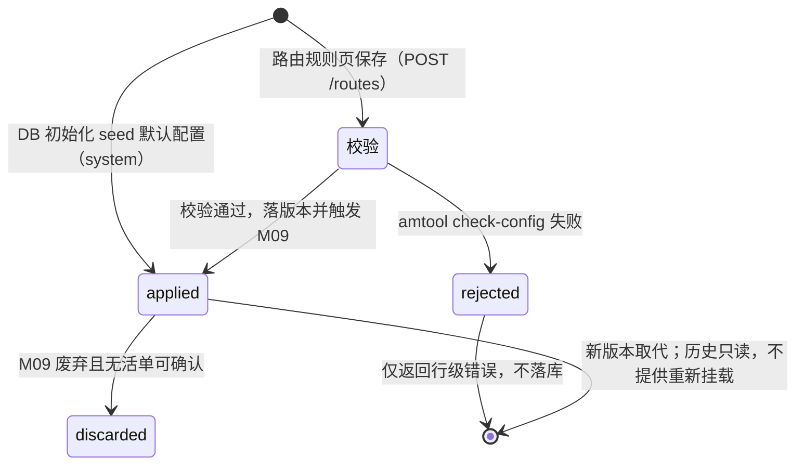
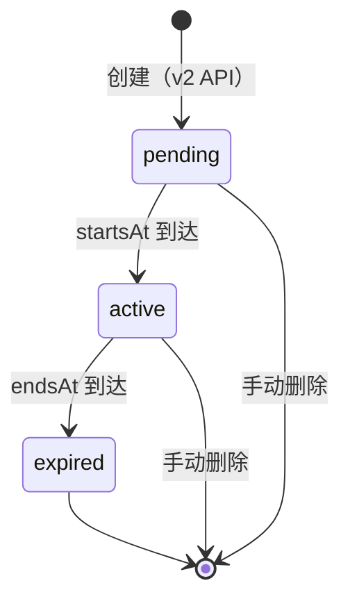
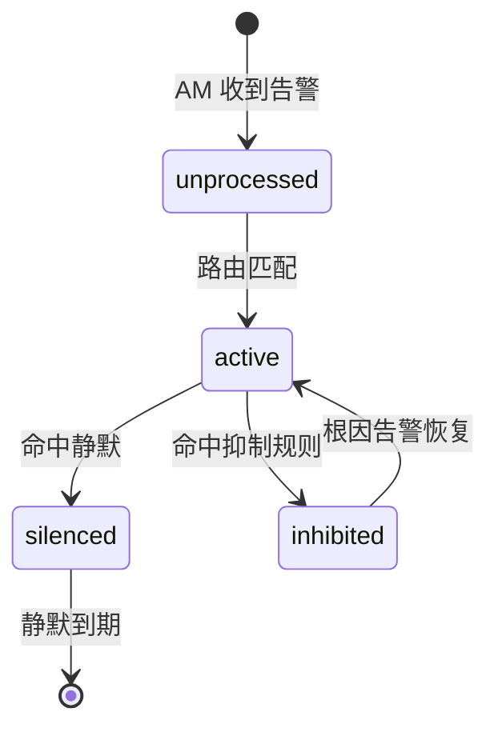

# Module 08: 告警收敛与通知管理

> **PRD 状态**: `ready`（可开发版本）
> **PRD 版本**: v1.20
> **产品版本覆盖**: MVP / v0.2 / v0.3 / v0.3-a / v0.3-b / v0.3-c / v1.0
> **原型版本**: v1.7（v1.13「历史告警」、v1.15「实例列口径」为 Track B 轻量增量，均免高保真原型，豁免记录见 `docs/05-execution-records/module-08/design-decisions.md`；「路由规则」页（`RoutesPage.tsx`）的拖拽排序 / 根路由锁定等增量待跟进，见 prototype-designer 评审记录；PL-3 通知渠道/通知模板页原型增量、#32 派生预览绑定展示与 v1.20 #45–#48 的渠道/模板/路由 IA 增量，待后续原型轮承接，本轮仅回写 PRD；以 `docs/prototypes/module-08/package.json` 为准）
> **更新日期**: 2026-10-23
> **对应原型**: `docs/prototypes/module-08/`

> **模块类型**: 扩展能力模块
> **依赖文档**: [00\_Global\_Architecture.md](../00_Global_Architecture.md)、[03\_Functional\_Architecture.md](../03_Functional_Architecture.md)、[Module\_01\_Metric\_Collection\_Center.md](Module_01_Metric_Collection_Center.md)、[Module\_02\_Query\_Center.md](Module_02_Query_Center.md)、[Module\_09\_Network\_Domain\_and\_Edge\_Config\_Center.md](Module_09_Network_Domain_and_Edge_Config_Center.md)
> **目标用户**: 运维工程师、运维架构师

---

## 0. 需求背景与典型场景

### 这个模块解决什么问题

当监控系统产生大量告警时，运维团队面临「告警风暴」——重要告警被淹没、通知渠道分散、临时变更时无法快速静音。本模块把 Alertmanager 的路由、静默、抑制能力产品化，让运维工程师无需手写 YAML 即可完成告警收敛与通知管理。

### 用户需求的演进过程

从 MVP 开发期的真实反馈看，告警管理的需求随着监控规模扩大逐步暴露：

**阶段 1：通知接入期——「告警产生了，但没人知道」**
- 平台首次部署后，用户需要把告警通知到具体的人或渠道
- 痛点：Alertmanager 原生配置是 YAML 文件，接收人/路由配置复杂，且无法与平台其他模块联动
- 对应能力：平台生成 `alertmanager.yml`（默认 seed + 路由树 + 渠道 receiver）+ `amtool check-config` 校验 + 版本留痕

**阶段 2：变更管控期——「告警配置改了，什么时候生效？」**
- 用户在修改告警配置后，需要确认变更内容并控制生效时机
- 痛点：配置修改直接生效风险高，需要审计与变更确认能力
- 对应能力：`alertmanager.yml` 纳入 M09 变更确认流水线——人工确认 → 下发 → reload

**阶段 3：静默管理期——「计划内变更，不想被告警轰炸」**
- 用户在数据库迁移、系统升级等计划内操作时，需要临时屏蔽相关告警
- 痛点：Alertmanager 静默 API 是运行时状态，静态配置文件无法表达；且 v1 API 已被移除
- 对应能力：静默极简 UI（创建/列表/删除）+ Alertmanager v2 API 代理

**阶段 4：风暴抑制期——「网域离线时，几百条告警同时爆发」**
- 某网域整体离线时，该网域内所有主机的 `up=0` 告警会瞬间形成告警风暴
- 痛点：次生告警淹没根因，运维无法快速定位问题
- 对应能力：自动生成 `inhibit_rules`（网域离线时抑制 `inhibitable=true` 的次生告警）

**阶段 5：状态可视化期——「告警到底通知了没有？」**
- 用户需要知道告警是否已路由、是否被静默/抑制
- 痛点：Prometheus 告警状态与 Alertmanager 通知状态分离，用户需要两个视图对照
- 对应能力：告警状态页 + Alertmanager `/api/v2/alerts` 代理

**阶段 6：路由前台化期——「整条链路不再需要手写 YAML」**
- 上行（M01 规则编辑）与下行（接收人/模板/通知渲染桥）均已前台化；路由（`route`）也已由「路由规则」页的路由树生成，后端统一生成整份 `alertmanager.yml`
- 痛点：① 平台物化的接收人若无 `route` 引用，渠道不会物化、也收不到告警，用户需要知道「还差一步引用」；② 平台产物与历史手写 receiver 在同一份文件里互相误判（变更单校验失败根因）；③ 路由是**有序树、先匹配先生效**，顺序语义只能靠 YAML 注释传承，最易写错
- 对应能力：**路由规则页**（v0.3-a 只读渲染 → v0.3-b 表单可写 → v0.3-c 联动）+ **默认配置 seed + 只物化被路由引用的渠道**；告警配置页只读，平台不再提供整份手写/导入/重挂载入口

### 不同技术背景用户的痛点分层

同一个告警管理能力，不同技术背景的用户会提出完全不同的问题：

| 用户类型 | 典型问题 | 本模块的应对 |
|----------|----------|-------------|
| **Alertmanager 专家** | 「我想直接写 `alertmanager.yml`，能支持吗？」 | 平台不再提供整份手写/导入入口；告警配置页只读展示当前 YAML，路由统一通过路由规则树表达（如需复杂语义，先在路由页建树再保存） |
| **有经验的运维** | 「告警路由规则太复杂，能不能按标签自动分组？」 | 路由规则按 `severity`/`team`/`network_domain` 标签匹配，支持分组/等待/间隔配置 |
| **普通运维** | 「我不想改配置，只想临时屏蔽某个告警」 | 静默 UI 提供创建/列表/删除三个动作，API 直调即时生效 |
| **监控新手** | 「什么是静默？什么是抑制？它们有什么区别？」 | 静默=临时屏蔽通知（手动创建），抑制=根因存在时自动屏蔽次生告警（规则驱动） |

### 典型场景（基于真实用户反馈）

| 场景 | 角色 | 触发条件 | 用户目标 | 成功标准 | 来源 |
|------|------|----------|----------|----------|------|
| 配置告警通知渠道 | 运维工程师 | 平台首次部署完成 | 配置飞书/钉钉/企业微信/自定义 Webhook 等通知渠道 | 告警触发后指定渠道收到通知 | 原始需求 |
| 告警配置变更确认 | 运维工程师 | 修改了接收人或路由规则 | 确认变更内容后下发 | 变更单在 M09 配置中心人工确认后生效 | 决策 60 |
| 临时静默已知故障 | 运维工程师 | 计划内数据库迁移 | 创建静默规则避免告警轰炸 | 静默期间匹配告警不再通知，过期自动恢复 | 原始需求 |
| 抑制告警风暴 | 运维架构师 | 某网域整体离线 | 自动抑制该网域内次生告警 | 只保留根因告警，通知量显著下降 | 原始需求 |
| 静默 API 版本迁移 | 运维工程师 | Alertmanager 升级到 ≥0.27 | 静默管理功能正常可用 | 静默列表/创建/删除走 v2 API，不再报 410 Gone | F-3 / 决策 61 |
| 查看告警通知状态 | 运维工程师 | 告警触发后确认是否已通知 | 查看告警是否已路由、是否被静默/抑制 | 告警状态页展示 active/silenced/inhibited/unprocessed | 决策 55 |

> 本模块覆盖的用户故事详见 [§2 用户故事](#2-用户故事)。

---

## 1. 模块目标

> 决策依据：design-decisions.md 决策 49 / 59 / 60 / 61。

本模块对应 **告警收敛与通知管理域**，回答「告警如何通知、通知给谁、是否收敛、是否静默」的问题：

1. **通知路由与接收人管理（MVP 批次 / v0.3 / v1.0）**：维护 Alertmanager 的 `route` / `receiver` 配置，按告警标签（如 `severity`、`team`、`network_domain`）决定通知渠道与接收人。默认配置由平台 seed 入库；路由规则在「路由规则」页以树形表单编辑，保存时由**后端**生成 `alertmanager.yml` 并进入 M09 变更确认；告警配置页只读查看，不再提供整份手写/导入入口。**路由（`route`）前台化**分期交付：**v0.3-a** 只读渲染路由树（看懂顺序与匹配）、**v0.3-b** 表单可写（后端生成路由，已提前落地）、**v0.3-c** 联动（接收人下拉、标签联想），v1.0 完整 UI。
2. **静默与抑制管理（MVP / v1.0）**：提供静默规则 UI（创建/查询/删除）和自动抑制规则（如网域离线时抑制该网域 `inhibitable=true` 的可达性风暴）。静默作为 Alertmanager 运行时 API 状态，MVP 提供极简 UI（创建/列表/删除三个动作，API 直调即时生效）。
3. **告警状态查看（MVP 起）**：
   - 通过 [Module\_02: 查询中心](Module_02_Query_Center.md) 代理 Prometheus `/api/v1/alerts`，展示当前由 Prometheus 规则求值产生的 firing/pending 告警实例（回答「当前触发了哪些规则」）。
   - 本模块直接代理 Alertmanager `/api/v2/alerts` 或封装通知状态 API，展示告警经过路由、静默、抑制后的通知状态（回答「告警正在通知给谁、是否被静默/抑制」）。
   - **历史告警**：通过 Module\_02 的 `/api/v1/alerts/history`（基于 Prometheus `ALERTS` 时间序列 `query_range` 重建触发/恢复区间），展示规则级告警的触发时间、恢复时间与持续时长。恢复时间为 Prometheus 求值视角的近似值，不等同于故障真实恢复时间。
   - **实例口径**：三个视图中的「实例」统一拆分为**「实例名」+「采集地址」两列**——「实例名」取 [Module\_07](Module_07_Monitoring_Object_Management.md) 资源清单的口径（host=`instance_name`、database/middleware=`instance_ip`、application=`service_name`、generic_target=`target_name`），由服务端按告警标签 `resource_id` 回连 M01 资源表回填；「采集地址」为 Prometheus 抓取地址（`ip:exporter端口` 或拨测 URL，即 `instance` 标签值），表头必须标注「采集器地址，非业务端口」，避免用户把 `:9100`（exporter 端口）误读为业务端口（详见 [4.4 节](#44-告警状态查看)）。
4. **通知渠道与模板（MVP 批次）**：维护飞书/钉钉/企业微信/自定义 Webhook 等通知渠道与消息模板，支撑告警通知内容格式化；模板为可变实体，不进入 `alertmanager.yml`。

### 边界与配置形态

- **告警规则内容创作、规则分组、`rules.yml` 生成与下发均不归本模块**：规则内容与编辑 UI 由 [Module\_01](Module_01_Metric_Collection_Center.md) 负责（`MonitoringRule`）；规则按网域分组、生成并下发 `rules.yml` 由 [Module\_09](Module_09_Network_Domain_and_Edge_Config_Center.md) 负责。本模块聚焦 **Alertmanager 域**：`alertmanager.yml` 的接收人、路由、静默、抑制、通知状态。
- **配置生成与下发分离**：`alertmanager.yml` 由平台生成（默认 seed + 路由规则树 + 被引用渠道的 receiver，`amtool check-config` 校验）；作为**管理域（`default`）scope** 的配置产物纳入 M09 变更确认流水线（人工确认 → 下发 → reload），不参与按网域扇出（详见 [4.1 节](#41-alertmanager-配置管理)）。
- **告警收敛与派发组件锁定 Alertmanager**：配置模型与「UI 配置 → 生成文件 → reload」及 M09 配置生成流水线天然兼容，且不产生租户/网域隔离缺口；易用性诉求由本模块的 UI 化管理承接。
- **`route` 段唯一作者 = 平台**：`alertmanager.yml` 的 `route` 段由「路由规则」页的路由树生成，后端统一生成整份配置；不存在「手写 / 平台管理」双模式，也不提供整份导入或重新挂载入口。`receivers` 段只物化被路由引用的渠道，名称恒为 `notify-<渠道ID>`；历史手写 receiver / 未被引用渠道不写入产物（详见 [4.1.1](#411-route-段唯一作者与默认配置)）。

---

## 2. 用户故事

> 完整用户故事条目（角色 / 我希望 / 以便于）见**全局用户故事库 [01_User_Stories.md](../01_User_Stories.md) 4.8 节**；本模块用户故事使用模块命名空间编码（`M08-ROLE-NN`，全局唯一），仅在此列出编码与一句话摘要。

- M08-OPS-01：配置通知渠道（飞书/钉钉/企业微信/自定义 Webhook）与通知模板，指定渠道参数与内容格式（MVP 批次 PL-3；渠道无启停，IM 必须绑定模板）。
- M08-OPS-02：配置告警路由规则，按 `severity`、`team`、`network_domain` 等标签决定告警通知到哪个接收人（MVP 批次默认只读，v0.3-b 起路由页可编辑；保存由后端生成 YAML）。
- M08-OPS-03：查看当前被 Alertmanager 处理的告警通知状态（active / silenced / inhibited / unprocessed），判断告警是否已路由、是否被静默/抑制（MVP 起，v1.12 由 v0.3 提前）。
- M08-OPS-04：创建临时静默规则，避免计划内变更或已知故障引发告警轰炸（MVP 起）。
- M08-OPS-05：查看并删除正在生效的静默规则（MVP 起）。
- M08-OPS-06：配置告警通知模板（summary / description 格式），使通知内容清晰可读（MVP 批次 PL-3）。
- M08-OPS-07：配置告警升级策略（如 5 分钟未确认升级给主管）（v1.0）。
- M08-OPS-08：查看历史告警（含已恢复），确认某条告警何时触发、何时恢复（MVP 起，基于 Prometheus `ALERTS` 时间序列重建触发/恢复区间，恢复时间为求值视角近似值）。
- M08-ARCH-01：当某个网域整体离线时，自动抑制该网域内 `inhibitable=true` 的可达性告警风暴，只保留 `EdgeSiteOffline` 根因告警（MVP 起，通过 Alertmanager `inhibit_rules` 自动生成）。
- M08-ARCH-02：在边缘网域断网场景下，边缘本地 Alertmanager 继续通过本地通知通道（本地飞书/钉钉 webhook）发送自治告警（v0.4+，与 M09 边缘配置下发配合）。

---

## 3. 核心功能

### 3.1 功能表

| 功能 | 说明 | 优先级 / 版本 |
|------|------|---------------|
| **Alertmanager 配置管理** | 维护 `alertmanager.yml`：默认配置在数据库初始化时 seed 入库；路由规则页保存时由后端生成整份配置（`global` + `route` + 被引用渠道的 `receivers`），`amtool check-config` 校验后进入 M09 变更确认流水线（管理域 scope、不扇出；人工确认后由 M09 写文件并触发 reload）。告警配置页只读查看当前生效与历史版本，不提供整文件导入/手写入口。 | P0 / MVP 批次（平台生成；路由页 v0.3-b 提前落地） |
| **接收人管理** | Alertmanager `receiver` 只由平台物化：`default`（空接收人，不通知）+ 被当前/待确认路由树引用的渠道 `notify-<渠道ID>`。不提供手写 receiver、`receiver-snippet` 或独立接收人 CRUD；未引用渠道不物化。 | P0 / MVP 批次（PL-3，v1.20） |
| **通知渠道管理** | 管理飞书 / 钉钉 / 企业微信 / 自定义 Webhook 渠道：增删改查；Webhook 地址 SSRF 校验（默认拒绝私网 / 环回 / link-local / 云元数据，显式开关放行内网例外）；渠道无启停字段；飞书/钉钉/企业微信必须绑定模板，Webhook 禁止模板；仅被路由引用的渠道物化 receiver（`?id=<渠道ID>`）；列表显示名称/类型/被引用次数/创建时间/操作；删除被引用渠道返回 409。 | P0 / MVP 批次（PL-3，v1.20） |
| **路由规则管理** | 按标签匹配条件（`severity=critical`、`team=sre`、`network_domain=gov-cloud-a` 等）配置路由，指定接收人、分组、等待/间隔/重复时间；`route` 段唯一作者=平台：默认配置 seed 提供根路由，前端只提交 `{base_checksum, route_tree}`，后端生成 YAML；路由页默认只读、点「编辑路由」进入编辑；无模式开关/导入/重新载入；接收人候选 = `default` ∪ 全部渠道 `notify-<渠道ID>`。 | P0 / MVP 批次（v0.3-a 只读 / v0.3-b 可写，已提前落地） |
| **静默管理** | 创建/查询/删除 Alertmanager 静默规则；支持按标签匹配、起止时间、原因说明；调用 Alertmanager API 生效；**MVP 提供极简 UI**（创建/列表/删除三个动作，API 直调，决策 59）——静默是运行时状态、静态配置无法表达 | P0 / MVP |
| **告警抑制规则** | 自动生成 `inhibit_rules`：当网域整体离线时，抑制该网域 `inhibitable=true` 的告警风暴；支持手动调整抑制策略 | P0 / MVP |
| **Alertmanager 通知状态** | 代理 Alertmanager `/api/v2/alerts`，展示告警经过路由、静默、抑制后的通知状态；实例列展示「实例名 + 采集地址」两列（v1.15） | P0 / MVP（v1.12 由 v0.3 提前） |
| **Prometheus 触发告警状态** | 由 [Module\_02: 查询中心](Module_02_Query_Center.md) 代理 Prometheus `/api/v1/alerts`（MVP 起交付，v1.12 同步提前），本模块不重复实现，告警状态页只读消费；实例列口径同「实例名 + 采集地址」（v1.15） | —（依赖 M02） |
| **历史告警** | 独立页面展示规则级告警的触发/恢复历史（含已恢复）：触发时间、恢复时间（按 Prometheus 求值近似）、持续时长、实例、网域、摘要；数据由 [Module\_02: 查询中心](Module_02_Query_Center.md) `/api/v1/alerts/history` 提供，本模块只读消费；实例列展示「实例名 + 采集地址」两列（v1.15） | P0 / MVP |
| **通知模板管理** | 管理告警通知的 title / body 模板（Go template，支持 `{{ $labels }}`、`{{ $value }}`、`{{ $annotations }}` 等变量）：内置模板 + 自定义模板；模板是可变实体，原地新建/编辑/复制/删除，无版本历史/remount/status/checksum 展示；按渠道类型 Tab；内置只读、可复制；被渠道绑定的模板禁止删除；模板不进入 `alertmanager.yml`，桥按渠道 ID 实时读取。自 v1.0 提前至 MVP 批次落地（PL-3，v1.20） | P0 / MVP 批次（PL-3，v1.20；原 P2 / v1.0） |
| **告警升级与降噪** | 升级策略（未确认超时升级）、值班组、告警降噪（合并相似告警） | P2 / v1.0 |
| **边缘本地通知通道** | 断网场景下边缘 Alertmanager 使用本地 webhook 通知（v0.4+ 多网域） | P2 / v0.4+ |

### 3.2 Prometheus 告警状态 vs Alertmanager 通知状态

| 维度 | Prometheus `/api/v1/alerts` | Alertmanager `/api/v2/alerts` / 通知状态 API |
|------|------------------------------|-----------------------------------------------|
| 语义 | 「什么出了问题」—— 告警规则求值状态 | 「谁正在被通知」—— 路由、静默、抑制后的通知状态 |
| 数据来源 | Prometheus 规则管理器求值结果 | Alertmanager 接收到的告警及处理结果 |
| 包含状态 | firing / pending | active / suppressed / silenced / unprocessed |
| 模块归属 | 由 [Module\_02](Module_02_Query_Center.md) 代理 | 由 Module_08 负责集成与展示 |
| 适用场景 | 查看当前有哪些规则被触发、影响哪些对象 | 查看告警是否已路由、是否被静默、通知发送情况 |

> UI 设计建议：告警状态页可同时展示「Prometheus 当前触发告警」与「Alertmanager 通知状态」两个视图，并在图例/说明中明确区分二者语义，避免用户混淆。

### 3.3 中心/边缘告警灾备边界

| 维度 | 中心告警通知（Central） | 边缘自治告警通知（Edge，v0.4+） |
|------|-----------------------|-----------------------------------|
| 适用场景 | 跨网域聚合、复杂环比、全局 SLA | 网域内死活、本地服务宕机 |
| 求值组件 | 中心 Prometheus | 边缘 vmalert（由 M09 随配置包下发 `rules.yml`） |
| 通知组件 | 中心 Alertmanager → 企业 webhook | 边缘本地 Alertmanager → 本地飞书/钉钉 webhook |
| 断网行为 | 无法感知边缘本地指标 | 独立存活，继续通知 |
| 状态上报 | 通过 M02 代理 Prometheus `/api/v1/alerts` | 通过 Module_11 EdgeHeartbeat 上报，展示在 Module_11 采集节点状态页或 M08 边缘告警视图 |

MVP ~ v0.3 只实现中心 Alertmanager 通知；边缘自治告警与本地通知在边缘 Agent 支持本地 rules 评估后实现（v0.4+）。

### 3.4 通知渠道、通知模板与渲染桥（PL-3）

> 契约权威：`docs/05-execution-records/module-08/api-contract-snapshot.md` §11（dev-feedback #17 / #21 / #29 / #30 / #45–#48；本 PRD v1.20 回写）。

**通知渠道（NotifyChannel）**：平台一等公民的通知出口，支持飞书 / 钉钉 / 企业微信 / 自定义 Webhook。渠道无启停字段；飞书/钉钉/企业微信必须绑定同类型模板，自定义 Webhook 禁止绑定模板。渠道列表只展示名称、类型、被引用次数、创建时间、操作；IM 渠道的 Webhook 地址与密钥响应脱敏，自定义 Webhook 地址回填完整值。

**通知接收人（Receiver）与物化**：平台只为 `default`（空接收人，不通知）和**被当前/待确认路由树引用**的渠道生成 receiver。receiver 名恒为 `notify-<渠道ID>`，URL 为渲染桥地址 + `?id=<渠道ID>`；模板 ID、密钥、渠道名都不进入 URL。新增渠道本身不写 yml；路由引用集合变化才触发配置重算与 M09 变更检测。

**通知模板（NotifyTemplate）**：飞书/钉钉/企业微信的 Go `text/template` 渲染模板（白名单 FuncMap）。模板是可变实体：新建/编辑/复制/删除原地生效，无版本历史/remount/status/checksum 展示；按渠道类型 Tab 展示，内置模板置顶只读（可复制），自定义模板可编辑；同渠道类型内名称唯一、渠道类型创建后不可变；被渠道绑定的模板禁止删除。模板内容不进入 `alertmanager.yml`，换绑或修改模板立即生效，不产生 M09 变更单。

**渠道 ↔ 模板绑定**：飞书/钉钉/企业微信建渠道时必须选择同类型模板（飞书自动选中内置「飞书卡片-默认」；钉钉/企业微信无内置模板，必须选自定义）；自定义 Webhook 不显示模板、后端拒绝绑定。桥投递时按渠道 `default_template_id` 读取模板；IM 渠道绑定失效时优先回落内置默认并记 warning，该类型无内置模板时返回明确错误（不静默丢失）。

**通知渲染桥（`POST /api/v1/webhooks/notify?id=<渠道ID>`）**：接收 AM 原生 webhook 载荷。IM 渠道按模板渲染后出站（飞书 body 注入签名、钉钉 URL query 加签、企业微信无加签）；自定义 Webhook 将 AM 原始 JSON 原样 POST，不渲染、不签名、不判业务错误码，只看 HTTP 状态；本期不支持自定义 header / 鉴权。桥端点不再使用内部令牌，依赖部署层同机/内网防火墙限制访问；任何能访问该端点的人都能伪造通知，生产必须做网络层限制。

**receiver 物化边界**：平台只写 `config-output/alertmanager.yml` 一个文件；历史手写 receiver、未引用渠道、模板/密钥都不进入产物。渠道/模板 CRUD 移出 M09 `sourceTableScopes`，不空跑变更检测；只有路由保存（或 M09 重生成）触发变更单。

---

## 4. 核心流程

> 决策依据：design-decisions.md 决策 59 / 60 / 68-2。

### 4.1 Alertmanager 配置管理

`alertmanager.yml` 由平台生成并纳入 M09 变更确认；**告警配置页只读**，唯一写入口是「路由规则」页的路由保存。

1. **默认配置入库**：数据库初始化时若无已生效配置，幂等写入与 `deploy/alertmanager/alertmanager.yml` 一致的默认配置（`status=applied`、`applied_at=seed 时间`、`applied_by=system`）；已有配置不覆盖。首次打开路由页即可读到真实根路由，不再由前端合成空树。
2. **路由保存**：`POST /api/v2/platform/alertmanager/routes`，请求 `{base_checksum, route_tree}`。后端执行乐观锁校验 → 路由树与接收人校验 → 生成 route 段并整份重建配置 → `amtool check-config` → 写入 `AlertmanagerConfigVersion` → 触发 M09 变更检测。前端不再生成/合并 YAML。
3. **变更确认**：内容作为管理域（`default`）scope 配置产物提交 M09 → `ConfigDraft` → 人工确认 → `ConfigVersion`；确认后 M09 写中心 Alertmanager 配置路径并触发 reload（SIGHUP / `POST /-/reload`），`change_status` 回写 M08。**两段式人工闸门（#43 立场 1）**：提交只产/复用 pending 草稿（`ensurePendingDraft`），**绝不自动 ConfirmDraft**；根兜底接收人与路由结构变更均属高危，必须人工确认。
4. **查看**：告警配置页只读展示当前生效配置、状态与历史版本；不提供整份导入、手写 route、模式开关、重新挂载入口。调整路由统一回「路由规则」页保存，生成新版本。

> M08 是配置内容 Owner（生成规则 + 路由树），M09 是变更确认与下发管道 Owner。

配置产物示例（平台生成，仅展示关键段）：

```yaml
global:
  resolve_timeout: 5m

route:
  group_by: ['alertname']
  group_wait: 30s
  group_interval: 5m
  repeat_interval: 4h
  receiver: default
  routes:
    - matchers: ['severity="critical"']
      receiver: notify-1

receivers:
  - name: default
  - name: notify-1
    webhook_configs:
      - url: 'http://metric-center:8080/api/v1/webhooks/notify?id=1'
        send_resolved: true
```

> `default` 是平台内置空接收人（不通知），用于新环境根路由兜底；要真正收到告警，需把根路由或子路由接收人指向某个渠道。`receivers` 中只出现被 route 引用的渠道，模板、密钥、渠道名不落盘。

- 中心 Alertmanager 是全局单例，每部署一份，不按网域扇出；仅 v0.4+ 边缘自治告警的边缘 `alertmanager.yml` 进入按域下发。
- 通知路由/接收人/静默调整频繁、影响面可控，MVP 阶段统一人工确认；后续版本由 M09 按配置类型风险分级将本类配置降为低风险自动确认（预留）。

#### 4.1.1 route 段唯一作者与默认配置

> 决策依据：dev-feedback #45–#48（本 PRD v1.20 收割）。生成器统一与整份重建属同一收口语义，避免退回「前端生成 + 后端镜像」。

**`route` 段唯一作者 = 平台。** `alertmanager.yml` 不再有「手写 / 平台管理」双模式，也不提供整份导入、重新挂载或根兜底设置接口；所有路由配置都从「路由规则」页的路由树生成。

- **默认配置**：DB seed 写入根路由（根 `receiver=default`、无 matchers、无子路由）；`GET /routes` 的只读态与编辑态都读同一份 DB/产物，删除「未配置」标签与前端合成占位。`default` 是空接收人（不通知），不是某个渠道。
- **保存链路**：前端只提交 `{base_checksum, route_tree}`；后端校验 `base_checksum`（409）、根/子路由结构、matcher 与时长、接收人可达性，生成 route 段并整份重建 `alertmanager.yml`，再走 `amtool` + `AlertmanagerConfigVersion` + M09。前端不再生成/合并 YAML，后端不接受前端 YAML 作为事实。
- **接收人合法集合**：`default` ∪ **全部已登记通知渠道**的 `notify-<渠道ID>`。渠道自 v1.20 起无启停字段，登记即全部可选；`declared_receivers`、历史手写 receiver、未被引用渠道不参与可选集合与合法性校验。悬空/历史 receiver 判 `receiver_dangling` 并阻断保存。
- **物化范围**：只有被当前生效或待确认路由树引用的渠道才写 receiver；新增渠道本身不写 yml，路由引用变化才触发 M09。
- **已删除的旧机制**：`AlertmanagerRouteSetting` / `/route-setting`、「默认接收人」策略卡、托管模式预置 seed、根 receiver 物化、最小运行骨架、模式开关、导入卡/抽屉、手写说明、重新载入/重新挂载入口全部不再存在。根兜底就是路由树的根节点，接收人直接在该节点编辑。
- **路由页形态**：默认只读；点「编辑路由」先 `GET /routes` 刷新并载入最新树；编辑态只有「新建 / 保存 / 放弃」；保存成功回只读态并提示「待确认下发」；有 pending 时展示「当前显示的是待确认版本」横幅。

**`receivers` 段**：只由平台生成 `default` + 被引用渠道；不再有「平台槽位 / 用户自有命名空间」双作者判定，也不做手写 receiver 重名冲突处理。未来接入的抑制规则等段落纳入同一生成规则扩展，不另开旁路。

**v0.4+ 多网域边缘**：中心 Alertmanager 配置由 M08 直接管理；边缘 `alertmanager.yml`（各网域独立）可由 M08 生成后经 M09 配置包下发，或边缘首次部署时由 M08 初始化脚本推送；边缘静默由边缘 Alertmanager 本地处理，M08 提供静默管理代理（P2）。

### 4.2 静默规则管理

静默规则通过 **Alertmanager v2 API** 调用（Alertmanager ≥0.27 已移除 v1 silence 端点，返回 410 Gone）。List/Create 使用 `/api/v2/silences`；Get/Delete 单条使用 `/api/v2/silence/{id}`；v2 列表响应为裸数组、单条为裸对象、创建成功返回 `{"silenceID": "..."}`。

```http
POST /api/v2/silences
Content-Type: application/json

{
  "matchers": [
    {"name": "alertname", "value": "HighCPUUsage", "isRegex": false},
    {"name": "instance", "value": "10.0.1.11:9100", "isRegex": false}
  ],
  "startsAt": "2026-08-15T10:00:00Z",
  "endsAt": "2026-08-15T12:00:00Z",
  "createdBy": "ops-chen",
  "comment": "计划内变更：数据库迁移"
}
```

M08 提供 UI 表单封装：
- 选择告警标签键/值（可从当前 Alertmanager 活跃告警中联想）；
- 选择起止时间（支持相对时间如「1 小时后」）；
- 填写原因；
- 列表展示活跃静默，支持删除。

**授权校验**：Alertmanager 静默全局生效——租户 A 的宽 matcher 静默会影响到租户 B 的告警。创建静默时 M08 必须在**服务端校验** matcher 收敛于当前用户的授权网域集合（越权 matcher 直接拒绝），不得依赖前端表单约束。MVP 单租户单网域阶段校验恒通过（机制骨架保留）。

#### 4.2.1 matcher 编写口径：可匹配标签四层并集

matcher 匹配的是 **AM 收到告警时携带的标签全集**，口径为四层并集：

| 层 | 可匹配标签 | 来源口径 |
|---|---|---|
| 目标层 | `resource_id`（system 强制，不挂模板也在）、`instance`、`app`/`biz`/`env`/`cluster`/`service_name` 等 | **被 `enabled + draft_status=ready` 的采集 Job 实际引用的标签模板中 enabled mappings**（模板解析：显式挂载 → 类别默认模板）∪ system 强制标签；**不是「所有已生效模板的集合」**——未被生效 Job 引用 / 未下发模板的键不可匹配 |
| 采集机制层 | `job`、`alertname` | Prometheus / 规则求值自动附加 |
| 规则层 | `severity` 及自定义键 | 规则编辑自定义 labels（enabled + ready + central/both 规则） |
| external 层 | `network_domain_id`、`zone_type` | 发往 AM 出口附加；**AM 静默可按网域匹配，键为 `network_domain_id`**（该层在 Prometheus 告警查询中不可见） |

例外：拨测（blackbox）类告警无目标层标签，仅规则层 + external 可匹配。

UI 编写引导（表单）：
- **标签名分组联想框**：按上述四层分组提示可匹配键（聚合端点 `GET /api/v2/platform/alertmanager/silences/label-options`），拼错键「静默空集且无报错」的陷阱由联想 + 键描述软引导兜底，不做硬校验（自定义键属合法能力）；
- **正则预检**：`is_regex=true` 时前端预校验正则合法性（AM 侧 400 兜底保留）；
- **实例级静默**：`instance` / `resource_id` 均在标签全集内，matcher 直写即实例级；表单提供「按实例选择」入口——复用 M01 资源列表搜索，选中后自动生成 **`resource_id` matcher**（UUID 稳定，不随 IP / 端口变化）；手填 `instance` 须提示其值为 `ip:exporter端口`；
- **AND 语义提示**：同一静默内多条 matcher 为 AND 关系（`alertname + resource_id` = 静默某实例的某类告警；单 `resource_id` = 静默该实例全部告警）。

### 4.3 告警抑制规则

当某个网域整体离线时，该网域内数百台主机的 `up=0` 告警会瞬间形成告警风暴。MetricCenter 通过自动生成 Alertmanager `inhibit_rules` 来抑制此类次生告警。

**抑制规则生成逻辑：**

```yaml
inhibit_rules:
  - source_matchers:
      - alertname = "EdgeSiteOffline"
    target_matchers:
      - network_domain = "gov-cloud-a"
      - inhibitable = "true"
    equal:
      - network_domain
```

**规则说明：**

- **源告警（Source）**：`EdgeSiteOffline`，由 [Module\_11](Module_11_Edge_Access_and_Agent_Delivery.md) 在边缘 Agent 失联超过阈值（默认 5 分钟）时触发。
- **目标告警（Target）**：同一 `network_domain` 下且 `inhibitable=true` 的告警。
- **抑制条件**：`network_domain` 必须相同。
- **抑制范围**：只抑制可达性/网络类告警，不抑制资源类告警（如 `disk_full`、`cpu_high`）。

**设计原则：**

| 告警类型 | `inhibitable` 建议 | 示例 |
|----------|-------------------|------|
| 目标不可达 / 服务宕机 | `true` | `up == 0`、`probe_success == 0` |
| 网络连接失败 | `true` | `prometheus_target_scrape_exceeded_sample_limit` |
| 资源使用率高 | `false` | `disk_full`、`cpu_high`、`memory_high` |
| 业务自定义告警 | `false` | 应用层 SLA 告警 |

> `inhibitable` 字段来自 Module_01 的 `MonitoringRule.labels` 或 `annotations` 约定（建议在规则编辑 UI 中默认提供并允许用户覆盖）。M08 生成 `inhibit_rules` 时消费该字段。

### 4.4 告警状态查看

用户动线为「什么出了问题 → 通知了谁/是否被静默 → 加静默/调路由」的连续任务链。「告警状态页」归属本模块（告警域工作台）；Module_02 只交付注入代理 API，不出告警相关页面。三个视图如下：

- **Prometheus 当前触发告警**：由 [Module\_02: 查询中心](Module_02_Query_Center.md) 代理 `/api/v1/alerts`（已注入租户/网域上下文），本模块告警状态页只读消费，展示当前 firing/pending 告警列表，支持按 `network_domain` 筛选。
- **Alertmanager 通知状态**：由 Module_08 直接代理 Alertmanager `/api/v2/alerts` 或封装通知状态 API，展示告警经过路由、静默、抑制后的通知状态。代理时必须在服务端强制注入当前用户的授权网域集合 filter（不信任前端传参）；授权集合 = 全部网域时不附加 filter，前端筛选只承担 UX、不构成权限。
- **历史告警**：作为独立页面「历史告警」交付（菜单「告警收敛与通知管理 → 历史告警」），不复用「当前告警状态」列表语义——当前视图只回答「现在有哪些告警」，历史视图回答「某条告警何时触发、何时恢复」。数据由 Module\_02 `/api/v1/alerts/history` 提供（基于 Prometheus `ALERTS` 时间序列 `query_range` 重建触发区间），支持按 `network_domain` / `alertname` / `instance` / 状态（触发中 / 已恢复）/ 时间范围筛选；默认时间窗 24h、最大 7d。恢复时间为 Prometheus 求值视角的近似值（最后一次 firing 样本时间 + 一个求值步长），UI 列名必须标注「恢复时间（按 Prometheus 求值）」，不得表述为「故障恢复时间」。

**实例列口径（三个视图统一）**：告警列表原「实例」列展示的是 Prometheus 抓取地址（`instance` 标签 = `ip:exporter端口`，如 `1.15.94.116:9100`），`:9100` 是 exporter 监听端口，用户从未填写，极易被误读为「业务端口配错了」或「这是另一台机器」。三个视图统一拆为两列：

- **「实例名」**：取资源清单口径（host=`instance_name`、database/middleware=`instance_ip`、application=`service_name`、generic_target=`target_name`，与 [Module\_07](Module_07_Monitoring_Object_Management.md) §5.12 的展示口径一致）。服务端以告警标签 `resource_id` 批量回连 M01 五类资源表回填，与资源改名实时一致、覆盖存量告警（无需重新下发）；无 `resource_id` 时显示 `-`，不回落成地址（否则两列同值，等于没修）。
- **「采集地址」**：`instance` 标签原文（原「实例」列的取值），表头必须挂 tooltip「采集器地址，非业务端口」。
- **例外与回落**（不得假设一定有 `resource_id`）：① 拨测（blackbox）Job 的 target 组 `Labels` 为空 map、无 `resource_id`；② 聚合 / 全局规则（`sum(...) by (...)`）会抹掉 `instance` 与 `resource_id`；③ 用户自写规则若未选取 M01 下发的序列。以上三类「实例名」显示 `-`、「采集地址」显示原值，聚合 / 全局规则的「采集地址」沿用「全局/聚合」。
- **筛选口径**：历史告警页的「实例」筛选框同时匹配实例名与采集地址（展示改造后若只匹配地址，用户看到 `ceshi` 却搜不到）。
- 不做「点击实例跳转 M01 资源详情」。
- **标签侧增量（规划中）**：让 `targets/*.json` 直接带上 `instance_name` 标签（补 Module\_07 §5.12 已声明但未实现的映射），范围仅 4 类静态资源（host / database / middleware / generic_target；application 已有 `service_name`、拨测 URL 与容器不加），价值是「资源删除后历史告警仍可读」与「PromQL 可读」，不阻塞实例名回连方案。

- **边缘本地告警状态（P2）**：通过 [Module\_11](Module_11_Edge_Access_and_Agent_Delivery.md) EdgeHeartbeat 上报，展示在 Module_11 采集节点状态页或 Module_08 边缘告警视图，不归 Module_02 代理。

---

## 5. 数据模型

### 5.1 通知接收人（Receiver，平台物化视图）

接收人不再由用户单独维护，而是由平台按「被路由引用的渠道」物化生成；本表是只读派生视图，不是独立 CRUD 实体。

| 字段 | 类型 | 必填 | UI 展示名 | 说明 |
|------|------|------|-----------|------|
| name | string | 必填 | 接收人名称 | `default`（内置空接收人，不通知）或 `notify-<渠道ID>`；不由渠道名派生 |
| channel\_id | uint | 条件必填 | 关联渠道 | `notify-<ID>` 对应渠道；`default` 为空 |
| type | enum | 条件必填 | 渠道类型 | feishu / dingtalk / wecom / webhook |
| url | string | 条件必填 | 渲染桥地址 | `.../api/v1/webhooks/notify?id=<渠道ID>`；`default` 无 URL |
| materialized | bool | 服务端维护 | 是否物化 | 仅当前生效/待确认路由树引用的渠道为 true |
| created\_at / updated\_at | datetime | 服务端维护 | 仅技术信息 | 创建/更新时间 |

### 5.2 路由规则（Route）

| 字段 | 类型 | 必填 | UI 展示名 | 说明 |
|------|------|------|-----------|------|
| id | string | 必填 | 路由 ID | 唯一标识 |
| parent\_id | string | 选填 | 父路由 | 路由树父节点；根路由为空 |
| name | string | 必填 | 路由名称 | 展示名称 |
| matchers | []Matcher | 选填 | 匹配条件 | 标签匹配条件，如 `severity=critical`、`team=sre` |
| receiver | string | 必填 | 接收人 | `default` 或 `notify-<渠道ID>`；只允许这两个集合 |
| group\_by | []string | 选填 | 分组键 | 如 `alertname`、`severity`、`network_domain` |
| group\_wait | duration | 选填 | 初次等待 | 告警分组后首次发送等待时间 |
| group\_interval | duration | 选填 | 分组间隔 | 同一组告警发送间隔 |
| repeat\_interval | duration | 选填 | 重复间隔 | 同一告警重复通知间隔 |
| continue | bool | 选填 | 继续匹配 | 命中后是否继续匹配子路由 |
| order | int | 选填 | 排序 | 同层级路由优先级（**编辑态辅助字段**；落盘顺序由 `routes[]` 数组位置表达，见下注 1） |
| enabled | bool | 选填 | 启用状态 | 是否启用（`false` 时生成 YAML 整条剔除，含子树；见下注 1） |

> 说明（v1.20 收割 dev-feedback #45–#48）：
> 1. **编辑态字段 vs 落盘字段**：`id` / `parent_id` / `name` / `order` / `enabled` 为**平台内部字段，不落盘**——`parent_id` 转为 YAML 嵌套位置；`order` 由 `routes[]` 数组位置表达（列表态用**拖拽/上下移**调顺序，不用数字框）；`enabled=false` 的规则在生成时**整条剔除**（AM 无此字段）；`name` AM 无对应字段，**以注释落盘**（`# 路由名称: xxx`）。
> 2. **落盘字段**：`matchers`（AM 0.34 新式 `matchers:` / 字符串简写）、`receiver`（`default` 或渠道的 `notify-<ID>`）、`group_by` / `group_wait` / `group_interval` / `repeat_interval` / `continue`（`continue: true` 才输出）。
> 3. **`route` 段唯一作者 = 平台**：路由树由后端生成，接收人合法集合 = `default` ∪ 全部渠道 `notify-<ID>`；不存在手写/平台双模式（见 [4.1.1](#411-route-段唯一作者与默认配置)）。
> 4. **保存 = `POST /routes` 提交 M09 变更单**（后端生成 → 校验 → 落草稿 → 人工确认 → 下发 reload），不即时生效；提交只产/复用 pending 草稿。
> 5. **物化范围**：仅被当前/待确认路由树引用的渠道进入 `receivers`；未引用渠道不物化，也不出现在接收人下拉。

### 5.3 静默规则（Silence）

| 字段 | 类型 | 必填 | UI 展示名 | 说明 |
|------|------|------|-----------|------|
| id | string | 必填 | 静默 ID | Alertmanager silence ID |
| matchers | []Matcher | 必填 | 匹配条件 | 标签匹配条件（多条为 AND 关系） |
| starts\_at | datetime | 必填 | 开始时间 | 静默生效时间 |
| ends\_at | datetime | 必填 | 结束时间 | 静默失效时间 |
| comment | string | 选填 | 静默原因 | 创建原因 |
| created\_by | string | 选填（服务端维护） | 创建人 | 创建人 |
| status | enum | 选填（服务端维护） | 状态 | active / expired / pending |

### 5.4 抑制规则（InhibitionRule）

| 字段 | 类型 | 必填 | UI 展示名 | 说明 |
|------|------|------|-----------|------|
| id | string | 必填 | 抑制规则 ID | 唯一标识 |
| source\_matchers | []Matcher | 必填 | 源告警匹配 | 触发抑制的根因告警匹配条件 |
| target\_matchers | []Matcher | 必填 | 目标告警匹配 | 被抑制的目标告警匹配条件 |
| equal | []string | 选填 | 等同标签 | 源与目标必须相同的标签键，如 `network_domain` |
| is\_builtin | bool | 选填 | 内置规则 | 是否平台自动生成（如 EdgeSiteOffline 抑制规则） |
| enabled | bool | 选填 | 启用状态 | 是否启用 |

### 5.5 Matcher 结构

| 字段 | 类型 | 必填 | UI 展示名 | 说明 |
|------|------|------|-----------|------|
| name | string | 必填 | 标签名 | 标签名（可匹配键全集见 §4.2.1 四层并集） |
| value | string | 必填 | 标签值 | 标签值 |
| is\_regex | bool | 选填 | 是否正则 | 是否正则匹配（true 时前端预校验正则合法性，AM 侧 400 兜底） |
| is\_equal | bool | 选填 | 是否等于 | 是否等于（false 表示取反） |

> 多条 matcher 之间为 **AND** 关系（同一静默内同时满足才命中）。

### 5.6 Alertmanager 配置版本（AlertmanagerConfigVersion）

| 字段 | 类型 | 必填 | UI 展示名 | 说明 |
|------|------|------|-----------|------|
| id | string | 必填 | 版本 ID | 唯一标识 |
| content | text | 必填 | 配置内容 | 平台生成的 `alertmanager.yml` 完整内容 |
| checksum | string | 选填（校验通过后生成） | 校验和 | 配置内容 sha256 |
| applied\_at | datetime | 选填（服务端维护） | 生效时间 | 写入并 reload 成功时间 |
| applied\_by | string | 选填（服务端维护） | 操作人 | 应用人；默认 seed 为 `system` |
| status | enum | 选填（服务端维护） | 状态 | `applied` / `discarded`（废弃联动终态，#44） |

> 说明：
> 1. **校验失败不落库（决策 59/60）**：平台生成内容必须先通过 `amtool check-config` 等价校验，校验失败仅向用户返回行级错误（不写 `AlertmanagerConfigVersion`、不进 M09 流水线）；只有校验通过的内容才写入本表留痕。因此本表 `status` 不存在 `failed`、也不存 `error_msg`。
> 2. **默认 seed**：数据库初始化时若无已生效版本，写入与 `deploy/alertmanager/alertmanager.yml` 一致的默认配置（`status=applied`、`applied_at=seed 时间`、`applied_by=system`）；已有 applied 版本时不覆盖、不新增。模板漂移由单测守卫。
> 3. MVP 起 `alertmanager.yml` 纳入 M09 变更确认流水线（决策 60）；本表为 **M08 内容侧留痕**，管道侧版本与下发状态以 M09 `ConfigDraft` / `ConfigVersion` 为准。告警配置页只读展示当前生效与历史版本，**不提供重新挂载**；调整路由统一在「路由规则」页重新保存，生成新版本。
> 4. **废弃联动（#44）**：M09 废弃管理域变更单时，事务内把「已无活单可确认」的留痕（`status=applied AND applied_at IS NULL AND source_change_no` 为空）标记 `discarded` 终态；取代路径（supersede）同规则并保护新单来源版本。确认下发按 `ConfigDraft.alertmanager_source_version_id` **精确回填**来源版本（并一并标记同产物骑窗兄弟版本），reuse 路径不再误回填 / 覆盖已生效时间戳。被废弃留痕不参与幂等查询（仅认 `applied`）与「当前生效」派生（`LatestApplied` 排除 discarded）——「重新保存同样路由」即最自然的恢复路径（产新版本 + 新单）。

### 5.7 通知渠道（NotifyChannel）

| 字段 | 类型 | 必填 | UI 展示名 | 说明 |
|------|------|------|-----------|------|
| id | uint | 必填 | 渠道 ID | 数字 ID；桥 URL query 与物化 receiver 均引用此值 |
| name | string | 必填 | 渠道名 | 用户可见名称；仅用于界面展示，不参与 receiver 名派生 |
| type | enum | 必填 | 渠道类型 | feishu / dingtalk / wecom / webhook |
| webhook\_url | string | 必填 | Webhook 地址 | IM 渠道响应脱敏为 `scheme://host/***`；自定义 Webhook 返回完整地址 |
| secret | string | 条件必填：签名开关打开时 | 签名密钥 | 仅飞书/钉钉使用；响应只回 `secret_set`，编辑抽屉以 `***` 占位；关闭签名清空 |
| default\_template\_id | \*uint | 条件必填 | 通知模板 | 飞书/钉钉/企业微信必填（同类型模板）；自定义 Webhook 恒为 `null` |
| receiver\_name | string | 服务端维护 | 平台接收人 | 恒为 `notify-<ID>`，与 M09 生成器同源 |
| route\_reference\_count | int | 服务端维护 | 被引用次数 | 当前生效/待确认路由树引用该渠道的节点数；0 表示未物化 |
| created\_at / updated\_at | datetime | 服务端维护 | 仅技术信息 | 创建 / 更新时间 |

> - **无启停字段**：渠道登记即可选；是否写 yml 由路由引用决定，不靠 `enabled` 过滤。
> - **物化与删除保护**：只有被路由引用的渠道才物化 receiver；删除被引用渠道返回 409，要求先去路由页改绑。
> - **webhook 地址校验（SSRF 防护，契约快照 §11.5）**：仅允许 `http` / `https` 且 host 非空；**默认拒绝**私网 / 环回 / link-local / 未指定 / 云元数据地址；内网自建机器人属业务例外，提供显式允许开关。
> - **签名**：飞书 body 注入 timestamp/sign；钉钉把 timestamp/sign 追加到出站 URL query；企业微信不加签；自定义 Webhook 不签名。
> - **自定义 Webhook**：不渲染模板、不判业务错误码，AM 原始 JSON 原样转发，只看 HTTP 状态。

### 5.8 通知模板（NotifyTemplate）

| 字段 | 类型 | 必填 | UI 展示名 | 说明 |
|------|------|------|-----------|------|
| id | uint | 必填 | 模板 ID | 唯一标识 |
| name | string | 必填 | 模板名称 | 同一渠道类型内唯一；改名不影响已绑定渠道 |
| channel\_type | enum | 必填 | 适用渠道类型 | feishu / dingtalk / wecom；创建后不可变，如需其他类型请复制 |
| content | text | 必填 | 模板内容 | Go `text/template`（白名单 FuncMap，含 `jsonStr` 等） |
| is\_builtin | bool | 选填 | 内置模板 | 内置模板只读、可复制，不可编辑/删除 |
| bound\_channel\_count | int | 服务端维护 | 绑定渠道数 | 被多少渠道绑定；>0 时禁止删除 |
| created\_at / updated\_at | datetime | 服务端维护 | 仅技术信息 | 创建 / 更新时间 |

> - 模板是**可变实体**：新建、编辑、复制、删除原地生效；不展示版本历史、`remount`、`status`、`checksum`，也不提供模板版本端点。
> - 模板内容与绑定**不进入** `alertmanager.yml`；桥在投递时按渠道 ID 实时读取 `default_template_id`，换绑/改内容不产生 M09 变更单、不 reload。
> - 模板类型仅限飞书/钉钉/企业微信；自定义 Webhook 不使用模板。

---

## 6. 接口设计

### 6.1 Alertmanager v2 API 代理（静默）

本模块代理 Alertmanager v2 静默端点，调 v2 接口即时生效；不提供 v1 平替端点（Alertmanager ≥0.27 已移除 v1 silence 端点，返回 410 Gone）。

| 能力 | 端点 | 说明 |
|------|------|------|
| 静默列表 / 创建 | `/api/v2/silences` | List 响应为裸数组；创建成功返回 `{"silenceID": "..."}` |
| 静默查询 / 删除 | `/api/v2/silence/{id}` | 单条返回裸对象 |

- 创建静默时服务端校验 matcher 收敛于当前用户授权网域集合，越权 matcher 直接拒绝。
- 创建入参含 matcher 列表、`startsAt` / `endsAt`、`createdBy`、`comment`。

### 6.2 静默标签联想

`GET /api/v2/platform/alertmanager/silences/label-options`（只读、仅认证）。

- 按 §4.2.1 四层并集口径返回分组键集：target_system 固定清单（`resource_id` / `instance` / `job`）∪ 被 `enabled + draft_status=ready` Job 实际引用模板的 enabled mappings TargetLabel ∪ `enabled + ready + central/both` 规则的 `alertname` / `severity` / 自定义 labels 键 ∪ external 固定清单（`network_domain_id` / `zone_type`）。
- 分组与键去重；模板键缺失时对应组为空；不改既有静默三端点契约。

### 6.3 通知状态代理

`GET /api/v2/platform/alertmanager/alerts`（对 Alertmanager `/api/v2/alerts` 的封装）。

- 返回告警经过路由、静默、抑制后的通知状态，映射为 active / silenced / inhibited / unprocessed。
- 服务端强制注入当前用户授权网域集合 filter，不信任前端传参；授权 = 全部网域时不附加 filter。

### 6.4 路由保存与变更确认

`alertmanager.yml` 的唯一写入口是「路由规则」页保存；告警配置页只读。

1. 前端 `POST /api/v2/platform/alertmanager/routes`，请求只携带 `{base_checksum, route_tree}`。
2. 后端校验 `base_checksum`（与当前生效产物 checksum 不一致返回 409）→ 校验路由树（单根、根接收人、根 matchers 禁止、matcher/时长、接收人可达性）→ 生成 route 段并整份重建 `alertmanager.yml`（`global` + `route` + `default` 与被引用渠道的 `receivers`）。
3. 执行 `amtool check-config` 等价校验；失败返回行级错误，不落库、不进流水线。
4. 校验通过后写入 `AlertmanagerConfigVersion`（内容侧留痕，见 §5.6），并触发 M09 变更检测 → `ConfigDraft` → 人工确认 → `ConfigVersion`；由 M09 写中心配置路径并触发 reload，`change_status` 回写本模块。**两段式人工闸门（#43 立场 1）**：提交只产/复用 pending 草稿（`ensurePendingDraft`），**绝不自动 ConfirmDraft**。
5. 告警配置页不提供整份导入、手写 route、重新挂载或模式开关；默认配置由 DB seed 提供，恢复/调整统一通过路由页重新保存。

> 返回：保存成功响应包含 `version` 与（若有）`change_no`；前端回到只读态并提示待确认下发。

### 6.5 通知渠道 / 通知模板 API（PL-3）

| 能力 | 端点 | 鉴权 | 说明 |
|------|------|------|------|
| 渠道列表 / 新建 | `GET/POST /api/v2/platform/alertmanager/notify-channels` | 读=全局认证；写=RequireAdmin | 列表返回名称/类型/被引用次数/创建时间/操作所需字段；新建校验名称、类型、Webhook 合法性（SSRF）与模板绑定：IM 必须绑定同类型模板，webhook 禁止模板 |
| 渠道更新 / 删除 | `PUT/DELETE /api/v2/platform/alertmanager/notify-channels/{id}` | RequireAdmin | 指针语义更新；IM 的 `webhook_url` / `secret` 以掩码回填，保持原值=不改、清空触发必填校验；删除被路由引用的渠道返回 409 |
| 模板列表 / 新建 | `GET/POST /api/v2/platform/alertmanager/notify-templates` | 读=全局认证；写=RequireAdmin | 列表可按 `?channel_type=feishu\|dingtalk\|wecom` 过滤；新建校验 Go template 语法、渠道类型与同类型名称唯一 |
| 模板详情 / 更新 / 删除 | `GET/PUT/DELETE /api/v2/platform/alertmanager/notify-templates/{id}` | 读=全局认证；写=RequireAdmin | 模板为可变实体，原地更新；内置模板只读、不可编辑/删除；渠道类型不可变；被渠道绑定的模板禁止删除；**无 remount 端点** |

### 6.6 通知渲染桥

`POST /api/v1/webhooks/notify?id=<渠道ID>`——Alertmanager webhook 指向的平台渲染出口：Query 只接受 `id`（真实数字渠道 ID）；body = AM 原生 webhook 载荷；响应 `{ success, fail, channel, template?, alert_count }`。

- **访问控制**：不再使用内部令牌（移除 `NOTIFY_BRIDGE_TOKEN` / `--notify.bridge-token` 与 Bearer 校验）；依赖部署层同机 / 内网防火墙限制访问。任何能访问该端点的人都能伪造通知，生产必须做网络层限制。
- **参数与 SSRF**：只按 `id` 从 DB 解析渠道；拒绝请求方传入的 `url` / `target` / `webhook_url` / `fsurl` 等目标地址参数；不接受 `?channel=` / `?template=` 旧参数。
- **模板与签名**：IM 渠道按 `default_template_id` 实时读取模板（无绑定时按类型回落内置默认；无内置模板则返回明确错误）；飞书 body 注入签名，钉钉 URL query 加签，企业微信无加签。自定义 Webhook 原样转发 AM JSON，不渲染、不签名、不判业务错误码，只看 HTTP 状态。
- 错误口径：`bad_request`（`id` 缺失/非法、携带请求方目标地址、模板/载荷非法）/ `not_found`（渠道未登记）/ `bad_gateway`（出站失败）；不再有 `unauthorized`。

### 6.7 路由视图与路由保存

| 能力 | 端点 | 鉴权 | 说明 |
|------|------|------|------|
| 路由视图 | `GET /api/v2/platform/alertmanager/routes` | 全局认证（只读） | 成功 `{ items, effective_checksum, pending, declared_receivers }`；解析失败仍 **200** + `parse_error` + `raw_yaml` 降级展示；**数据源 = 平台最新产物视图**（待确认草稿 > 配置版本 > 默认 seed），不再读取文件挂载留痕 |
| 路由保存 | `POST /api/v2/platform/alertmanager/routes` | RequireAdmin | 请求 `{base_checksum, route_tree}`；`base_checksum` 与生效产物不一致返回 409；后端校验路由树/接收人并整份生成 `alertmanager.yml`，经 `amtool` 后落版本并触发 M09；返回 `version` 与 `change_no`（如有） |

> `declared_receivers` 仅为当前 YAML `receivers:` 段的只读展示辅助；**不参与**路由接收人可选集合、合法性校验或物化判定。前端悬空判据固定为 `default` ∪ 全部渠道 `notify-<渠道ID>`；`dead_receivers` 已删除，未引用渠道是正常状态，由通知渠道页「被引用次数」表达。

---

## 7. 依赖

### 7.1 与 Alertmanager 的职责边界

| 能力 | MetricCenter 职责 | Alertmanager 职责 |
|------|-------------------|-------------------|
| 告警规则求值 | 不介入 | Prometheus Rule Manager / vmalert 执行 |
| 告警收敛 | 通过 UI 配置生成 `route` / `group_by` | 原生 group 执行 |
| 告警抑制规则生成 | **自动生成 `inhibit_rules`（网域离线场景）** | 原生执行抑制 |
| 静默 | 调用 Alertmanager **v2 API**（`/api/v2/silences`、`/api/v2/silence/{id}`）创建/删除/查询 | 原生 silence 管理 |
| 通知路由 | 平台生成 `route` 段 + 仅物化被引用渠道的 `receiver`（`default` 为空接收人） | 原生 route 执行 |
| 通知发送 | 通知渲染桥 + 可扩展 Webhook | 飞书/钉钉/企业微信/自定义 Webhook 等实际发送 |
| 通知状态查询 | Module_08 代理 Alertmanager `/api/v2/alerts` 或封装通知状态 API | 原生提供告警处理状态 |
| `rules.yml` 生成与下发 | 不介入 | 不介入 |

> **通知路由归属补充（v1.20）**：「生成 `route` / `receiver`」为 MetricCenter 职责，且 **`route` 段唯一作者 = 平台**；`receivers` 只物化 `default` 与被路由引用的渠道，不存在手写 receiver / 平台槽位双作者。详见 [4.1.1](#411-route-段唯一作者与默认配置)。

### 7.2 依赖清单

- [Module\_01: 监控策略与指标管理](Module_01_Metric_Collection_Center.md)（规则内容来源；`inhibitable` 等标签约定来自规则编辑）
- [Module\_02: 查询中心](Module_02_Query_Center.md)（MVP 起代理 Prometheus `/api/v1/alerts`，展示当前 firing/pending 告警实例）
- [Module\_09: 网域与边缘配置中心](Module_09_Network_Domain_and_Edge_Config_Center.md)（v0.4+ 边缘 Alertmanager 配置分发）

- [Module\_11: 网域边缘接入与 Agent 交付](Module_11_Edge_Access_and_Agent_Delivery.md)（EdgeAgent 心跳上报边缘本地告警状态）
- `upstream/prometheus/alertmanager/`（Alertmanager 二进制与配置）
- `platform/config/alertmanager/`（Alertmanager 配置生成与版本管理）
- `platform/gateway/proxy/`（代理 Alertmanager API）
- `platform/models/`

---

## 8. 数据模型状态机

### 8.1 AlertmanagerConfigVersion（配置版本）

校验失败不落库，仅校验通过的内容写入本表；`status` 为 `applied` / `discarded`，不存在 `failed`。



> 默认 seed 仅在无已生效版本时写入，已有配置不覆盖；路由保存生成新版本，告警配置页只读展示，调整统一回路由页重新保存。

### 8.2 Silence（静默规则，Alertmanager 运行时状态）

静默为 Alertmanager 运行时 API 状态，不进 M09 流水线。



### 8.3 告警通知状态（Alertmanager 对告警的处理结果）



---

## 9. 验收标准

### 9.1 用户验收（用户可在 UI 感知/操作）

- [ ] {P0} 模块名称与文档目录已更新为「告警收敛与通知管理」。
- [ ] {P0，默认配置} 全新数据库首次打开「路由规则」页即可看到平台 seed 的根路由（根接收人 `default`、无 matchers）；页面不出现「未配置」/前端合成空树，只读态与编辑态看到同一棵树。
- [ ] {P0，路由保存} 路由页默认只读，只有「编辑路由」入口；进入编辑先刷新 `GET /routes` 并载入最新树；编辑态只保留新建/保存/放弃；保存只提交 `{base_checksum, route_tree}`，成功后回只读态并提示待确认；有 pending 时显示「当前显示的是待确认版本」横幅。
- [ ] {P0，后端生成} 保存后由后端生成 route 段并整份重建 `alertmanager.yml`；`amtool check-config` 失败返回行级错误、不落版本；成功写入 `AlertmanagerConfigVersion` 并产/复用 M09 pending 草稿；不即时生效。
- [ ] {P0，接收人收口} 路由接收人下拉仅 `default` ∪ 全部渠道 `notify-<渠道ID>`；历史手写/已删除渠道的 receiver 判悬空并阻断保存；`declared_receivers` 不参与可选集合。
- [ ] {P0，物化范围} 仅当前/待确认路由树引用的渠道进入 `receivers`；新增未引用渠道不写 yml；路由引用变化才触发 M09；未引用渠道不显示「死接收人」提示。
- [ ] {P0，渠道列表} 通知渠道页只显示渠道名称/渠道类型/被引用次数/创建时间/操作；无启停开关、无接收人配置、无 Webhook/密钥/模板列；被引用渠道删除返回 409 并提示先改路由；未被引用显示 0。
- [ ] {P0，模板页} 通知模板页按渠道类型 Tab、单表展示内置+自定义；内置只读可复制，自定义可新建/编辑/复制/删除；无版本历史/重新挂载/status/checksum；渠道类型创建后不可改；删除被绑定模板阻断并提示先改绑。
- [ ] {P0，模板解耦} 模板不进入 `alertmanager.yml`，receiver URL 只带 `?id=<渠道ID>`；换绑模板/改模板内容立即生效，不产生 M09 变更单、不 reload。
- [ ] {P0，Webhook} 通知渠道支持自定义 Webhook：只填名称/类型/地址；不显示模板/签名；桥原样转发 AM JSON、不渲染/不签名/不判业务错误；IM 渠道必须绑定模板，Webhook 禁止模板。
- [ ] {P0，掩码与必填} IM 渠道编辑回填 `scheme://host/***` 与 `***`，保持原值=不修改、清空触发必填；自定义 Webhook 回填完整地址且必填；地址/模板/签名密钥（开关打开时）显示 `*`，关闭签名隐藏并清空密钥。
- [ ] {P0，桥安全} 桥端点不再使用 `NOTIFY_BRIDGE_TOKEN` / Bearer；依赖部署层网络限制；文档明示任何能访问端点的人都能伪造通知。
- [ ] {P0，签名} 钉钉加签（timestamp+sign 拼 URL query）与飞书 body 注入签名可用；签名开关可清空历史密钥；企业微信无加签；自定义 Webhook 不签名。
- [ ] {P0} 端到端告警链路可验证：触发一条告警规则 → Alertmanager 按平台生成配置路由 → 渠道实际收到通知。
- [ ] {P0} **告警可投递到 Alertmanager**：触发一条测试告警规则 → 中心 Alertmanager `GET /api/v2/alerts` 返回非空 → 本页「Alertmanager 通知状态」视图可见该告警。投递由 M09 生成的 `alerting.alertmanagers` 段承载（**仅中心生成、条件注入、AM 地址由 `env/env.sh` 注入**，见 [Module\_09](Module_09_Network_Domain_and_Edge_Config_Center.md) §6.4.4）；此前未接线时本视图恒为空。
- [ ] {P0} 通知渠道可配置飞书 / 钉钉 / 企业微信 / 自定义 Webhook 中至少一种；IM 渠道必须绑定模板，Webhook 禁止模板。
- [ ] {P0} 告警配置页只读展示当前生效配置与历史版本；无导入/手写/重新挂载/模式开关入口；调整统一回路由规则页保存。
- [ ] {v0.3} 「路由规则」页交互规则：`group_interval` 不整除 `repeat_interval` 时给出**警告级**提示（不阻断，与 AM 行为一致）；`group_interval` 兼作通知管道 timeout 给出说明性 Tooltip；`continue` 有解释（关闭=命中即停，打开=继续匹配下一级）。
- [ ] {P0} 可创建/查询/删除静默规则，并查看静默规则生效状态（MVP 极简 UI，API 直调 Alertmanager）。
- [ ] {P0} 当网域整体离线时，自动生成 `inhibit_rules` 抑制该网域 `inhibitable=true` 的告警风暴（只保留根因告警）。
- [ ] {P0} 可查看 Alertmanager 通知状态（active / silenced / inhibited / unprocessed）。
- [ ] {P0} `alertmanager.yml` 纳入 M09 变更确认流水线：生成管理域（`default`）scope 变更单，人工确认后由 M09 写中心 Alertmanager 配置路径并触发 reload，`change_status` 回写 M08；不参与按网域扇出。
- [ ] {P0} 告警状态页（M08 归属，菜单「告警收敛与通知管理 → 告警状态」）可查看当前告警：Prometheus 触发告警（firing / pending，经 [Module\_02](Module_02_Query_Center.md) 代理 `/api/v1/alerts`）与 Alertmanager 通知状态双视图展示，支持按 `network_domain` 筛选（v1.12 由 v0.3 提前至 MVP）。
- [ ] {P0，v1.13} 历史告警页（菜单「告警收敛与通知管理 → 历史告警」）可查看规则级告警触发/恢复历史：列表展示告警名称、实例、网域、状态（触发中 / 已恢复）、触发时间、恢复时间（按 Prometheus 求值）、持续时长、摘要，支持按 `network_domain` / `alertname` / `instance` / 状态 / 时间范围筛选，默认时间窗 24h、最大 7d，提供手动刷新；历史深度受 Prometheus TSDB 保留策略限制，页面需有对应提示。
- [ ] {P0，v1.15} 告警状态页两个视图与历史告警页的「实例」列均拆为**「实例名」+「采集地址」两列**：实例名显示用户在 M01 资源清单中填写的名字（如主机 `ceshi`），采集地址显示采集器地址（如 `1.15.94.116:9100`）且表头提示「采集器地址，非业务端口」；M01 中改名后告警列实时跟随；无 `resource_id` 的告警（拨测 / 聚合 / 自写规则）实例名显示 `-`、不回落成地址；聚合 / 全局规则采集地址显示「全局/聚合」；历史告警页「实例」筛选框输入实例名或采集地址均可命中。
- [ ] {P0，v1.16} 创建静默表单提供 matcher 编写引导：①标签名输入框按「系统与采集 / 标签模板 / 规则标签 / 网域标识」四组联想可匹配键（§4.2.1 四层并集，聚合端点 `GET /api/v2/platform/alertmanager/silences/label-options`）；②勾选正则时前端预校验正则合法性（非法正则提交前拦截）；③提供「按实例选择」入口——从 M01 资源清单搜索选中后自动生成 `resource_id` 匹配条件（实例级静默），手填 `instance` 时提示其值为采集地址 `ip:exporter端口`；④表单明示多条匹配条件为 AND 关系。
- [ ] {v1.0} 告警升级策略（模板已 MVP 批次交付）。
- [ ] {v0.4+} 支持边缘本地 Alertmanager 通知通道配置（P2）。

### 9.2 技术验收（后端/契约可验证）

- [ ] {P0} M08 生成的 `alertmanager.yml` 通过 `amtool check-config` 等价校验。
- [ ] {P0} **默认 seed**：全新 DB 初始化时若无已生效版本，幂等写入默认配置（`status=applied`、`applied_by=system`）；已有 applied 版本不覆盖、不重复；模板漂移有单测守卫。
- [ ] {P0} **路由保存契约**：`POST /routes` 只接受 `{base_checksum, route_tree}`；`base_checksum` 过期返回 409；根节点/根接收人/matchers/时长/接收人可达性校验失败返回行级错误；成功后后端整份重建 YAML、`amtool`、落 `AlertmanagerConfigVersion` 并触发 M09，不落前端 YAML。
- [ ] {P0} **route 生成器正确性**：生成的 `route` 段通过 `amtool check-config`；`is_regex=true` 的条件落 `isRegex: true`（或字符串简写）；`routes[]` 数组顺序与界面顺序一致；`enabled=false` 规则及其子树整条剔除；`id`/`parent_id`/`name`/`order`/`enabled` 不落盘、`name` 以注释还原。
- [ ] {P0} **接收人集合与物化**：合法集合 = `default` ∪ 全部渠道 `notify-<id>`；`declared_receivers` / 历史手写 receiver 不参与；仅被当前/待确认路由树引用的渠道进入 `receivers`；未引用渠道不物化；悬空引用阻断保存。
- [ ] {P0} **`GET /routes` 契约**：成功返回 `{items, effective_checksum, pending, declared_receivers}`；不返回 `dead_receivers`；解析失败仍 200 + `parse_error` + `raw_yaml`；数据源为平台最新产物视图（pending > version > seed）。
- [ ] {P0} **渠道 API**：列表字段与 UI 五列一致；IM 渠道 Webhook/密钥脱敏、Webhook 类型明文；`route_reference_count` 正确；删除被路由引用渠道返回 409；渠道无 `enabled` 字段/过滤。
- [ ] {P0} **模板 API**：模板可变实体，无版本历史/remount/status/checksum 端点；同渠道类型名称唯一、类型不可变；内置模板只读；被渠道绑定模板删除返回 409。
- [ ] {P0} **渲染桥**：仅接受 `?id=`，拒绝 `?channel=` / `?template=` 与请求方目标地址参数；无 `NOTIFY_BRIDGE_TOKEN` / Bearer；IM 按绑定模板渲染并加签（飞书 body / 钉钉 query / 企微无签）；自定义 Webhook 原样转发 AM JSON、不判业务错误。
- [ ] {P0} 渠道/模板 CRUD 移出 M09 `sourceTableScopes`，不触发变更检测；只有路由保存或 M09 重生成会产配置变更单。
- [ ] {P0} **投递链路**：中心 `prometheus.yml` 含 `alerting.alertmanagers[].static_configs[].targets` 且指向注入的 AM 地址（**非硬编码**）；`alertmanager.yml` 无产物时中心不生成 `alerting` 段；边缘配置包不含 `alerting` / `rule_files`（vmagent / prometheus-agent 硬限制）；`promtool check config` 对含 `alerting` 段的产物校验通过。承载方为 M09 生成器（见 [Module\_09](Module_09_Network_Domain_and_Edge_Config_Center.md) §6.4.4）。
- [ ] {P0} 修改路由/抑制策略后，经 M09 变更单人工确认 → 下发 → Alertmanager reload 成功；静默规则为 Alertmanager 运行时 API 状态，不进 M09 流水线（API 直调即时生效）。
- [ ] {P0} 静默规则通过 Alertmanager **v2 API**（`/api/v2/silences`、`/api/v2/silence/{id}`）创建/删除/查询，状态同步正确；禁止调用已移除的 v1 silence 端点。
- [ ] {P0} `inhibit_rules` 生成逻辑正确：源告警 `EdgeSiteOffline` 抑制同 `network_domain` 下 `inhibitable=true` 的目标告警。
- [ ] {P0} Alertmanager `/api/v2/alerts` 代理接口返回通知状态，并正确映射为 active / silenced / inhibited / unprocessed。
- [ ] {P0，v1.13} 历史告警页消费 Module\_02 `/api/v1/alerts/history`：返回字段含 `alertname` / `instance` / `network_domain` / `state`（firing/resolved）/ `fired_at` / `resolved_at` / `duration_seconds` / `summary` / `value`，空结果返回 `[]` 而非 `null`；授权网域过滤由服务端强制注入。
- [ ] {P0，v1.15} 三条告警读取链路（M02 `/api/v1/alerts`、M02 `/api/v1/alerts/history`、M08 `/api/v2/platform/alertmanager/alerts`）的响应均新增 `resource_id` / `resource_name` / `resource_category` / `resource_ip` / `resource_port` / `instance_address` 字段：服务端按告警标签 `resource_id` **一次性批量**回连 M01 五类资源表（禁止逐条 N+1），`resource_name` 取值口径为 host=`instance_name`、database/middleware=`instance_ip`、application=`service_name`、generic_target=`target_name`；无 `resource_id` 或回连未命中时 `resource_name` 为空串、`instance_address` 保留原 `instance` 标签值（不丢失既有展示）；`instance_display`（兼容字段）语义修订为「`resource_name` 非空取之，否则取 `instance_address`」。回连为**只读**跨表查询，不写 M01 任何表。
- [ ] {P0，v1.15} 实例展示回落链修订为 `instance_name → instance → instance_ip → service_name → nodename → device`（删除默认标签模板从不产出的死键 `hostname`；补入 application 实际产出的 `service_name`）。
- [ ] {P0} M08 不生成 `rules.yml`、不管理 `MonitoringRule` 内容；规则相关数据由 M01 写入、M09 生成配置。
- [ ] {P0} M08 `AlertmanagerConfigVersion` 仅留痕**校验通过**的平台生成 `alertmanager.yml`（含默认 seed；校验失败不落库、仅返回行级错误）；管道版本与下发状态以 M09 `ConfigVersion` 为准。
- [ ] {P0} Alertmanager `/api/v2/alerts` 代理在服务端强制注入当前用户授权网域集合 filter（授权=全部网域时不附加），不信任前端传参。
- [ ] {P0} 创建静默规则时服务端校验 matcher 收敛于当前用户授权网域集合，越权 matcher 拒绝。
- [ ] {P0，v1.16} 静默 matcher 标签联想聚合端点 `GET /api/v2/platform/alertmanager/silences/label-options`（只读、仅认证）：按四层并集口径返回分组键集——target_system 固定清单（`resource_id`/`instance`/`job`）∪ 被 `enabled + draft_status=ready` Job 实际引用模板（显式挂载 → 类别默认，同 `LoadTemplateForJob` 口径）的 enabled mappings TargetLabel ∪ `enabled + ready + central/both` 规则的 `alertname` / `severity` / 自定义 labels 键 ∪ external 固定清单（`network_domain_id`/`zone_type`）；分组与键去重、模板键缺失时对应组为空；不改既有静默三端点契约。
- [ ] {v0.4+} 边缘 Alertmanager 配置可随 M09 配置包下发或由 M08 初始化脚本推送（P2）。

---

## 10. 术语映射（用户词汇表）

| 后端术语 | 用户语言 | 说明 |
|----------|----------|------|
| `Receiver` | 平台接收人 | 平台按被路由引用的渠道物化的 Alertmanager 通知目标，名称恒为 `notify-<渠道ID>`；`default` 为空接收人（不通知），不提供用户手写 receiver |
| `Route` | 路由规则 | 按告警标签决定通知到哪个接收人、如何分组、何时重复；唯一作者=平台 |
| `Silence` | 静默规则 | 临时屏蔽匹配告警的通知，常用于计划内变更 |
| `InhibitionRule` | 抑制规则 | 当根因告警存在时，自动抑制相关次生告警，减少告警风暴 |
| `AlertmanagerConfigVersion` | 配置版本 | M08 自身维护的 `alertmanager.yml` 内容留痕；默认 seed 为 `system`，页面只读，不提供重新挂载 |
| `alertmanager.yml` | Alertmanager 配置 | 由平台生成（默认 seed + 路由树 + 被引用渠道 receiver），模板/密钥/历史手写 receiver 不落盘 |
| `active` / `silenced` / `inhibited` / `unprocessed` | 通知状态 | Alertmanager 对告警的处理状态 |
| `firing` / `resolved`（历史告警） | 触发中 / 已恢复 | 历史告警页状态：`firing`=查询窗口结束时仍在触发；`resolved`=触发区间已结束（恢复时间为 Prometheus 求值近似值） |
| `fired_at` / `resolved_at` | 触发时间 / 恢复时间（按 Prometheus 求值） | 由 Module\_02 `/api/v1/alerts/history` 基于 `ALERTS` 时间序列重建 |
| `resource_id` / `resource_name` / `resource_category` | 资源标识 / 实例名 / 资源类型 | 服务端按告警标签 `resource_id` 回连 Module\_01 资源表得到（v1.15）；`resource_name` 即用户在资源清单中看到的实例名 |
| `instance` 标签 / `instance_address` 字段 | 采集地址 | Prometheus 抓取地址 `ip:exporter端口`（拨测为 URL）；**不是业务端口、不是实例名**，UI 表头须提示「采集器地址，非业务端口」 |
| `instance_display` | 实例展示值（兼容字段） | `resource_name` 非空取之，否则取 `instance_address`；两者皆空表示聚合 / 全局告警 |
| `MonitoringRule` | 告警 / 记录规则 | 由 M01 负责内容创作，M08 不直接管理 |
| `rules.yml` | 告警规则文件 | 由 M09 按网域分组生成并下发，M08 不生成 |
| matcher 标签四层并集（§4.2.1） | 可匹配的告警标签 | AM 收到告警时携带的标签全集：目标层（系统强制 + 生效 Job 引用模板展开）+ 采集机制层（`job`/`alertname`）+ 规则层（`severity` + 自定义）+ 网域标识（`network_domain_id`/`zone_type`，v1.16） |
| `resource_id` matcher | 按实例静默 | 实例级静默推荐写法：UUID 稳定不随 IP/端口变化；UI「按实例选择」自动生成（v1.16） |
| `NotifyChannel` | 通知渠道 | 飞书 / 钉钉 / 企业微信 / 自定义 Webhook 的出站配置；无启停字段，删除受路由引用保护 |
| `NotifyTemplate` | 通知模板 | IM 渠道的可变渲染模板；内置只读可复制，自定义原地增删改，无版本历史/checksum 展示 |
| `notify-<渠道ID>` | 平台接收人 | 渠道在 `receivers` 段的稳定名称；只对被路由引用的渠道物化 |
| `default` | 空接收人 / 不通知 | 平台内置兜底接收人；根路由的默认起点，不对应任何渠道 |
| `route_reference_count` | 被引用次数 | 当前生效/待确认路由树引用某渠道的节点数；0 表示未物化、删除不受保护 |
| `base_checksum` / `effective_checksum` | 编辑基线 / 当前生效校验和 | 保存时携带的乐观锁；不一致说明配置已被他人更新，返回 409 |
| `pending` | 待确认版本 | 已提交但尚未经 M09 人工确认下发的配置版本 |
| 编辑态字段 / 落盘字段 | — 仅技术信息 | `id`/`parent_id`/`name`/`order`/`enabled` 为平台内部字段不落盘（`name` 以注释还原）；落盘字段为 `matchers`/`receiver`/`group_by`/三个时间/`continue`（v1.20） |
| `matchers`（路由） | 匹配条件 | 决定「什么告警走这条路由」的标签条件，多条为 AND（v1.18） |
| `group_by`（路由） | 分组键 | 攒批聚合的标签键，留空=不分组（v1.18） |
| `group_wait` / `group_interval` / `repeat_interval` | 发送节奏（初次等待 / 分组间隔 / 重复间隔） | 告警攒多久发第一条 / 同组发送间隔（兼作通知管道 timeout，超时会漏发）/ 同一告警重复通知间隔；“分组间隔”须能整除“重复间隔”（v1.18） |
| `continue`（路由） | 继续匹配 | 命中后是否继续匹配下一级（默认关闭=命中即停；打开可能收多条通知）（v1.18） |

---

## 11. 前端交互契约

### 11.1 页面状态矩阵

| 菜单 | 页面 | 访问形态 | 版本 |
|------|------|----------|------|
| 告警收敛与通知管理 / 告警状态 | 告警状态页 | 菜单进入 | MVP |
| 告警收敛与通知管理 / 历史告警 | 历史告警页 | 菜单进入 | MVP |
| 告警收敛与通知管理 / 静默管理 | 静默管理页 | 菜单进入，创建走抽屉 | MVP |
| 告警收敛与通知管理 / 告警配置 | Alertmanager 配置页 | 菜单进入，只读 | MVP |
| 告警收敛与通知管理 / 通知渠道 | 通知渠道页 | 菜单进入，编辑走抽屉 | MVP 批次（PL-3） |
| 告警收敛与通知管理 / 通知模板 | 通知模板页 | 菜单进入，按渠道类型 Tab，编辑走抽屉 | MVP 批次（PL-3） |
| 告警收敛与通知管理 / 路由规则 | 路由规则页 | 菜单进入，默认只读；编辑走抽屉 | v0.3-a（只读）/ v0.3-b（可写，已提前落地） |

### 11.2 全局行为规则

- 数据权限按当前用户授权网域集合过滤，由服务端强制注入，前端筛选仅承担 UX。
- 数据为空展示空态占位，并提供进入创建或配置的引导入口。
- 列表类页面提供手动刷新；历史类数据不自动轮询。

### 11.3 告警状态页

**用户任务**：查看当前触发告警及其通知状态（是否已路由、被静默、被抑制）。

入口与路径：菜单「告警收敛与通知管理 / 告警状态」。

布局与列设计：页面分「Prometheus 当前触发告警」与「Alertmanager 通知状态」两个视图区块；告警列表含告警名称、实例名、采集地址、网域、状态、触发时间列；实例列拆为「实例名 + 采集地址」两列，采集地址列表头带「采集器地址，非业务端口」提示。

关键交互规则：支持按网域筛选；实例名随资源改名实时跟随；无法回连资源标识的告警实例名展示为「-」，不回落成地址。

状态与边界：通知状态覆盖 active / silenced / inhibited / unprocessed；本页只读消费数据，不在此页修改配置。

跨模块跳转：实例名数据回连 [Module\_01](Module_01_Metric_Collection_Center.md) 资源清单；Prometheus 视图数据依赖 [Module\_02](Module_02_Query_Center.md) 代理接口，本模块只读消费。

### 11.4 历史告警页

**用户任务**：查询某条规则级告警何时触发、何时恢复。

入口与路径：菜单「告警收敛与通知管理 / 历史告警」。

布局与列设计：表格列含告警名称、实例名、采集地址、网域、状态（触发中 / 已恢复）、触发时间、恢复时间、持续时长、摘要；顶部筛选区含网域、告警名、实例、状态、时间范围。

关键交互规则：默认时间窗 24 小时、最大 7 天，提供手动刷新；「实例」筛选项同时匹配实例名与采集地址；恢复时间列表头标注「按 Prometheus 求值」。

状态与边界：状态枚举为触发中 / 已恢复；历史深度受 Prometheus TSDB 保留策略限制，页面展示对应提示。

跨模块跳转：数据由 [Module\_02](Module_02_Query_Center.md) 的 `/api/v1/alerts/history` 提供，本模块只读消费。

### 11.5 静默管理页

**用户任务**：创建临时静默规则以避免计划内变更的告警轰炸，并查看 / 删除已生效静默。

入口与路径：菜单「告警收敛与通知管理 / 静默管理」；创建动作开抽屉表单。

布局与列设计：列表展示静默的匹配条件、起止时间、原因、创建人、状态；创建抽屉包含标签条件、起止时间、原因字段。

关键交互规则：标签名输入提供分组联想（四层并集键），支持勾选正则并由前端预校验；提供按实例选择入口，自动生成资源标识匹配条件；多条匹配条件明示为 AND 关系。

状态与边界：静默状态覆盖 pending / active / expired；静默为运行时 API 状态，调用即生效，不进配置变更流水线。

跨模块跳转：「按实例选择」复用 [Module\_01](Module_01_Metric_Collection_Center.md) 资源列表搜索。

### 11.6 告警配置页

**用户任务**：只读查看当前生效的告警配置与历史版本，确认配置是否已生效；不在此页修改。

入口与路径：菜单「告警收敛与通知管理 / 告警配置」。四页统一 PageIntro 结构（#39）：「页头（标题 + 一行副标 + 右侧操作位）+ 可折叠说明区（默认收起，标题「这个页面管什么」）+ 主内容」；仅**随状态变化**的信息允许常驻 Alert。

布局与列设计（**两卡只读**）：

- **现状卡**：当前生效配置只读视图，完整 YAML 默认折叠；展示版本 ID、生效时间、应用人；状态按 `applied_at` 派生（有值「已生效」，为空「已提交，待确认下发」）。
- **版本历史卡**（页面级常驻卡）：历史版本列表 + 版本详情抽屉；操作列只有「查看」；无「重新挂载此版本」/导入/编辑入口。
- 页面**不出现**策略卡、模式开关、默认接收人控件、高级导入区、手写说明；路由调整去「路由规则」页，渠道调整去「通知渠道」页，模板调整去「通知模板」页。

关键交互规则：本页只读；空态引导用户去「路由规则」页保存首份路由；配置状态覆盖已生效 / 待确认下发 / **已废弃**（discarded 终态只呈终态 + 恢复指引，**不给确认入口**——无在途单可确认，不造死链，#44）；管道侧状态以配置中心变更单为准。

状态与边界：配置内容由平台生成并留痕；本页不提供任何写入口，避免与「路由树唯一作者」冲突。

跨模块跳转：变更确认与下发由 [Module\_09](Module_09_Network_Domain_and_Edge_Config_Center.md) 配置中心承接，人工确认后生效。

### 11.7 路由规则页

**用户任务**：看懂并调整「告警发到谁、按什么条件分、怎么攒批、多久重发」——即 `route` 段的可视化查看与编辑。

入口与路径：菜单「告警收敛与通知管理 / 路由规则」；默认只读，点「编辑路由」进入编辑；新建 / 编辑开**抽屉（Drawer）**（字段较多，Modal 高度不足）。

布局与列设计（列表态）：

- 顶部常驻说明「**路由顺序 = 生效顺序：先匹配到的先生效**，可拖拽或上下移动调整」；**无模式徽标**、无「从当前配置导入」按钮；操作区只有「编辑路由」。
- 列表以**树形缩进**展示路由（**根路由单独置顶并锁定**，对应 AM 的 `route:` 本体，不可删、不可移），列含路由名称、匹配条件、接收人、分组键、发送节奏、继续匹配、启用。
- **无「死接收人」卡**：未被路由引用的渠道是正常状态，不物化、不提示；渠道使用情况由「通知渠道」页「被引用次数」列表达。

编辑态（三段式表单）：① 这条规则管什么（路由名称、父路由）；② 匹配什么告警（标签名 / 值 / 正则开关，多条 AND，留空=匹配所有）；③ 发给谁、怎么发（接收人下拉、分组键 Tags 输入、发送节奏三时间、`continue`、启用）。

关键交互规则：

- **进入编辑先刷新**：点「编辑路由」先 `GET /routes` 拉取最新树并载入编辑区，避免用旧页面覆盖他人改动；**不再有首屏自动导入 / 「重新载入」按钮**。
- **顺序即优先级**：用**拖拽 / 上移下移**表达，不用数字框；`order` 仅作编辑态辅助。
- **接收人可达集合**：前端 `knownReceivers = default ∪ 全部渠道 notify-<渠道ID>`；`declared_receivers` 只读展示、**不参与**下拉与合法性校验；历史手写/已删除渠道的引用标「未定义」红字并在保存时阻断。
- **接收人下拉**数据源为「通知渠道」，无启停过滤；平台内置 `default` 显示为「默认（不通知）」；只物化被当前/待确认路由树引用的渠道。
- **分组键**用 Tags 输入，提供标签名联想（复用静默页四层并集键联想能力）。
- **时长校验**：`group_interval` 不整除 `repeat_interval` 给**警告级**提示（不阻断）；`group_interval` 兼作通知管道 timeout 给说明性 Tooltip；`continue` 给解释性 Tooltip。
- **保存 = `POST /routes` 提交 M09 变更单**：请求只带 `{base_checksum, route_tree}`，后端生成 YAML 并校验；成功后回只读态并提示「待确认下发」；`base_checksum` 过期返回 409，提示重新载入；**不即时生效**。
- **pending 提示**：存在待确认版本时，只读态展示「当前显示的是待确认版本」横幅；不再显示模式/接管状态。
- **解析失败降级**：`GET /routes` 返回 `parse_error` + `raw_yaml` 时，页面以原文只读展示并提示配置无法完整解析；不静默塞空白树，保存前需二次确认覆盖式重建。

状态与边界：根路由必须指定接收人；删除带子路由的规则需二次确认（明示「将同时删除 N 条子路由」）；保存成功后只读态与编辑态都读同一份最新产物，不再出现 0 节点 / 1 节点割裂。

跨模块跳转：接收人下拉数据源来自「通知渠道」；保存产物经 [Module\_09](Module_09_Network_Domain_and_Edge_Config_Center.md) 变更确认管道下发；分组键联想复用静默管理页能力。

---

## Change Log

> **Change Log 定位**：本表记录业务侧沟通决策与文档变更（保留最近 3 版一句话摘要；v1.17（章节骨架基线轮）随轮转迁入完整历史表归档；v1.16 及更早逐版详情已迁移至 `docs/05-execution-records/module-08/design-decisions.md`「Change Log（完整历史）」小节）；开发契约见 5.x 数据模型 / 9 验收标准 / 10 术语映射。

| 版本 | 日期 | 变更类型 | 变更内容 | 影响章节 | 产品版本影响 | 状态 |
|------|------|----------|----------|----------|--------------|------|
| v1.20 | 2026-10-23 | 修改 | 收割 dev-feedback #45–#48：①默认 `alertmanager.yml` 入库 seed，路由页只读/编辑同源，删除前端合成空树；②路由保存改为 `POST /routes`（`base_checksum` + `route_tree`），后端生成整份 YAML，删除 `route-setting`/模式开关/导入/重挂载/托管预置 seed/最小运行骨架；③接收人集合收敛为 `default` ∪ 全部渠道 `notify-<ID>`，仅物化被路由引用渠道，删除 `dead_receivers`；④通知渠道去启停/接收人配置/receiver-snippet/桥令牌，列表五列 + 引用计数 + 删除保护，钉钉加签；⑤通知模板改可变实体（去版本历史/remount/status/checksum、按类型 Tab、内置只读、模板退出 yml、`?id=`）；⑥新增自定义 Webhook 类型（原样转发、模板禁令、掩码/必填）。 | 1 / 3.1 / 3.4 / 4.1 / 4.1.1 / 5.1 / 5.2 / 5.6-5.8 / 6.4-6.7 / 7.1 / 8.1 / 9 / 10 / 11.1 / 11.6 / 11.7 | MVP/v0.3 | ready |
| v1.19 | 2026-10-15 | 修改 | 收割 dev-feedback #17/#21/#29-#44：新增 §3.4「通知渠道、通知模板与渲染桥（PL-3）」与 §5.7/§5.8/§6.5-§6.7 端点与模型全量回写（#29 去重键、#30 渠道↔模板绑定三级优先级、#41 Makefile `?=` 默认值）；§4.1/§6.4 落两段式人工闸门（#43）；§4.1.1/§6.7 清除 `route_files` 残留、补 Mode 持久化（#36）与托管预置种子（#33）、根兜底接管不判 mode 关键事实；§5.6 扩 `discarded` 终态与废弃联动（#44）；§11.6 四卡 IA 重构 + PageIntro 统一（#38/#39/#42）、§11.7 首屏自动导入与 declared/dead 口径（#40/#41）、模式改名「我来编辑 \| 平台生成」（#40）；§11.1 页面矩阵补通知渠道/通知模板页。 | 3.1 / 3.4 / 4.1 / 4.1.1 / 5.6 / 5.7 / 5.8 / 6.4-6.7 / 10 / 11 | v0.3 | ready |
| v1.18 | 2026-09-30 | 修改 | 吸收 design-proposal `alert-route-frontend-editor.md`（prototype-designer 评审通过）：路由前台化分期（v0.3-a 只读 / v0.3-b 表单可写 / v0.3-c 联动）；新增 §4.1.1「route 段作者模式与最小运行骨架」（单一作者 + 模式开关、receivers 双作者命名空间）；§5.2 补编辑态/落盘字段；新增 §11.7 路由规则页交互契约；§11.6 补模式开关与默认接收人；§9 补验收；§10 补术语。 | 0 / 1 / 2 / 3.1 / 4.1 / 5.2 / 7.1 / 9 / 10 / 11 | v0.3 | ready |

