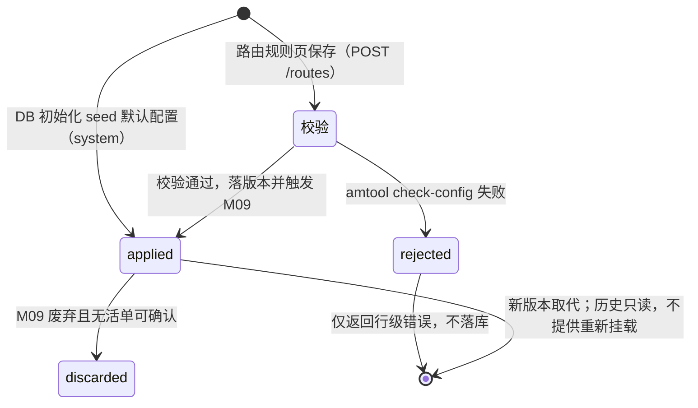
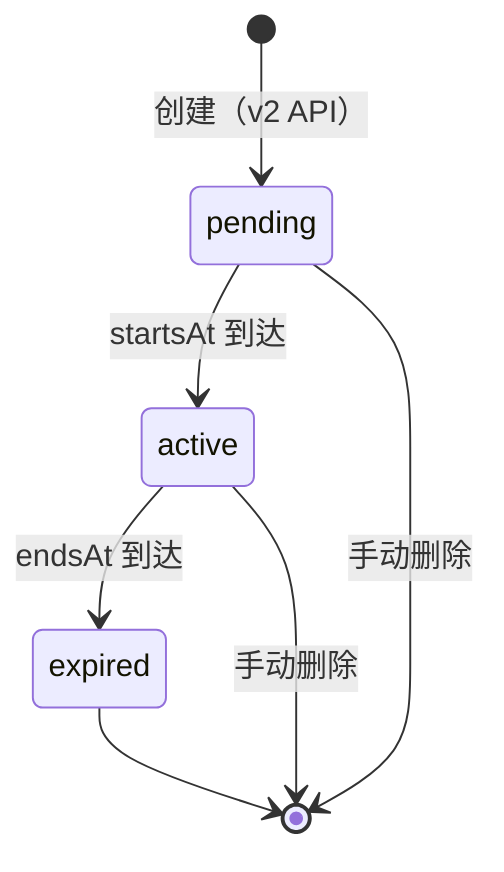
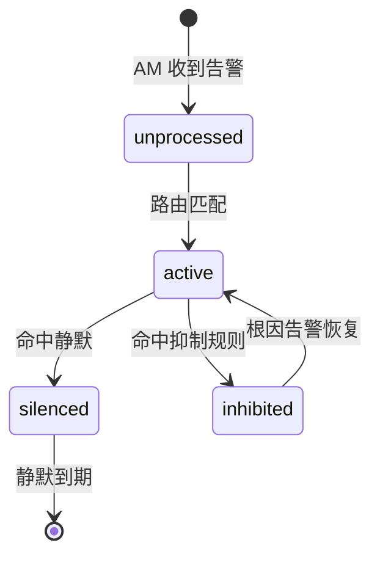
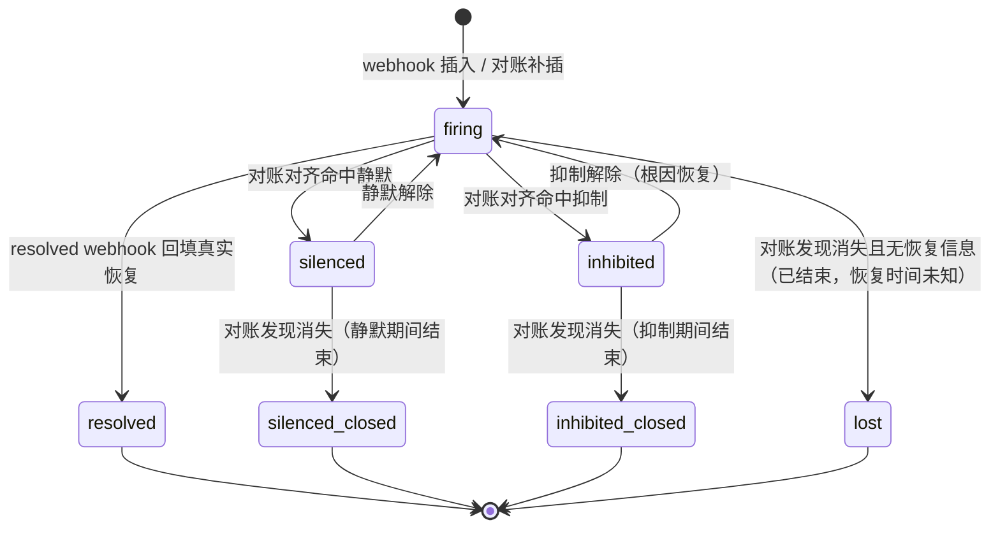

# Module 08: 告警收敛与通知管理

> **PRD 状态**: `ready`（可开发版本）
> **PRD 版本**: v1.22
> **产品版本覆盖**: MVP / v0.2 / v0.3 / v0.3-a / v0.3-b / v0.3-c / v1.0
> **原型版本**: v1.7（**v1.22 为告警抑制独立功能回填轮**——抑制由「仅网域离线自动生成」改为独立页面 + 独立 `/inhibitions` API + 可编辑规则，与路由保存共用同一生成器与变更单，属契约级修订、**原型待后续原型轮承接**；**v1.21 为 event 表单一事实源回填轮**——吸收 design-proposal `alert-history-model-and-home-metrics`（2026-10-26）与 `alert-event-single-source`（2026-10-29），历史告警 / 当前告警 / 首页四指标口径整体改写，属契约级修订、**原型待后续原型轮承接**；v1.13「历史告警」、v1.15「实例列口径」为 Track B 轻量增量，均免高保真原型，豁免记录见 `docs/05-execution-records/module-08/design-decisions.md`；「路由规则」页（`RoutesPage.tsx`）的拖拽排序 / 根路由锁定等增量待跟进，见 prototype-designer 评审记录；PL-3 通知渠道/通知模板页原型增量、#32 派生预览绑定展示与 v1.20 #45–#48 的渠道/模板/路由 IA 增量，待后续原型轮承接，本轮仅回写 PRD；以 `docs/prototypes/module-08/package.json` 为准）
> **更新日期**: 2026-11-05
> **对应原型**: `docs/prototypes/module-08/`

> **模块类型**: 扩展能力模块
> **依赖文档**: [00\_Global\_Architecture.md](../00_Global_Architecture.md)、[03\_Functional\_Architecture.md](../03_Functional_Architecture.md)、[Module\_01\_Metric\_Collection\_Center.md](Module_01_Metric_Collection_Center.md)、[Module\_02\_Query\_Center.md](Module_02_Query_Center.md)、[Module\_09\_Network\_Domain\_and\_Edge\_Config\_Center.md](Module_09_Network_Domain_and_Edge_Config_Center.md)
> **目标用户**: 运维工程师、运维架构师

---

## 0. 需求背景与典型场景

### 这个模块解决什么问题

当监控系统产生大量告警时，运维团队面临「告警风暴」——重要告警被淹没、通知渠道分散、临时变更时无法快速静音。本模块把 Alertmanager 的路由、静默、抑制能力产品化，让运维工程师无需手写 YAML 即可完成告警收敛与通知管理。

### 用户需求的演进过程

从 MVP 开发期的真实反馈看，告警管理的需求随着监控规模扩大逐步暴露：

**阶段 1：通知接入期——「告警产生了，但没人知道」**
- 平台首次部署后，用户需要把告警通知到具体的人或渠道
- 痛点：Alertmanager 原生配置是 YAML 文件，接收人/路由配置复杂，且无法与平台其他模块联动
- 对应能力：平台生成 `alertmanager.yml`（默认 seed + 路由树 + 渠道 receiver）+ `amtool check-config` 校验 + 版本留痕

**阶段 2：变更管控期——「告警配置改了，什么时候生效？」**
- 用户在修改告警配置后，需要确认变更内容并控制生效时机
- 痛点：配置修改直接生效风险高，需要审计与变更确认能力
- 对应能力：`alertmanager.yml` 纳入 M09 变更确认流水线——人工确认 → 下发 → reload

**阶段 3：静默管理期——「计划内变更，不想被告警轰炸」**
- 用户在数据库迁移、系统升级等计划内操作时，需要临时屏蔽相关告警
- 痛点：Alertmanager 静默 API 是运行时状态，静态配置文件无法表达；且 v1 API 已被移除
- 对应能力：静默极简 UI（创建/列表/删除）+ Alertmanager v2 API 代理

**阶段 4：风暴抑制期——「网域离线时，几百条告警同时爆发」**
- 某网域整体离线时，该网域内所有主机的 `up=0` 告警会瞬间形成告警风暴
- 痛点：次生告警淹没根因，运维无法快速定位问题
- 对应能力：告警抑制规则（独立「告警抑制」页维护 `inhibit_rules`；预置「网域离线时抑制 `inhibitable=true` 次生告警」场景）

**阶段 5：状态可视化期——「告警到底通知了没有？」**
- 用户需要知道告警是否已路由、是否被静默/抑制
- 痛点：Prometheus 告警状态与 Alertmanager 通知状态分离，用户需要两个视图对照
- 对应能力：告警状态页 + Alertmanager `/api/v2/alerts` 代理

**阶段 6：路由前台化期——「整条链路不再需要手写 YAML」**
- 上行（M01 规则编辑）与下行（接收人/模板/通知渲染桥）均已前台化；路由（`route`）也已由「路由规则」页的路由树生成，后端统一生成整份 `alertmanager.yml`
- 痛点：① 平台物化的接收人若无 `route` 引用，渠道不会物化、也收不到告警，用户需要知道「还差一步引用」；② 平台产物与历史手写 receiver 在同一份文件里互相误判（变更单校验失败根因）；③ 路由是**有序树、先匹配先生效**，顺序语义只能靠 YAML 注释传承，最易写错
- 对应能力：**路由规则页**（v0.3-a 只读渲染 → v0.3-b 表单可写 → v0.3-c 联动）+ **默认配置 seed + 只物化被路由引用的渠道**；告警配置页只读，平台不再提供整份手写/导入/重挂载入口

### 不同技术背景用户的痛点分层

同一个告警管理能力，不同技术背景的用户会提出完全不同的问题：

| 用户类型 | 典型问题 | 本模块的应对 |
|----------|----------|-------------|
| **Alertmanager 专家** | 「我想直接写 `alertmanager.yml`，能支持吗？」 | 平台不再提供整份手写/导入入口；告警配置页只读展示当前 YAML，路由统一通过路由规则树表达（如需复杂语义，先在路由页建树再保存） |
| **有经验的运维** | 「告警路由规则太复杂，能不能按标签自动分组？」 | 路由规则按 `severity`/`team`/`network_domain` 标签匹配，支持分组/等待/间隔配置 |
| **普通运维** | 「我不想改配置，只想临时屏蔽某个告警」 | 静默 UI 提供创建/列表/删除三个动作，API 直调即时生效 |
| **监控新手** | 「什么是静默？什么是抑制？它们有什么区别？」 | 静默=临时屏蔽通知（手动创建），抑制=根因存在时自动屏蔽次生告警（规则驱动） |

### 典型场景（基于真实用户反馈）

| 场景 | 角色 | 触发条件 | 用户目标 | 成功标准 | 来源 |
|------|------|----------|----------|----------|------|
| 配置告警通知渠道 | 运维工程师 | 平台首次部署完成 | 配置飞书/钉钉/企业微信/自定义 Webhook 等通知渠道 | 告警触发后指定渠道收到通知 | 原始需求 |
| 告警配置变更确认 | 运维工程师 | 修改了接收人或路由规则 | 确认变更内容后下发 | 变更单在 M09 配置中心人工确认后生效 | 决策 60 |
| 临时静默已知故障 | 运维工程师 | 计划内数据库迁移 | 创建静默规则避免告警轰炸 | 静默期间匹配告警不再通知，过期自动恢复 | 原始需求 |
| 抑制告警风暴 | 运维架构师 | 某网域整体离线 | 自动抑制该网域内次生告警 | 只保留根因告警，通知量显著下降 | 原始需求 |
| 静默 API 版本迁移 | 运维工程师 | Alertmanager 升级到 ≥0.27 | 静默管理功能正常可用 | 静默列表/创建/删除走 v2 API，不再报 410 Gone | F-3 / 决策 61 |
| 查看当前告警 | 运维工程师 | 告警触发后确认是否还在发生 | 查看当前未结束的告警、是否被静默/抑制 | 告警状态页「当前告警」展示事件表未结三态（告警中/静默中/抑制中） | 决策 55 / v1.21 |

> 本模块覆盖的用户故事详见 [§2 用户故事](#2-用户故事)。

---

## 1. 模块目标

> 决策依据：design-decisions.md 决策 49 / 59 / 60 / 61。

本模块对应 **告警收敛与通知管理域**，回答「告警如何通知、通知给谁、是否收敛、是否静默」的问题：

1. **通知路由与接收人管理（MVP 批次 / v0.3 / v1.0）**：维护 Alertmanager 的 `route` / `receiver` 配置，按告警标签（如 `severity`、`team`、`network_domain`）决定通知渠道与接收人。默认配置由平台 seed 入库；路由规则在「路由规则」页以树形表单编辑，保存时由**后端**生成 `alertmanager.yml` 并进入 M09 变更确认；告警配置页只读查看，不再提供整份手写/导入入口。**路由（`route`）前台化**分期交付：**v0.3-a** 只读渲染路由树（看懂顺序与匹配）、**v0.3-b** 表单可写（后端生成路由，已提前落地）、**v0.3-c** 联动（接收人下拉、标签联想），v1.0 完整 UI。
2. **静默与抑制管理（MVP / v1.0；v1.22 抑制改独立功能）**：提供静默规则 UI（创建/查询/删除）与**告警抑制规则管理页**——抑制规则不再只由平台按网域离线场景自动生成，用户可在「告警抑制」页新增 / 编辑 / 删除 / 启停通用抑制规则（`source_matchers` / `target_matchers` / `equal`），保存后与路由共用同一 `alertmanager.yml` 生成与 M09 变更确认链。静默作为 Alertmanager 运行时 API 状态，MVP 提供极简 UI（创建/列表/删除三个动作，API 直调即时生效）。
3. **告警状态查看（MVP 起，v1.21 起以 `alert_events` 为单一事实源）**：
   - **当前告警**：本模块维护 `alert_events` 事件表，由 Alertmanager webhook 留痕 + 分钟级对账写入；告警状态页「当前告警」页签展示事件表**未结三态**（告警中 / 静默中 / 抑制中），回答「现在有哪些告警、是否被静默/抑制」。
   - **历史告警**：同一事件表回答「某条告警何时触发、何时恢复、是否已结束」，一行 = 一次告警发生，按 Alertmanager `fingerprint` + `starts_at` 去重合并；恢复时间只有真实恢复才写值，其余留空不伪造。
   - **规则评估（只读参考）**：通过 [Module\_02: 查询中心](Module_02_Query_Center.md) 代理 Prometheus `/api/v1/alerts`，展示规则求值态 firing/pending（文案「观察中」），仅作技术参考，不再是首页与告警状态页的主数据源。
   - **通知状态代理**：本模块仍保留 Alertmanager `/api/v2/alerts` 通知状态代理（兼容保留，前端不再消费为单一视图）。
   - **实例口径**：告警列表的「实例」拆分为**「实例名」+「采集地址」两列**——「实例名」取 [Module\_07](Module_07_Monitoring_Object_Management.md) 资源清单口径（host=`instance_name`、database/middleware=`instance_ip`、application=`service_name`、generic_target=`target_name`），由服务端按告警标签 `resource_id` 回连 M01 资源表回填；「采集地址」为 Prometheus 抓取地址（`ip:exporter端口` 或拨测 URL，即 `instance` 标签值），表头标注「采集器地址，非业务端口」（详见 [4.4 节](#44-告警状态查看)）。历史告警页的实例名随事件行携带的 `resource_name` 展示，缺失显示 `-`。
4. **通知渠道与模板（MVP 批次）**：维护飞书/钉钉/企业微信/自定义 Webhook 等通知渠道与消息模板，支撑告警通知内容格式化；模板为可变实体，不进入 `alertmanager.yml`。

### 边界与配置形态

- **告警规则内容创作、规则分组、`rules.yml` 生成与下发均不归本模块**：规则内容与编辑 UI 由 [Module\_01](Module_01_Metric_Collection_Center.md) 负责（`MonitoringRule`）；规则按网域分组、生成并下发 `rules.yml` 由 [Module\_09](Module_09_Network_Domain_and_Edge_Config_Center.md) 负责。本模块聚焦 **Alertmanager 域**：`alertmanager.yml` 的接收人、路由、静默、抑制、通知状态。
- **配置生成与下发分离**：`alertmanager.yml` 由平台生成（默认 seed + 路由规则树 + 被引用渠道的 receiver，`amtool check-config` 校验）；作为**管理域（`default`）scope** 的配置产物纳入 M09 变更确认流水线（人工确认 → 下发 → reload），不参与按网域扇出（详见 [4.1 节](#41-alertmanager-配置管理)）。
- **告警收敛与派发组件锁定 Alertmanager**：配置模型与「UI 配置 → 生成文件 → reload」及 M09 配置生成流水线天然兼容，且不产生租户/网域隔离缺口；易用性诉求由本模块的 UI 化管理承接。
- **`route` 段唯一作者 = 平台**：`alertmanager.yml` 的 `route` 段由「路由规则」页的路由树生成，后端统一生成整份配置；不存在「手写 / 平台管理」双模式，也不提供整份导入或重新挂载入口。`receivers` 段只物化被路由引用的渠道，名称恒为 `notify-<渠道ID>`；历史手写 receiver / 未被引用渠道不写入产物（详见 [4.1.1](#411-route-段唯一作者与默认配置)）。

---

## 2. 用户故事

> 完整用户故事条目（角色 / 我希望 / 以便于）见**全局用户故事库 [01_User_Stories.md](../01_User_Stories.md) 4.8 节**；本模块用户故事使用模块命名空间编码（`M08-ROLE-NN`，全局唯一），仅在此列出编码与一句话摘要。

- M08-OPS-01：配置通知渠道（飞书/钉钉/企业微信/自定义 Webhook）与通知模板，指定渠道参数与内容格式（MVP 批次 PL-3；渠道无启停，IM 必须绑定模板）。
- M08-OPS-02：配置告警路由规则，按 `severity`、`team`、`network_domain` 等标签决定告警通知到哪个接收人（MVP 批次默认只读，v0.3-b 起路由页可编辑；保存由后端生成 YAML）。
- M08-OPS-03：查看当前告警（事件表未结三态：告警中 / 静默中 / 抑制中），判断告警是否仍在发生、是否被静默/抑制（MVP 起；v1.21 由「通知状态四态」收敛为事件表口径）。
- M08-OPS-04：创建临时静默规则，避免计划内变更或已知故障引发告警轰炸（MVP 起）。
- M08-OPS-05：查看并删除正在生效的静默规则（MVP 起）。
- M08-OPS-06：配置告警通知模板（summary / description 格式），使通知内容清晰可读（MVP 批次 PL-3）。
- M08-OPS-07：配置告警升级策略（如 5 分钟未确认升级给主管）（v1.0）。
- M08-OPS-08：查看历史告警（含已恢复），确认某条告警何时触发、何时恢复、何时关闭，并支持按条件筛选导出 CSV 用于日报（MVP 起；v1.21 改由 `alert_events` 事件表承载，一行 = 一次告警发生）。
- M08-ARCH-01：当某个网域整体离线时，抑制该网域内 `inhibitable=true` 的可达性告警风暴，只保留 `EdgeSiteOffline` 根因告警（MVP 起，v1.22 该场景作为一条预置抑制规则承载，用户可在「告警抑制」页启停/调整）。
- M08-ARCH-02：在边缘网域断网场景下，边缘本地 Alertmanager 继续通过本地通知通道（本地飞书/钉钉 webhook）发送自治告警（v0.4+，与 M09 边缘配置下发配合）。

---

## 3. 核心功能

### 3.1 功能表

| 功能 | 说明 | 优先级 / 版本 |
|------|------|---------------|
| **Alertmanager 配置管理** | 维护 `alertmanager.yml`：默认配置在数据库初始化时 seed 入库；路由规则页保存时由后端生成整份配置（`global` + `route` + 被引用渠道的 `receivers`），`amtool check-config` 校验后进入 M09 变更确认流水线（管理域 scope、不扇出；人工确认后由 M09 写文件并触发 reload）。告警配置页只读查看当前生效与历史版本，不提供整文件导入/手写入口。 | P0 / MVP 批次（平台生成；路由页 v0.3-b 提前落地） |
| **接收人管理** | Alertmanager `receiver` 只由平台物化：`default`（空接收人，不通知）+ 被当前/待确认路由树引用的渠道 `notify-<渠道ID>`。不提供手写 receiver、`receiver-snippet` 或独立接收人 CRUD；未引用渠道不物化。 | P0 / MVP 批次（PL-3，v1.20） |
| **通知渠道管理** | 管理飞书 / 钉钉 / 企业微信 / 自定义 Webhook 渠道：增删改查；Webhook 地址 SSRF 校验（默认拒绝私网 / 环回 / link-local / 云元数据，显式开关放行内网例外）；渠道无启停字段；飞书/钉钉/企业微信必须绑定模板，Webhook 禁止模板；仅被路由引用的渠道物化 receiver（`?id=<渠道ID>`）；列表显示名称/类型/被引用次数/创建时间/操作；删除被引用渠道返回 409。 | P0 / MVP 批次（PL-3，v1.20） |
| **路由规则管理** | 按标签匹配条件（`severity=critical`、`team=sre`、`network_domain=gov-cloud-a` 等）配置路由，指定接收人、分组、等待/间隔/重复时间；`route` 段唯一作者=平台：默认配置 seed 提供根路由，前端只提交 `{base_checksum, route_tree}`，后端生成 YAML；路由页默认只读、点「编辑路由」进入编辑；无模式开关/导入/重新载入；接收人候选 = `default` ∪ 全部渠道 `notify-<渠道ID>`。 | P0 / MVP 批次（v0.3-a 只读 / v0.3-b 可写，已提前落地） |
| **静默管理** | 创建/查询/删除 Alertmanager 静默规则；支持按标签匹配、起止时间、原因说明；调用 Alertmanager API 生效；**MVP 提供极简 UI**（创建/列表/删除三个动作，API 直调，决策 59）——静默是运行时状态、静态配置无法表达 | P0 / MVP |
| **告警抑制规则** | 独立页面「告警抑制」维护 Alertmanager `inhibit_rules`：通用 `source_matchers` / `target_matchers` / `equal` / `enabled`，支持新增 / 编辑 / 删除 / 启停与整份保存；网域离线抑制场景作为预置规则承载；与路由保存共用同一生成器、`amtool` 校验、M09 变更单与 reload（v1.22） | P0 / MVP |
| **告警事件留痕与对账（v1.21）** | 平台为每个 Alertmanager receiver（含 `default`）追加内置 webhook 留痕（`POST /api/v1/webhooks/alerts`，对 AM 永远 2xx，由平台生成、不可删除）；分钟级对账拉取 AM 活跃告警与 uptime，补插漏记、关闭消失行、对齐静默/抑制状态；一行 = 一次告警发生，按 `fingerprint` + `starts_at` 去重（`occurrence_key`）。 | P0 / MVP |
| **当前告警（事件表未结三态）** | 告警状态页默认页签展示事件表未结三态：告警中（`firing`）/ 静默中（`silenced`）/ 抑制中（`inhibited`），支持服务端筛选与分页；首页告警卡右栏同源展示全部未结告警（不分页、卡内滚动）。 | P0 / MVP |
| **历史告警（事件表）** | 独立页面展示告警发生历史：一行 = 一次发生，七态（告警中 / 静默中 / 抑制中 / 已恢复 / 静默期间结束 / 抑制期间结束 / 已结束（恢复时间未知）），字段含触发时间、恢复时间、关闭时间、持续时长、实例名、网域、摘要、描述；支持按网域 / 告警名 / 实例 / 状态 / 描述 / 时间范围筛选，并按当前筛选导出 CSV（日报用途）。 | P0 / MVP |
| **规则评估（只读参考）** | 由 [Module\_02: 查询中心](Module_02_Query_Center.md) 代理 Prometheus `/api/v1/alerts`，展示规则求值态 firing/pending（文案「观察中」），仅作技术参考，不再是首页与告警状态页主数据源。 | —（依赖 M02） |
| **通知状态代理（兼容保留）** | 保留 Alertmanager `/api/v2/alerts` 通知状态代理（active / silenced / inhibited / unprocessed）；事件表对账内部仍消费该数据，前端不再以该四态作为主视图。 | P0 / MVP（v1.21 起降为兼容保留） |
| **通知模板管理** | 管理告警通知的 title / body 模板（Go template，支持 `{{ $labels }}`、`{{ $value }}`、`{{ $annotations }}` 等变量）：内置模板 + 自定义模板；模板是可变实体，原地新建/编辑/复制/删除，无版本历史/remount/status/checksum 展示；按渠道类型 Tab；内置只读、可复制；被渠道绑定的模板禁止删除；模板不进入 `alertmanager.yml`，桥按渠道 ID 实时读取。自 v1.0 提前至 MVP 批次落地（PL-3，v1.20） | P0 / MVP 批次（PL-3，v1.20；原 P2 / v1.0） |
| **告警升级与降噪** | 升级策略（未确认超时升级）、值班组、告警降噪（合并相似告警） | P2 / v1.0 |
| **边缘本地通知通道** | 断网场景下边缘 Alertmanager 使用本地 webhook 通知（v0.4+ 多网域） | P2 / v0.4+ |

### 3.2 告警事件事实源 vs 规则求值 / 通知状态（v1.21 收敛）

> **v1.21 关键决策**：以 `alert_events` 事件表为**唯一事实源**——当前告警、历史告警、首页四格统计全部同源；取消「AM 通知状态四态」与「Prometheus firing/pending」作为主视图的地位，二者降级为参考/兼容数据源。详见 design-proposal `alert-event-single-source`。

| 维度 | `alert_events` 事件表（本模块，主事实源） | Prometheus `/api/v1/alerts`（规则求值，参考） | Alertmanager `/api/v2/alerts`（通知状态，兼容保留） |
|------|------------------------------------------|----------------------------------------------|------------------------------------------------|
| 语义 | 「这条告警发生了没有、现在什么状态、何时恢复/关闭」 | 「规则现在求值成什么状态」 | 「告警经过路由、静默、抑制后正在被谁通知」 |
| 数据来源 | AM webhook 留痕 + 分钟级对账 | Prometheus 规则管理器求值结果 | Alertmanager 接收到的告警及处理结果 |
| 包含状态 | 七态：firing / silenced / inhibited / resolved / silenced_closed / inhibited_closed / lost | firing / pending | active / suppressed / silenced / unprocessed |
| 时间口径 | UTC+8 带偏移存储；`closed_at` 为所有终态的关闭时刻，统计统一用它 | 求值采样时间 | AM 事件时间 |
| 适用场景 | 当前告警页、历史告警页、首页四格统计 | 「规则评估」只读参考页签 | 对账内部消费；前端不作主视图 |

**「待处理」口径**：AM `unprocessed` 不再对外展示（对账本就按 `firing` 处理，无信息丢失）；Prometheus `pending` 文案统一为「观察中」，不作行动对象。

### 3.3 中心/边缘告警灾备边界

| 维度 | 中心告警通知（Central） | 边缘自治告警通知（Edge，v0.4+） |
|------|-----------------------|-----------------------------------|
| 适用场景 | 跨网域聚合、复杂环比、全局 SLA | 网域内死活、本地服务宕机 |
| 求值组件 | 中心 Prometheus | 边缘 vmalert（由 M09 随配置包下发 `rules.yml`） |
| 通知组件 | 中心 Alertmanager → 企业 webhook | 边缘本地 Alertmanager → 本地飞书/钉钉 webhook |
| 断网行为 | 无法感知边缘本地指标 | 独立存活，继续通知 |
| 状态上报 | 通过 M02 代理 Prometheus `/api/v1/alerts` | 通过 Module_11 EdgeHeartbeat 上报，展示在 Module_11 采集节点状态页或 M08 边缘告警视图 |

MVP ~ v0.3 只实现中心 Alertmanager 通知；边缘自治告警与本地通知在边缘 Agent 支持本地 rules 评估后实现（v0.4+）。

### 3.4 通知渠道、通知模板与渲染桥（PL-3）

> 契约权威：`docs/05-execution-records/module-08/api-contract-snapshot.md` §11（dev-feedback #17 / #21 / #29 / #30 / #45–#48；本 PRD v1.20 回写）。

**通知渠道（NotifyChannel）**：平台一等公民的通知出口，支持飞书 / 钉钉 / 企业微信 / 自定义 Webhook。渠道无启停字段；飞书/钉钉/企业微信必须绑定同类型模板，自定义 Webhook 禁止绑定模板。渠道列表只展示名称、类型、被引用次数、创建时间、操作；IM 渠道的 Webhook 地址与密钥响应脱敏，自定义 Webhook 地址回填完整值。

**通知接收人（Receiver）与物化**：平台只为 `default`（空接收人，不通知）和**被当前/待确认路由树引用**的渠道生成 receiver。receiver 名恒为 `notify-<渠道ID>`，URL 为渲染桥地址 + `?id=<渠道ID>`；模板 ID、密钥、渠道名都不进入 URL。新增渠道本身不写 yml；路由引用集合变化才触发配置重算与 M09 变更检测。

**通知模板（NotifyTemplate）**：飞书/钉钉/企业微信的 Go `text/template` 渲染模板（白名单 FuncMap）。模板是可变实体：新建/编辑/复制/删除原地生效，无版本历史/remount/status/checksum 展示；按渠道类型 Tab 展示，内置模板置顶只读（可复制），自定义模板可编辑；同渠道类型内名称唯一、渠道类型创建后不可变；被渠道绑定的模板禁止删除。模板内容不进入 `alertmanager.yml`，换绑或修改模板立即生效，不产生 M09 变更单。

**渠道 ↔ 模板绑定**：飞书/钉钉/企业微信建渠道时必须选择同类型模板（飞书自动选中内置「飞书卡片-默认」；钉钉/企业微信无内置模板，必须选自定义）；自定义 Webhook 不显示模板、后端拒绝绑定。桥投递时按渠道 `default_template_id` 读取模板；IM 渠道绑定失效时优先回落内置默认并记 warning，该类型无内置模板时返回明确错误（不静默丢失）。

**通知渲染桥（`POST /api/v1/webhooks/notify?id=<渠道ID>`）**：接收 AM 原生 webhook 载荷。IM 渠道按模板渲染后出站（飞书 body 注入签名、钉钉 URL query 加签、企业微信无加签）；自定义 Webhook 将 AM 原始 JSON 原样 POST，不渲染、不签名、不判业务错误码，只看 HTTP 状态；本期不支持自定义 header / 鉴权。桥端点不再使用内部令牌，依赖部署层同机/内网防火墙限制访问；任何能访问该端点的人都能伪造通知，生产必须做网络层限制。

**receiver 物化边界**：平台只写 `config-output/alertmanager.yml` 一个文件；历史手写 receiver、未引用渠道、模板/密钥都不进入产物。渠道/模板 CRUD 移出 M09 `sourceTableScopes`，不空跑变更检测；只有路由保存（或 M09 重生成）触发变更单。

---

## 4. 核心流程

> 决策依据：design-decisions.md 决策 59 / 60 / 68-2。

### 4.1 Alertmanager 配置管理

`alertmanager.yml` 由平台生成并纳入 M09 变更确认；**告警配置页只读**，唯一写入口是「路由规则」页的路由保存。

1. **默认配置入库**：数据库初始化时若无已生效配置，幂等写入与 `deploy/alertmanager/alertmanager.yml` 一致的默认配置（`status=applied`、`applied_at=seed 时间`、`applied_by=system`）；已有配置不覆盖。首次打开路由页即可读到真实根路由，不再由前端合成空树。
2. **路由保存**：`POST /api/v2/platform/alertmanager/routes`，请求 `{base_checksum, route_tree}`。后端执行乐观锁校验 → 路由树与接收人校验 → 生成 route 段并整份重建配置 → `amtool check-config` → 写入 `AlertmanagerConfigVersion` → 触发 M09 变更检测。前端不再生成/合并 YAML。
3. **变更确认**：内容作为管理域（`default`）scope 配置产物提交 M09 → `ConfigDraft` → 人工确认 → `ConfigVersion`；确认后 M09 写中心 Alertmanager 配置路径并触发 reload（SIGHUP / `POST /-/reload`），`change_status` 回写 M08。**两段式人工闸门（#43 立场 1）**：提交只产/复用 pending 草稿（`ensurePendingDraft`），**绝不自动 ConfirmDraft**；根兜底接收人与路由结构变更均属高危，必须人工确认。
4. **查看**：告警配置页只读展示当前生效配置、状态与历史版本；不提供整份导入、手写 route、模式开关、重新挂载入口。调整路由统一回「路由规则」页保存，生成新版本。

> M08 是配置内容 Owner（生成规则 + 路由树），M09 是变更确认与下发管道 Owner。

配置产物示例（平台生成，仅展示关键段）：

```yaml
global:
  resolve_timeout: 5m

route:
  group_by: ['alertname']
  group_wait: 30s
  group_interval: 5m
  repeat_interval: 4h
  receiver: default
  routes:
    - matchers: ['severity="critical"']
      receiver: notify-1

receivers:
  - name: default
  - name: notify-1
    webhook_configs:
      - url: 'http://metric-center:8080/api/v1/webhooks/notify?id=1'
        send_resolved: true
```

> `default` 是平台内置空接收人（不通知），用于新环境根路由兜底；要真正收到告警，需把根路由或子路由接收人指向某个渠道。`receivers` 中只出现被 route 引用的渠道，模板、密钥、渠道名不落盘。

- 中心 Alertmanager 是全局单例，每部署一份，不按网域扇出；仅 v0.4+ 边缘自治告警的边缘 `alertmanager.yml` 进入按域下发。
- 通知路由/接收人/静默调整频繁、影响面可控，MVP 阶段统一人工确认；后续版本由 M09 按配置类型风险分级将本类配置降为低风险自动确认（预留）。

#### 4.1.1 route 段唯一作者与默认配置

> 决策依据：dev-feedback #45–#48（本 PRD v1.20 收割）。生成器统一与整份重建属同一收口语义，避免退回「前端生成 + 后端镜像」。

**`route` 段唯一作者 = 平台。** `alertmanager.yml` 不再有「手写 / 平台管理」双模式，也不提供整份导入、重新挂载或根兜底设置接口；所有路由配置都从「路由规则」页的路由树生成。

- **默认配置**：DB seed 写入根路由（根 `receiver=default`、无 matchers、无子路由）；`GET /routes` 的只读态与编辑态都读同一份 DB/产物，删除「未配置」标签与前端合成占位。`default` 是空接收人（不通知），不是某个渠道。
- **保存链路**：前端只提交 `{base_checksum, route_tree}`；后端校验 `base_checksum`（409）、根/子路由结构、matcher 与时长、接收人可达性，生成 route 段并整份重建 `alertmanager.yml`，再走 `amtool` + `AlertmanagerConfigVersion` + M09。前端不再生成/合并 YAML，后端不接受前端 YAML 作为事实。
- **接收人合法集合**：`default` ∪ **全部已登记通知渠道**的 `notify-<渠道ID>`。渠道自 v1.20 起无启停字段，登记即全部可选；`declared_receivers`、历史手写 receiver、未被引用渠道不参与可选集合与合法性校验。悬空/历史 receiver 判 `receiver_dangling` 并阻断保存。
- **物化范围**：只有被当前生效或待确认路由树引用的渠道才写 receiver；新增渠道本身不写 yml，路由引用变化才触发 M09。
- **已删除的旧机制**：`AlertmanagerRouteSetting` / `/route-setting`、「默认接收人」策略卡、托管模式预置 seed、根 receiver 物化、最小运行骨架、模式开关、导入卡/抽屉、手写说明、重新载入/重新挂载入口全部不再存在。根兜底就是路由树的根节点，接收人直接在该节点编辑。
- **路由页形态**：默认只读；点「编辑路由」先 `GET /routes` 刷新并载入最新树；编辑态只有「新建 / 保存 / 放弃」；保存成功回只读态并提示「待确认下发」；有 pending 时展示「当前显示的是待确认版本」横幅。

**`receivers` 段**：只由平台生成 `default` + 被引用渠道；不再有「平台槽位 / 用户自有命名空间」双作者判定，也不做手写 receiver 重名冲突处理。未来接入的抑制规则等段落纳入同一生成规则扩展，不另开旁路。

**v0.4+ 多网域边缘**：中心 Alertmanager 配置由 M08 直接管理；边缘 `alertmanager.yml`（各网域独立）可由 M08 生成后经 M09 配置包下发，或边缘首次部署时由 M08 初始化脚本推送；边缘静默由边缘 Alertmanager 本地处理，M08 提供静默管理代理（P2）。

### 4.2 静默规则管理

静默规则通过 **Alertmanager v2 API** 调用（Alertmanager ≥0.27 已移除 v1 silence 端点，返回 410 Gone）。List/Create 使用 `/api/v2/silences`；Get/Delete 单条使用 `/api/v2/silence/{id}`；v2 列表响应为裸数组、单条为裸对象、创建成功返回 `{"silenceID": "..."}`。

```http
POST /api/v2/silences
Content-Type: application/json

{
  "matchers": [
    {"name": "alertname", "value": "HighCPUUsage", "isRegex": false},
    {"name": "instance", "value": "10.0.1.11:9100", "isRegex": false}
  ],
  "startsAt": "2026-08-15T10:00:00Z",
  "endsAt": "2026-08-15T12:00:00Z",
  "createdBy": "ops-chen",
  "comment": "计划内变更：数据库迁移"
}
```

M08 提供 UI 表单封装：
- 选择告警标签键/值（可从当前 Alertmanager 活跃告警中联想）；
- 选择起止时间（支持相对时间如「1 小时后」）；
- 填写原因；
- 列表展示活跃静默，支持删除。

**授权校验**：Alertmanager 静默全局生效——租户 A 的宽 matcher 静默会影响到租户 B 的告警。创建静默时 M08 必须在**服务端校验** matcher 收敛于当前用户的授权网域集合（越权 matcher 直接拒绝），不得依赖前端表单约束。MVP 单租户单网域阶段校验恒通过（机制骨架保留）。

#### 4.2.1 matcher 编写口径：可匹配标签四层并集

matcher 匹配的是 **AM 收到告警时携带的标签全集**，口径为四层并集：

| 层 | 可匹配标签 | 来源口径 |
|---|---|---|
| 目标层 | `resource_id`（system 强制，不挂模板也在）、`instance`、`app`/`biz`/`env`/`cluster`/`service_name` 等 | **被 `enabled + draft_status=ready` 的采集 Job 实际引用的标签模板中 enabled mappings**（模板解析：显式挂载 → 类别默认模板）∪ system 强制标签；**不是「所有已生效模板的集合」**——未被生效 Job 引用 / 未下发模板的键不可匹配 |
| 采集机制层 | `job`、`alertname` | Prometheus / 规则求值自动附加 |
| 规则层 | `severity` 及自定义键 | 规则编辑自定义 labels（enabled + ready + central/both 规则） |
| external 层 | `network_domain_id`、`zone_type` | 发往 AM 出口附加；**AM 静默可按网域匹配，键为 `network_domain_id`**（该层在 Prometheus 告警查询中不可见） |

例外：拨测（blackbox）类告警无目标层标签，仅规则层 + external 可匹配。

UI 编写引导（表单）：
- **标签名分组联想框**：按上述四层分组提示可匹配键（聚合端点 `GET /api/v2/platform/alertmanager/silences/label-options`），拼错键「静默空集且无报错」的陷阱由联想 + 键描述软引导兜底，不做硬校验（自定义键属合法能力）；
- **正则预检**：`is_regex=true` 时前端预校验正则合法性（AM 侧 400 兜底保留）；
- **实例级静默**：`instance` / `resource_id` 均在标签全集内，matcher 直写即实例级；表单提供「按实例选择」入口——复用 M01 资源列表搜索，选中后自动生成 **`resource_id` matcher**（UUID 稳定，不随 IP / 端口变化）；手填 `instance` 须提示其值为 `ip:exporter端口`；
- **AND 语义提示**：同一静默内多条 matcher 为 AND 关系（`alertname + resource_id` = 静默某实例的某类告警；单 `resource_id` = 静默该实例全部告警）。

### 4.3 告警抑制规则（v1.22：独立页面 + 独立 API）

当某个网域整体离线时，该网域内数百台主机的 `up=0` 告警会瞬间形成告警风暴。MetricCenter 通过 Alertmanager `inhibit_rules` 抑制此类次生告警；v1.22 起抑制规则由**独立页面「告警抑制」**承载，用户可自助新增 / 编辑 / 删除 / 启停通用规则，「网域离线抑制」只是其中一条预置规则，不再由平台单方面写死。

**页面与写入口**：

- **页面**：菜单「告警收敛与通知管理 → 告警抑制」（`/inhibitions`），初始只读；点「编辑抑制」进入编辑态，支持新增 / 修改 / 删除 / 启停，编辑后「保存提交」或「放弃」。
- **API**：`GET /api/v2/platform/alertmanager/inhibitions` 只读视图（`{ items, effective_checksum, pending }`，已登录可读）；`POST /api/v2/platform/alertmanager/inhibitions` 整份保存（`{ base_checksum, inhibit_rules }`，管理员写）。**不把抑制字段塞进 `/routes` 请求体**——`/routes` 契约不变，仍为 `{base_checksum, route_tree}`。
- **数据模型**：不新增数据库表，以最新产品视图 YAML 为配置源；字段为 `name` / `source_matchers` / `target_matchers` / `equal` / `enabled`，**禁用项与编辑态 ID 不进入 YAML，名称以 `# 抑制规则名称: ...` 注释往返保留**。

**共用生成与下发**：底层共用 `SaveAlertmanagerConfig(routeTree, inhibitRules, ...)`——保存路由时使用修改后路由并**保留当前抑制**，保存抑制时**保留当前路由**并使用修改后抑制；两端都经 `BuildAlertmanagerConfig` 整份生成 `global + route + inhibit_rules + receivers`，然后复用既有 `amtool check-config`、版本留痕、M09 pending 变更单、人工确认、写盘与 reload 链，**不即时生效**。保存路由时 `inhibit_rules = nil` 表示保留当前规则；共享函数收到**显式空数组**表示清空。M09 草稿生成 / 重校同样提取并保留抑制规则。

**分配置段 pending 提示**：`pending` 增加 `route_changed` / `inhibit_rules_changed` 布尔字段（比较当前 pending 与上一确认版本的对应配置段）——路由页仅在 `route_changed !== false` 时显示待确认提示，抑制页仅在 `inhibit_rules_changed !== false` 时显示；两段都变化则两页都显示；**变更单仍只有一个，确认仍针对完整 YAML**。字段缺省兼容旧客户端按 `true` 处理。

**校验**：源 / 目标 matcher 均至少一条，标签名和值非空，正则合法；`equal` 标签非空且不重复；失败返回 400 `bad_request`，checksum 冲突返回 409 `conflict`，非管理员写入返回 403。

**预置规则示例（网域离线抑制）：**

```yaml
inhibit_rules:
  - source_matchers:
      - alertname = "EdgeSiteOffline"
    target_matchers:
      - network_domain = "gov-cloud-a"
      - inhibitable = "true"
    equal:
      - network_domain
```

**规则说明：**

- **源告警（Source）**：`EdgeSiteOffline`，由 [Module\_11](Module_11_Edge_Access_and_Agent_Delivery.md) 在边缘 Agent 失联超过阈值（默认 5 分钟）时触发。
- **目标告警（Target）**：同一 `network_domain` 下且 `inhibitable=true` 的告警。
- **抑制条件**：`network_domain` 必须相同。
- **抑制范围**：只抑制可达性/网络类告警，不抑制资源类告警（如 `disk_full`、`cpu_high`）。

**设计原则：**

| 告警类型 | `inhibitable` 建议 | 示例 |
|----------|-------------------|------|
| 目标不可达 / 服务宕机 | `true` | `up == 0`、`probe_success == 0` |
| 网络连接失败 | `true` | `prometheus_target_scrape_exceeded_sample_limit` |
| 资源使用率高 | `false` | `disk_full`、`cpu_high`、`memory_high` |
| 业务自定义告警 | `false` | 应用层 SLA 告警 |

> `inhibitable` 字段来自 Module_01 的 `MonitoringRule.labels` 或 `annotations` 约定（建议在规则编辑 UI 中默认提供并允许用户覆盖）。M08 生成 `inhibit_rules` 时消费该字段。

### 4.4 告警状态查看（v1.21：事件表单一事实源）

用户动线为「什么出了问题 → 通知了谁/是否被静默 → 加静默/调路由」的连续任务链。「告警状态页」归属本模块（告警域工作台）；Module_02 只交付注入代理 API，不出告警相关页面。v1.21 起收敛为「两个页签 + 一个独立历史页」：

- **当前告警（默认页签，事件表未结三态）**：数据源 `GET /api/v2/platform/alertmanager/alert-events?status=open`，展示 `firing`（告警中）/ `silenced`（静默中）/ `inhibited`（抑制中），三张统计卡 + 服务端筛选 / 分页；支持按 `network_domain` 筛选。**不再展示 AM 通知状态四态，「待处理」下线。**
- **规则评估（第二页签，只读参考）**：由 [Module\_02: 查询中心](Module_02_Query_Center.md) 代理 `/api/v1/alerts`，展示规则求值态 firing / pending（文案「观察中」），仅作技术参考，不作行动对象。
- **历史告警（独立页面）**：菜单「告警收敛与通知管理 → 历史告警」，数据源 `GET /api/v2/platform/alertmanager/alert-events`，一行 = 一次告警发生；默认时间窗 24h、最大 7d；支持按 `network_domain` / `alertname` / 实例 / 状态（七态）/ 描述 / 时间范围筛选；提供手动刷新与**按当前筛选导出 CSV**（日报用途）。

**首页四格（本模块统计口径的消费方）**：`GET /api/v2/platform/alertmanager/alert-events/stats` 返回四指标（今日告警 / 今日告警今日恢复 / 历史遗留告警 / 历史遗留今日恢复）与真实恢复 / 恢复时间未知拆分；四指标与当前告警列表同表同源、同一 UTC+8 日界。详见 [Module_05](Module_05_Custom_UI.md) §4.2 / §11.3。

**实例列口径（当前告警 / 历史告警统一）**：告警列表原「实例」列展示的是 Prometheus 抓取地址（`instance` 标签 = `ip:exporter端口`，如 `1.15.94.116:9100`），`:9100` 是 exporter 监听端口，用户从未填写，极易被误读为「业务端口配错了」或「这是另一台机器」。两个视图统一拆为两列：

- **「实例名」**：取资源清单口径（host=`instance_name`、database/middleware=`instance_ip`、application=`service_name`、generic_target=`target_name`，与 [Module\_07](Module_07_Monitoring_Object_Management.md) §5.12 的展示口径一致）。当前告警由服务端以告警标签 `resource_id` **一次性批量**回连 M01 五类资源表回填，与资源改名实时一致、覆盖存量告警（无需重新下发）；历史告警页展示事件行携带的 `resource_name`，缺失显示 `-`，不回落成采集地址（否则两列同值，等于没修）。
- **「采集地址」**：`instance` 标签原文（原「实例」列的取值），表头必须挂 tooltip「采集器地址，非业务端口」。
- **例外与回落**（不得假设一定有 `resource_id`）：① 拨测（blackbox）告警无 `resource_id`；② 聚合 / 全局规则（`sum(...) by (...)`）会抹掉 `instance` 与 `resource_id`；③ 用户自写规则若未选取 M01 下发的序列。以上三类「实例名」显示 `-`、「采集地址」显示原值，聚合 / 全局规则的「采集地址」沿用「全局/聚合」。
- **筛选口径**：历史告警页的「实例」筛选框同时匹配实例名与采集地址（展示改造后若只匹配地址，用户看到 `ceshi` 却搜不到）。
- 不做「点击实例跳转 M01 资源详情」。
- **标签侧增量（规划中）**：让 `targets/*.json` 直接带上 `instance_name` 标签（补 Module\_07 §5.12 已声明但未实现的映射），范围仅 4 类静态资源（host / database / middleware / generic_target；application 已有 `service_name`、拨测 URL 与容器不加），价值是「资源删除后历史告警仍可读」与「PromQL 可读」，不阻塞实例名回连方案。

**写入与对账口径（v1.21）**：

- **webhook 留痕**：由唯一生成规则给每个 receiver（含 `default`）追加 `webhook_configs → POST /api/v1/webhooks/alerts`，平台生成、用户不可删除；**不加 match-all 兜底子路由**（会吞掉 AM 根 receiver 的默认投递）。对 AM 永远 2xx，缺口由对账补。
- **去重**：按 `occurrence_key`（`fingerprint` + 归一化 UTC 毫秒 `starts_at` 的 SHA-256）合并同一次发生；firing 只刷新展示字段、不复活已结束的发生；resolved 回填 `ends_at = closed_at`，缺 `endsAt` 不伪造恢复时间；`mutedBy` 与 `silencedBy` 同义归入静默。
- **对账**：每分钟拉 AM 活跃告警（含 `silencedBy` / `inhibitedBy`）+ uptime——对齐未结三态、补插漏记（只补 `state=active`，首次触发即被静默/抑制的不补插）、关闭消失行（静默中 → 静默期间结束、抑制中 → 抑制期间结束、其余 → 已结束（恢复时间未知））；安全阀：AM 不可达整轮跳过、AM 启动不足 3 分钟不关行、行创建不足 2 分钟不关/不补、活跃集连续 2 轮为空才允许关行、单轮关闭占比 >50% 且 >10 条先缓一轮。
- **保留清理**：终态行默认保留 180 天（`ALERT_EVENT_RETENTION_DAYS` 可配），未结行永不清理。

- **边缘本地告警状态（P2）**：通过 [Module\_11](Module_11_Edge_Access_and_Agent_Delivery.md) EdgeHeartbeat 上报，展示在 Module_11 采集节点状态页或 Module_08 边缘告警视图，不归 Module_02 代理。

---

## 5. 数据模型

### 5.1 通知接收人（Receiver，平台物化视图）

接收人不再由用户单独维护，而是由平台按「被路由引用的渠道」物化生成；本表是只读派生视图，不是独立 CRUD 实体。

| 字段 | 类型 | 必填 | UI 展示名 | 说明 |
|------|------|------|-----------|------|
| name | string | 必填 | 接收人名称 | `default`（内置空接收人，不通知）或 `notify-<渠道ID>`；不由渠道名派生 |
| channel\_id | uint | 条件必填 | 关联渠道 | `notify-<ID>` 对应渠道；`default` 为空 |
| type | enum | 条件必填 | 渠道类型 | feishu / dingtalk / wecom / webhook |
| url | string | 条件必填 | 渲染桥地址 | `.../api/v1/webhooks/notify?id=<渠道ID>`；`default` 无 URL |
| materialized | bool | 服务端维护 | 是否物化 | 仅当前生效/待确认路由树引用的渠道为 true |
| created\_at / updated\_at | datetime | 服务端维护 | 仅技术信息 | 创建/更新时间 |

### 5.2 路由规则（Route）

| 字段 | 类型 | 必填 | UI 展示名 | 说明 |
|------|------|------|-----------|------|
| id | string | 必填 | 路由 ID | 唯一标识 |
| parent\_id | string | 选填 | 父路由 | 路由树父节点；根路由为空 |
| name | string | 必填 | 路由名称 | 展示名称 |
| matchers | []Matcher | 选填 | 匹配条件 | 标签匹配条件，如 `severity=critical`、`team=sre` |
| receiver | string | 必填 | 接收人 | `default` 或 `notify-<渠道ID>`；只允许这两个集合 |
| group\_by | []string | 选填 | 分组键 | 如 `alertname`、`severity`、`network_domain` |
| group\_wait | duration | 选填 | 初次等待 | 告警分组后首次发送等待时间 |
| group\_interval | duration | 选填 | 分组间隔 | 同一组告警发送间隔 |
| repeat\_interval | duration | 选填 | 重复间隔 | 同一告警重复通知间隔 |
| continue | bool | 选填 | 继续匹配 | 命中后是否继续匹配子路由 |
| order | int | 选填 | 排序 | 同层级路由优先级（**编辑态辅助字段**；落盘顺序由 `routes[]` 数组位置表达，见下注 1） |
| enabled | bool | 选填 | 启用状态 | 是否启用（`false` 时生成 YAML 整条剔除，含子树；见下注 1） |

> 说明（v1.20 收割 dev-feedback #45–#48）：
> 1. **编辑态字段 vs 落盘字段**：`id` / `parent_id` / `name` / `order` / `enabled` 为**平台内部字段，不落盘**——`parent_id` 转为 YAML 嵌套位置；`order` 由 `routes[]` 数组位置表达（列表态用**拖拽/上下移**调顺序，不用数字框）；`enabled=false` 的规则在生成时**整条剔除**（AM 无此字段）；`name` AM 无对应字段，**以注释落盘**（`# 路由名称: xxx`）。
> 2. **落盘字段**：`matchers`（AM 0.34 新式 `matchers:` / 字符串简写）、`receiver`（`default` 或渠道的 `notify-<ID>`）、`group_by` / `group_wait` / `group_interval` / `repeat_interval` / `continue`（`continue: true` 才输出）。
> 3. **`route` 段唯一作者 = 平台**：路由树由后端生成，接收人合法集合 = `default` ∪ 全部渠道 `notify-<ID>`；不存在手写/平台双模式（见 [4.1.1](#411-route-段唯一作者与默认配置)）。
> 4. **保存 = `POST /routes` 提交 M09 变更单**（后端生成 → 校验 → 落草稿 → 人工确认 → 下发 reload），不即时生效；提交只产/复用 pending 草稿。
> 5. **物化范围**：仅被当前/待确认路由树引用的渠道进入 `receivers`；未引用渠道不物化，也不出现在接收人下拉。

### 5.3 静默规则（Silence）

| 字段 | 类型 | 必填 | UI 展示名 | 说明 |
|------|------|------|-----------|------|
| id | string | 必填 | 静默 ID | Alertmanager silence ID |
| matchers | []Matcher | 必填 | 匹配条件 | 标签匹配条件（多条为 AND 关系） |
| starts\_at | datetime | 必填 | 开始时间 | 静默生效时间 |
| ends\_at | datetime | 必填 | 结束时间 | 静默失效时间 |
| comment | string | 选填 | 静默原因 | 创建原因 |
| created\_by | string | 选填（服务端维护） | 创建人 | 创建人 |
| status | enum | 选填（服务端维护） | 状态 | active / expired / pending |

### 5.4 抑制规则（InhibitionRule，v1.22 独立化）

| 字段 | 类型 | 必填 | UI 展示名 | 说明 |
|------|------|------|-----------|------|
| id | string | 服务端维护 | 仅技术信息 | 编辑态顺序标识（`inhibit-1`…）；**不进入 YAML、不落盘** |
| name | string | 选填 | 规则名称 | 展示用名称；以 `# 抑制规则名称: ...` 注释在 YAML 中往返保留 |
| source\_matchers | []Matcher | 必填 | 源告警匹配 | 触发抑制的根因告警匹配条件，至少一条 |
| target\_matchers | []Matcher | 必填 | 目标告警匹配 | 被抑制的目标告警匹配条件，至少一条 |
| equal | []string | 选填 | 等同标签 | 源与目标必须相同的标签键，如 `network_domain`；非空且不重复 |
| enabled | bool | 必填 | 启用状态 | 是否启用；**禁用项不输出到 YAML**（配置源保留，仅生成时剔除） |

> **与 v1.20 口径的差异**：删除 `is_builtin`（原「平台自动生成」标记）——v1.22 起所有规则统一走独立页面维护，「网域离线抑制」以预置规则形态存在，不再是特殊分支；模型不落库，以最新产品视图 YAML 为配置源。

### 5.5 Matcher 结构

| 字段 | 类型 | 必填 | UI 展示名 | 说明 |
|------|------|------|-----------|------|
| name | string | 必填 | 标签名 | 标签名（可匹配键全集见 §4.2.1 四层并集） |
| value | string | 必填 | 标签值 | 标签值 |
| is\_regex | bool | 选填 | 是否正则 | 是否正则匹配（true 时前端预校验正则合法性，AM 侧 400 兜底） |
| is\_equal | bool | 选填 | 是否等于 | 是否等于（false 表示取反） |

> 多条 matcher 之间为 **AND** 关系（同一静默内同时满足才命中）。

### 5.6 Alertmanager 配置版本（AlertmanagerConfigVersion）

| 字段 | 类型 | 必填 | UI 展示名 | 说明 |
|------|------|------|-----------|------|
| id | string | 必填 | 版本 ID | 唯一标识 |
| content | text | 必填 | 配置内容 | 平台生成的 `alertmanager.yml` 完整内容 |
| checksum | string | 选填（校验通过后生成） | 校验和 | 配置内容 sha256 |
| applied\_at | datetime | 选填（服务端维护） | 生效时间 | 写入并 reload 成功时间 |
| applied\_by | string | 选填（服务端维护） | 操作人 | 应用人；默认 seed 为 `system` |
| status | enum | 选填（服务端维护） | 状态 | `applied` / `discarded`（废弃联动终态，#44） |

> 说明：
> 1. **校验失败不落库（决策 59/60）**：平台生成内容必须先通过 `amtool check-config` 等价校验，校验失败仅向用户返回行级错误（不写 `AlertmanagerConfigVersion`、不进 M09 流水线）；只有校验通过的内容才写入本表留痕。因此本表 `status` 不存在 `failed`、也不存 `error_msg`。
> 2. **默认 seed**：数据库初始化时若无已生效版本，写入与 `deploy/alertmanager/alertmanager.yml` 一致的默认配置（`status=applied`、`applied_at=seed 时间`、`applied_by=system`）；已有 applied 版本时不覆盖、不新增。模板漂移由单测守卫。
> 3. MVP 起 `alertmanager.yml` 纳入 M09 变更确认流水线（决策 60）；本表为 **M08 内容侧留痕**，管道侧版本与下发状态以 M09 `ConfigDraft` / `ConfigVersion` 为准。告警配置页只读展示当前生效与历史版本，**不提供重新挂载**；调整路由统一在「路由规则」页重新保存，生成新版本。
> 4. **废弃联动（#44）**：M09 废弃管理域变更单时，事务内把「已无活单可确认」的留痕（`status=applied AND applied_at IS NULL AND source_change_no` 为空）标记 `discarded` 终态；取代路径（supersede）同规则并保护新单来源版本。确认下发按 `ConfigDraft.alertmanager_source_version_id` **精确回填**来源版本（并一并标记同产物骑窗兄弟版本），reuse 路径不再误回填 / 覆盖已生效时间戳。被废弃留痕不参与幂等查询（仅认 `applied`）与「当前生效」派生（`LatestApplied` 排除 discarded）——「重新保存同样路由」即最自然的恢复路径（产新版本 + 新单）。

### 5.7 通知渠道（NotifyChannel）

| 字段 | 类型 | 必填 | UI 展示名 | 说明 |
|------|------|------|-----------|------|
| id | uint | 必填 | 渠道 ID | 数字 ID；桥 URL query 与物化 receiver 均引用此值 |
| name | string | 必填 | 渠道名 | 用户可见名称；仅用于界面展示，不参与 receiver 名派生 |
| type | enum | 必填 | 渠道类型 | feishu / dingtalk / wecom / webhook |
| webhook\_url | string | 必填 | Webhook 地址 | IM 渠道响应脱敏为 `scheme://host/***`；自定义 Webhook 返回完整地址 |
| secret | string | 条件必填：签名开关打开时 | 签名密钥 | 仅飞书/钉钉使用；响应只回 `secret_set`，编辑抽屉以 `***` 占位；关闭签名清空 |
| default\_template\_id | \*uint | 条件必填 | 通知模板 | 飞书/钉钉/企业微信必填（同类型模板）；自定义 Webhook 恒为 `null` |
| receiver\_name | string | 服务端维护 | 平台接收人 | 恒为 `notify-<ID>`，与 M09 生成器同源 |
| route\_reference\_count | int | 服务端维护 | 被引用次数 | 当前生效/待确认路由树引用该渠道的节点数；0 表示未物化 |
| created\_at / updated\_at | datetime | 服务端维护 | 仅技术信息 | 创建 / 更新时间 |

> - **无启停字段**：渠道登记即可选；是否写 yml 由路由引用决定，不靠 `enabled` 过滤。
> - **物化与删除保护**：只有被路由引用的渠道才物化 receiver；删除被引用渠道返回 409，要求先去路由页改绑。
> - **webhook 地址校验（SSRF 防护，契约快照 §11.5）**：仅允许 `http` / `https` 且 host 非空；**默认拒绝**私网 / 环回 / link-local / 未指定 / 云元数据地址；内网自建机器人属业务例外，提供显式允许开关。
> - **签名**：飞书 body 注入 timestamp/sign；钉钉把 timestamp/sign 追加到出站 URL query；企业微信不加签；自定义 Webhook 不签名。
> - **自定义 Webhook**：不渲染模板、不判业务错误码，AM 原始 JSON 原样转发，只看 HTTP 状态。

### 5.8 通知模板（NotifyTemplate）

| 字段 | 类型 | 必填 | UI 展示名 | 说明 |
|------|------|------|-----------|------|
| id | uint | 必填 | 模板 ID | 唯一标识 |
| name | string | 必填 | 模板名称 | 同一渠道类型内唯一；改名不影响已绑定渠道 |
| channel\_type | enum | 必填 | 适用渠道类型 | feishu / dingtalk / wecom；创建后不可变，如需其他类型请复制 |
| content | text | 必填 | 模板内容 | Go `text/template`（白名单 FuncMap，含 `jsonStr` 等） |
| is\_builtin | bool | 选填 | 内置模板 | 内置模板只读、可复制，不可编辑/删除 |
| bound\_channel\_count | int | 服务端维护 | 绑定渠道数 | 被多少渠道绑定；>0 时禁止删除 |
| created\_at / updated\_at | datetime | 服务端维护 | 仅技术信息 | 创建 / 更新时间 |

> - 模板是**可变实体**：新建、编辑、复制、删除原地生效；不展示版本历史、`remount`、`status`、`checksum`，也不提供模板版本端点。
> - 模板内容与绑定**不进入** `alertmanager.yml`；桥在投递时按渠道 ID 实时读取 `default_template_id`，换绑/改内容不产生 M09 变更单、不 reload。
> - 模板类型仅限飞书/钉钉/企业微信；自定义 Webhook 不使用模板。

### 5.9 告警事件（AlertEvent，v1.21 新增）

事件表为**告警状态页「当前告警」、历史告警页与首页四格统计的唯一事实来源**；一行 = 一次告警发生，按 Alertmanager `fingerprint` + `starts_at` 合并去重。

| 字段 | 类型 | 必填 | UI 展示名 | 说明 |
|------|------|------|-----------|------|
| id | uint | 必填 | 仅技术信息 | 唯一标识 |
| fingerprint | string | 选填 | 仅技术信息 | Alertmanager 告警指纹；空指纹报文原样落库、不参与唯一约束 |
| occurrence\_key | string | 选填 | 仅技术信息 | 一次发生的去重键：SHA-256(`fingerprint` + 归一化 UTC 毫秒 `starts_at`)；非空时全表部分唯一，兜底 webhook 与对账并发 / 迟到推送 / 跨库精度差异 |
| status | enum | 必填 | 状态 | 七态：`firing`（告警中）/ `silenced`（静默中）/ `inhibited`（抑制中）/ `resolved`（已恢复）/ `silenced_closed`（静默期间结束）/ `inhibited_closed`（抑制期间结束）/ `lost`（已结束，恢复时间未知） |
| starts\_at | datetime | 必填 | 触发时间 | 告警开始时间，UTC+8 带偏移存储；四指标「今日告警」按它计数 |
| ends\_at | datetime | 选填 | 恢复时间 | 仅 `resolved` 写真实恢复时间（= AM `endsAt`）；其余终态留空、不伪造 |
| closed\_at | datetime | 选填 | 关闭时间 | 所有终态都有值：`resolved` 时 = `ends_at`，其余终态 = 对账发现时刻；统计统一用它，已建索引 |
| summary / description | string | 选填 | 摘要 / 描述 | 告警内容与详细描述，供列表与筛选、导出使用 |
| resource\_name | string | 选填 | 实例名 | 告警标签 `resource_id` 回连资源表得到的可读实例名；无 `resource_id` 时为空，前端显示 `-` |
| network\_domain / network\_domain\_name | string | 选填 | 网域 | 事件行携带的网域标签与中文展示名；缺失显示 `-`，不回连网域配置 |
| labels | json | 选填 | 仅技术信息 | 告警标签快照，供对账与筛选使用 |
| source / receiver / group\_key / last\_notified\_at | — | 选填 | 仅技术信息 | 诊断字段：投递来源、接收人、分组键、最后通知时间（多 receiver 场景排障用） |
| created\_at / updated\_at | datetime | 服务端维护 | 仅技术信息 | 创建 / 更新时间 |

**状态机与统计口径**：

- **未结三态**（`firing` / `silenced` / `inhibited`）按 `fingerprint` 部分唯一；对账在三态间互跳，判定关闭后重新活跃时在原行恢复未结状态并清空 `closed_at` / `ends_at`（已真实 resolved 的不复活）。
- **终态四类**：`resolved`（真实恢复，`closed_at` = 恢复时间）/ `silenced_closed` / `inhibited_closed` / `lost`（恢复信息丢失，`ends_at` 留空）。
- **四指标**（`GET .../alert-events/stats`，全部按 UTC+8 自然日、互斥不重复）：
  | 指标 | 口径 |
  |------|------|
  | 今日告警 | `starts_at` 落在今天自然日内的发生数（严格按开始时间；昨天开始今天仍在持续的不计入） |
  | 今日告警今日恢复 | `starts_at` 与 `closed_at` **均**落在今天（不含历史告警今天恢复） |
  | 历史遗留告警 | `starts_at` 早于今天 0 点，且当前未结或今天关闭 |
  | 历史遗留今日恢复 | 上项中 `closed_at` 落在今天的子集 |
- 时间边界先转 UTC+8 再进 SQL；历史表时间字段统一按 UTC+8 带偏移存储，迁移只处理本表，其他表历史时间不重写。
- 保留清理：启动先清一次、之后每 24 小时清理 `closed_at` 早于保留期（默认 180 天，`ALERT_EVENT_RETENTION_DAYS` 可配）的终态行；未结行永不清理。

---

## 6. 接口设计

### 6.1 Alertmanager v2 API 代理（静默）

本模块代理 Alertmanager v2 静默端点，调 v2 接口即时生效；不提供 v1 平替端点（Alertmanager ≥0.27 已移除 v1 silence 端点，返回 410 Gone）。

| 能力 | 端点 | 说明 |
|------|------|------|
| 静默列表 / 创建 | `/api/v2/silences` | List 响应为裸数组；创建成功返回 `{"silenceID": "..."}` |
| 静默查询 / 删除 | `/api/v2/silence/{id}` | 单条返回裸对象 |

- 创建静默时服务端校验 matcher 收敛于当前用户授权网域集合，越权 matcher 直接拒绝。
- 创建入参含 matcher 列表、`startsAt` / `endsAt`、`createdBy`、`comment`。

### 6.2 静默标签联想

`GET /api/v2/platform/alertmanager/silences/label-options`（只读、仅认证）。

- 按 §4.2.1 四层并集口径返回分组键集：target_system 固定清单（`resource_id` / `instance` / `job`）∪ 被 `enabled + draft_status=ready` Job 实际引用模板的 enabled mappings TargetLabel ∪ `enabled + ready + central/both` 规则的 `alertname` / `severity` / 自定义 labels 键 ∪ external 固定清单（`network_domain_id` / `zone_type`）。
- 分组与键去重；模板键缺失时对应组为空；不改既有静默三端点契约。

### 6.3 通知状态代理（v1.21 起兼容保留）

`GET /api/v2/platform/alertmanager/alerts`（对 Alertmanager `/api/v2/alerts` 的封装）。

- 返回告警经过路由、静默、抑制后的通知状态，映射为 active / silenced / inhibited / unprocessed。
- 服务端强制注入当前用户授权网域集合 filter，不信任前端传参；授权 = 全部网域时不附加 filter。
- **v1.21**：事件表对账内部仍消费本端点数据；前端不再以该四态作为主视图（当前告警改由 §6.8 事件端点承载），端点保留以兼容既有调用方。

### 6.4 路由保存与变更确认

`alertmanager.yml` 的唯一写入口是「路由规则」页保存；告警配置页只读。

1. 前端 `POST /api/v2/platform/alertmanager/routes`，请求只携带 `{base_checksum, route_tree}`。
2. 后端校验 `base_checksum`（与当前生效产物 checksum 不一致返回 409）→ 校验路由树（单根、根接收人、根 matchers 禁止、matcher/时长、接收人可达性）→ 生成 route 段并整份重建 `alertmanager.yml`（`global` + `route` + `default` 与被引用渠道的 `receivers`）。
3. 执行 `amtool check-config` 等价校验；失败返回行级错误，不落库、不进流水线。
4. 校验通过后写入 `AlertmanagerConfigVersion`（内容侧留痕，见 §5.6），并触发 M09 变更检测 → `ConfigDraft` → 人工确认 → `ConfigVersion`；由 M09 写中心配置路径并触发 reload，`change_status` 回写本模块。**两段式人工闸门（#43 立场 1）**：提交只产/复用 pending 草稿（`ensurePendingDraft`），**绝不自动 ConfirmDraft**。
5. 告警配置页不提供整份导入、手写 route、重新挂载或模式开关；默认配置由 DB seed 提供，恢复/调整统一通过路由页重新保存。

> 返回：保存成功响应包含 `version` 与（若有）`change_no`；前端回到只读态并提示待确认下发。

### 6.5 通知渠道 / 通知模板 API（PL-3）

| 能力 | 端点 | 鉴权 | 说明 |
|------|------|------|------|
| 渠道列表 / 新建 | `GET/POST /api/v2/platform/alertmanager/notify-channels` | 读=全局认证；写=RequireAdmin | 列表返回名称/类型/被引用次数/创建时间/操作所需字段；新建校验名称、类型、Webhook 合法性（SSRF）与模板绑定：IM 必须绑定同类型模板，webhook 禁止模板 |
| 渠道更新 / 删除 | `PUT/DELETE /api/v2/platform/alertmanager/notify-channels/{id}` | RequireAdmin | 指针语义更新；IM 的 `webhook_url` / `secret` 以掩码回填，保持原值=不改、清空触发必填校验；删除被路由引用的渠道返回 409 |
| 模板列表 / 新建 | `GET/POST /api/v2/platform/alertmanager/notify-templates` | 读=全局认证；写=RequireAdmin | 列表可按 `?channel_type=feishu\|dingtalk\|wecom` 过滤；新建校验 Go template 语法、渠道类型与同类型名称唯一 |
| 模板详情 / 更新 / 删除 | `GET/PUT/DELETE /api/v2/platform/alertmanager/notify-templates/{id}` | 读=全局认证；写=RequireAdmin | 模板为可变实体，原地更新；内置模板只读、不可编辑/删除；渠道类型不可变；被渠道绑定的模板禁止删除；**无 remount 端点** |

### 6.6 通知渲染桥

`POST /api/v1/webhooks/notify?id=<渠道ID>`——Alertmanager webhook 指向的平台渲染出口：Query 只接受 `id`（真实数字渠道 ID）；body = AM 原生 webhook 载荷；响应 `{ success, fail, channel, template?, alert_count }`。

- **访问控制**：不再使用内部令牌（移除 `NOTIFY_BRIDGE_TOKEN` / `--notify.bridge-token` 与 Bearer 校验）；依赖部署层同机 / 内网防火墙限制访问。任何能访问该端点的人都能伪造通知，生产必须做网络层限制。
- **参数与 SSRF**：只按 `id` 从 DB 解析渠道；拒绝请求方传入的 `url` / `target` / `webhook_url` / `fsurl` 等目标地址参数；不接受 `?channel=` / `?template=` 旧参数。
- **模板与签名**：IM 渠道按 `default_template_id` 实时读取模板（无绑定时按类型回落内置默认；无内置模板则返回明确错误）；飞书 body 注入签名，钉钉 URL query 加签，企业微信无加签。自定义 Webhook 原样转发 AM JSON，不渲染、不签名、不判业务错误码，只看 HTTP 状态。
- 错误口径：`bad_request`（`id` 缺失/非法、携带请求方目标地址、模板/载荷非法）/ `not_found`（渠道未登记）/ `bad_gateway`（出站失败）；不再有 `unauthorized`。

### 6.7 路由视图与路由保存

| 能力 | 端点 | 鉴权 | 说明 |
|------|------|------|------|
| 路由视图 | `GET /api/v2/platform/alertmanager/routes` | 全局认证（只读） | 成功 `{ items, effective_checksum, pending, declared_receivers }`；解析失败仍 **200** + `parse_error` + `raw_yaml` 降级展示；**数据源 = 平台最新产物视图**（待确认草稿 > 配置版本 > 默认 seed），不再读取文件挂载留痕 |
| 路由保存 | `POST /api/v2/platform/alertmanager/routes` | RequireAdmin | 请求 `{base_checksum, route_tree}`；`base_checksum` 与生效产物不一致返回 409；后端校验路由树/接收人并整份生成 `alertmanager.yml`，经 `amtool` 后落版本并触发 M09；返回 `version` 与 `change_no`（如有） |

> `declared_receivers` 仅为当前 YAML `receivers:` 段的只读展示辅助；**不参与**路由接收人可选集合、合法性校验或物化判定。前端悬空判据固定为 `default` ∪ 全部渠道 `notify-<渠道ID>`；`dead_receivers` 已删除，未引用渠道是正常状态，由通知渠道页「被引用次数」表达。

### 6.8 告警事件查询（v1.21 新增）

| 能力 | 端点 | 鉴权 | 说明 |
|------|------|------|------|
| 事件列表 | `GET /api/v2/platform/alertmanager/alert-events` | 全局认证（只读） | 服务端分页查询事件表；Query：`status`（七态精确值，或分组别名 `open` = 未结三态 `firing/silenced/inhibited`）、`network_domain`、`alertname`、实例、`description`（模糊）、`summary`（模糊）、时间范围、`page` / `page_size`；按 `starts_at` 倒序；授权网域过滤由服务端强制注入 |
| 当前告警（不分页） | `GET /api/v2/platform/alertmanager/alert-events/current` | 全局认证（只读） | 一次返回全部未结告警（`firing/silenced/inhibited`），响应 `{ list, total }`；可选 `network_domain`；供首页「当前告警」卡一次取满、卡内滚动浏览（历史页仍走分页列表） |
| 统计（四指标） | `GET /api/v2/platform/alertmanager/alert-events/stats` | 全局认证（只读） | 返回四指标（今日告警 / 今日告警今日恢复 / 历史遗留告警 / 历史遗留今日恢复）+ 真实恢复 / 恢复时间未知拆分 + 未结计数（`open_total` / `open_firing` / `open_silenced` / `open_inhibited`，不限今天）；可选 `network_domain` 过滤；所有时间边界先转 UTC+8 |
| 历史告警导出 | 前端 CSV 导出（无独立后端端点） | 全局认证 | 与列表共用筛选参数，按 100 条/页拉取当前筛选下全部记录，生成带 UTF-8 BOM 的 CSV；字段：告警名称、状态、网域、实例名、摘要、描述、触发时间、恢复时间、关闭时间、持续秒数；CSV 转义引号/换行并中和表格公式前缀；不导出采集地址 |

> **旧接口兼容**：M02 `/api/v1/alerts/history`（基于 Prometheus `ALERTS` 反推）保留可用，但首页与告警状态页**不再消费**，仅作历史兼容；新功能一律以本节事件端点为准。

### 6.9 抑制规则 API（v1.22 新增）

| 能力 | 端点 | 鉴权 | 说明 |
|------|------|------|------|
| 抑制规则视图 | `GET /api/v2/platform/alertmanager/inhibitions` | 全局认证（只读） | 成功 `{ items, effective_checksum, pending }`；数据源 = 平台最新产物视图（待确认草稿 > 配置版本 > 默认 seed） |
| 抑制规则保存 | `POST /api/v2/platform/alertmanager/inhibitions` | RequireAdmin | 请求 `{ base_checksum, inhibit_rules }`（`inhibit_rules` 必填，显式空数组 = 清空）；`base_checksum` 与生效产物不一致返回 409；后端校验规则并整份生成 `alertmanager.yml`（**保留当前路由**），经 `amtool` 后落版本并触发 M09；返回 `version` 与 `change_no`（如有） |

- **与路由保存的关系**：`/routes` 请求体不变（`{base_checksum, route_tree}`），两端共用 `SaveAlertmanagerConfig`——保存路由保留当前抑制、保存抑制保留当前路由；因此**不存在两条独立下发链**。
- **pending 分段**：`pending` 含 `route_changed` / `inhibit_rules_changed`，两页各自只消费自己那段提示（详见 §4.3）。
- **校验与错误**：规则名校验（源 / 目标 matcher 至少各一条、标签名值非空、正则合法、`equal` 非空不重复）失败 400；checksum 冲突 409；非管理员写入 403。
- **兼容**：本节取代早期「`inhibit_rules` 未 UI 化、不生成」的旧口径；`templates` / `mute_time_intervals` 仍不生成。

---

## 7. 依赖

### 7.1 与 Alertmanager 的职责边界

| 能力 | MetricCenter 职责 | Alertmanager 职责 |
|------|-------------------|-------------------|
| 告警规则求值 | 不介入 | Prometheus Rule Manager / vmalert 执行 |
| 告警收敛 | 通过 UI 配置生成 `route` / `group_by` | 原生 group 执行 |
| 告警事件留痕与对账 | 内置 webhook 留痕（`/api/v1/webhooks/alerts`，平台生成、不可删除）+ 分钟级对账写入 `alert_events` | 原生投递与状态计算 |
| 告警抑制规则生成 | **生成 `inhibit_rules`（v1.21 起由「告警抑制」页独立维护并与路由共用生成器）** | 原生执行抑制 |
| 静默 | 调用 Alertmanager **v2 API**（`/api/v2/silences`、`/api/v2/silence/{id}`）创建/删除/查询 | 原生 silence 管理 |
| 通知路由 | 平台生成 `route` 段 + 仅物化被引用渠道的 `receiver`（`default` 为空接收人） | 原生 route 执行 |
| 通知发送 | 通知渲染桥 + 可扩展 Webhook | 飞书/钉钉/企业微信/自定义 Webhook 等实际发送 |
| 通知状态查询 | Module_08 代理 Alertmanager `/api/v2/alerts`（v1.21 起兼容保留，主视图改用事件表） | 原生提供告警处理状态 |
| `rules.yml` 生成与下发 | 不介入 | 不介入 |

> **通知路由归属补充（v1.20）**：「生成 `route` / `receiver`」为 MetricCenter 职责，且 **`route` 段唯一作者 = 平台**；`receivers` 只物化 `default` 与被路由引用的渠道，不存在手写 receiver / 平台槽位双作者。详见 [4.1.1](#411-route-段唯一作者与默认配置)。

### 7.2 依赖清单

- [Module\_01: 监控策略与指标管理](Module_01_Metric_Collection_Center.md)（规则内容来源；`inhibitable` 等标签约定来自规则编辑）
- [Module\_02: 查询中心](Module_02_Query_Center.md)（MVP 起代理 Prometheus `/api/v1/alerts`，展示当前 firing/pending 告警实例）
- [Module\_09: 网域与边缘配置中心](Module_09_Network_Domain_and_Edge_Config_Center.md)（v0.4+ 边缘 Alertmanager 配置分发）

- [Module\_11: 网域边缘接入与 Agent 交付](Module_11_Edge_Access_and_Agent_Delivery.md)（EdgeAgent 心跳上报边缘本地告警状态）
- `upstream/prometheus/alertmanager/`（Alertmanager 二进制与配置）
- `platform/config/alertmanager/`（Alertmanager 配置生成与版本管理）
- `platform/gateway/proxy/`（代理 Alertmanager API）
- `platform/models/`

---

## 8. 数据模型状态机

### 8.1 AlertmanagerConfigVersion（配置版本）

校验失败不落库，仅校验通过的内容写入本表；`status` 为 `applied` / `discarded`，不存在 `failed`。



> 默认 seed 仅在无已生效版本时写入，已有配置不覆盖；路由保存生成新版本，告警配置页只读展示，调整统一回路由页重新保存。

### 8.2 Silence（静默规则，Alertmanager 运行时状态）

静默为 Alertmanager 运行时 API 状态，不进 M09 流水线。



### 8.3 告警通知状态（Alertmanager 对告警的处理结果，v1.21 起为内部/兼容视图）



> 该状态机是 Alertmanager 内部处理结果，v1.21 起**仅作事件表对账的输入与兼容数据源**，不再作为前端主视图；对外统一使用 §8.4 事件状态。

### 8.4 告警事件状态（AlertEvent，v1.21 新增）



- 未结三态（`firing` / `silenced` / `inhibited`）按 `fingerprint` 部分唯一；对账判定关闭后重新活跃时在原行恢复未结状态并清空 `closed_at` / `ends_at`（已真实 resolved 的不复活）。
- `closed_at` 为所有终态的关闭时刻，四指标统计统一用它；`ends_at` 仅 `resolved` 有真实恢复时间。
- 同 `fingerprint` 不同 `starts_at` 视为不同 occurrence：旧行按原规则关闭、新行按补插规则创建。

---

## 9. 验收标准

### 9.1 用户验收（用户可在 UI 感知/操作）

- [ ] {P0} 模块名称与文档目录已更新为「告警收敛与通知管理」。
- [ ] {P0，默认配置} 全新数据库首次打开「路由规则」页即可看到平台 seed 的根路由（根接收人 `default`、无 matchers）；页面不出现「未配置」/前端合成空树，只读态与编辑态看到同一棵树。
- [ ] {P0，路由保存} 路由页默认只读，只有「编辑路由」入口；进入编辑先刷新 `GET /routes` 并载入最新树；编辑态只保留新建/保存/放弃；保存只提交 `{base_checksum, route_tree}`，成功后回只读态并提示待确认；有 pending 时显示「当前显示的是待确认版本」横幅。
- [ ] {P0，后端生成} 保存后由后端生成 route 段并整份重建 `alertmanager.yml`；`amtool check-config` 失败返回行级错误、不落版本；成功写入 `AlertmanagerConfigVersion` 并产/复用 M09 pending 草稿；不即时生效。
- [ ] {P0，接收人收口} 路由接收人下拉仅 `default` ∪ 全部渠道 `notify-<渠道ID>`；历史手写/已删除渠道的 receiver 判悬空并阻断保存；`declared_receivers` 不参与可选集合。
- [ ] {P0，物化范围} 仅当前/待确认路由树引用的渠道进入 `receivers`；新增未引用渠道不写 yml；路由引用变化才触发 M09；未引用渠道不显示「死接收人」提示。
- [ ] {P0，渠道列表} 通知渠道页只显示渠道名称/渠道类型/被引用次数/创建时间/操作；无启停开关、无接收人配置、无 Webhook/密钥/模板列；被引用渠道删除返回 409 并提示先改路由；未被引用显示 0。
- [ ] {P0，模板页} 通知模板页按渠道类型 Tab、单表展示内置+自定义；内置只读可复制，自定义可新建/编辑/复制/删除；无版本历史/重新挂载/status/checksum；渠道类型创建后不可改；删除被绑定模板阻断并提示先改绑。
- [ ] {P0，模板解耦} 模板不进入 `alertmanager.yml`，receiver URL 只带 `?id=<渠道ID>`；换绑模板/改模板内容立即生效，不产生 M09 变更单、不 reload。
- [ ] {P0，Webhook} 通知渠道支持自定义 Webhook：只填名称/类型/地址；不显示模板/签名；桥原样转发 AM JSON、不渲染/不签名/不判业务错误；IM 渠道必须绑定模板，Webhook 禁止模板。
- [ ] {P0，掩码与必填} IM 渠道编辑回填 `scheme://host/***` 与 `***`，保持原值=不修改、清空触发必填；自定义 Webhook 回填完整地址且必填；地址/模板/签名密钥（开关打开时）显示 `*`，关闭签名隐藏并清空密钥。
- [ ] {P0，桥安全} 桥端点不再使用 `NOTIFY_BRIDGE_TOKEN` / Bearer；依赖部署层网络限制；文档明示任何能访问端点的人都能伪造通知。
- [ ] {P0，签名} 钉钉加签（timestamp+sign 拼 URL query）与飞书 body 注入签名可用；签名开关可清空历史密钥；企业微信无加签；自定义 Webhook 不签名。
- [ ] {P0} 端到端告警链路可验证：触发一条告警规则 → Alertmanager 按平台生成配置路由 → 渠道实际收到通知。
- [ ] {P0，v1.12} 告警可投递到 Alertmanager：触发一条测试告警规则 → 中心 Alertmanager `GET /api/v2/alerts` 返回非空 → 本页「当前告警」页签可见该告警（v1.21 起由事件表承载）。投递由 M09 生成的 `alerting.alertmanagers` 段承载（**仅中心生成、条件注入、AM 地址由 `env/env.sh` 注入**，见 [Module\_09](Module_09_Network_Domain_and_Edge_Config_Center.md) §6.4.4）；此前未接线时本视图恒为空。
- [ ] {P0} 通知渠道可配置飞书 / 钉钉 / 企业微信 / 自定义 Webhook 中至少一种；IM 渠道必须绑定模板，Webhook 禁止模板。
- [ ] {P0} 告警配置页只读展示当前生效配置与历史版本；无导入/手写/重新挂载/模式开关入口；调整统一回路由规则页保存。
- [ ] {v0.3} 「路由规则」页交互规则：`group_interval` 不整除 `repeat_interval` 时给出**警告级**提示（不阻断，与 AM 行为一致）；`group_interval` 兼作通知管道 timeout 给出说明性 Tooltip；`continue` 有解释（关闭=命中即停，打开=继续匹配下一级）。
- [ ] {P0} 可创建/查询/删除静默规则，并查看静默规则生效状态（MVP 极简 UI，API 直调 Alertmanager）。
- [ ] {P0，v1.22} 「告警抑制」页可查看、新增、编辑、删除、启停抑制规则，支持「保存提交」与「放弃」；保存只提交 `{base_checksum, inhibit_rules}`，不与路由树混在一个请求里；非管理员写入返回 403。
- [ ] {P0，v1.22} 抑制规则保存与路由保存互不覆盖：保存路由保留当前抑制规则、保存抑制保留当前路由；显式空数组可清空抑制规则；禁用规则不输出到 YAML、名称以注释往返保留；M09 草稿生成 / 重校同样保留抑制规则。
- [ ] {P0，v1.22} 分配置段 pending 提示：`pending.route_changed` / `pending.inhibit_rules_changed` 分别驱动路由页与抑制页的待确认提示，只变一段只提示一页、两段都变两页都提示；变更单仍只有一张、确认仍针对完整 YAML。
- [ ] {P0，MVP} 预置「网域离线抑制」规则可生效：源告警 `EdgeSiteOffline` 抑制同 `network_domain` 下 `inhibitable=true` 的目标告警（只保留根因告警），且用户可在抑制页启停 / 调整该规则。
- [ ] {P0} 可查看当前告警（事件表未结三态：告警中 / 静默中 / 抑制中），AM `unprocessed`「待处理」不再对外展示。
- [ ] {P0} `alertmanager.yml` 纳入 M09 变更确认流水线：生成管理域（`default`）scope 变更单，人工确认后由 M09 写中心 Alertmanager 配置路径并触发 reload，`change_status` 回写 M08；不参与按网域扇出。
- [ ] {P0，v1.12} 告警状态页（M08 归属，菜单「告警收敛与通知管理 → 告警状态」）默认页签为「当前告警」：展示事件表未结三态（告警中 / 静默中 / 抑制中）三张统计卡 + 列表，支持按网域与状态服务端筛选、分页；第二页签「规则评估」展示 Prometheus firing / pending（文案「观察中」），只读参考；页面不出现「待处理」字样。
- [ ] {P0，v1.21} 首页告警卡与「当前告警」页签同源：`GET /alert-events/current` 一次返回全部未结告警，首页右栏不分页、改为卡内纵向滚动展示全部未结告警（超可视高度出现滚动条）；无未结告警时显示「当前无告警」，统计接口失败时四格显示 `-`、不阻塞当前告警列表。
- [ ] {P0，v1.21} 四指标统计口径互斥：今日告警严格按 `starts_at`；今日告警今日恢复要求今天触发且今天关闭（不含历史告警今天恢复）；历史遗留告警 = 今天 0 点前触发且当前未结或今天关闭；历史遗留今日恢复为其中今天关闭的子集；四指标与当前告警列表同表同源、同一 UTC+8 日界；「首次触发即被静默/抑制、从未通知」的告警不补插进事件表。
- [ ] {P0，v1.13} 历史告警页（菜单「告警收敛与通知管理 → 历史告警」）可查看告警发生历史：一行 = 一次发生，展示告警名称、实例名、网域、状态（七态）、触发时间、恢复时间、关闭时间、持续时长、摘要、描述，支持按 `network_domain` / `alertname` / 实例 / 状态 / 描述 / 时间范围筛选，默认时间窗 24h、最大 7d，提供手动刷新；恢复时间仅真实恢复才有值，「已结束（恢复时间未知）」为中性色终态。
- [ ] {P0，v1.21} 历史告警页提供「导出」：与列表共用筛选参数拉取全部命中记录，生成带 UTF-8 BOM 的 CSV（字段含告警名称、状态、网域、实例名、摘要、描述、触发/恢复/关闭时间、持续秒数），转义引号/换行并中和表格公式前缀，不导出采集地址。
- [ ] {P0，v1.15} 告警状态页两个页签与历史告警页的「实例」列均拆为**「实例名」+「采集地址」两列**：实例名显示用户在 M01 资源清单中填写的名字（如主机 `ceshi`），采集地址显示采集器地址（如 `1.15.94.116:9100`）且表头提示「采集器地址，非业务端口」；M01 中改名后告警列实时跟随；无 `resource_id` 的告警（拨测 / 聚合 / 自写规则）实例名显示 `-`、不回落成地址；聚合 / 全局规则采集地址显示「全局/聚合」；历史告警页「实例」筛选框输入实例名或采集地址均可命中。
- [ ] {P0，v1.16} 创建静默表单提供 matcher 编写引导：①标签名输入框按「系统与采集 / 标签模板 / 规则标签 / 网域标识」四组联想可匹配键（§4.2.1 四层并集，聚合端点 `GET /api/v2/platform/alertmanager/silences/label-options`）；②勾选正则时前端预校验正则合法性（非法正则提交前拦截）；③提供「按实例选择」入口——从 M01 资源清单搜索选中后自动生成 `resource_id` 匹配条件（实例级静默），手填 `instance` 时提示其值为采集地址 `ip:exporter端口`；④表单明示多条匹配条件为 AND 关系。
- [ ] {v1.0} 告警升级策略（模板已 MVP 批次交付）。
- [ ] {v0.4+} 支持边缘本地 Alertmanager 通知通道配置（P2）。

### 9.2 技术验收（后端/契约可验证）

- [ ] {P0} M08 生成的 `alertmanager.yml` 通过 `amtool check-config` 等价校验。
- [ ] {P0} **默认 seed**：全新 DB 初始化时若无已生效版本，幂等写入默认配置（`status=applied`、`applied_by=system`）；已有 applied 版本不覆盖、不重复；模板漂移有单测守卫。
- [ ] {P0} **路由保存契约**：`POST /routes` 只接受 `{base_checksum, route_tree}`；`base_checksum` 过期返回 409；根节点/根接收人/matchers/时长/接收人可达性校验失败返回行级错误；成功后后端整份重建 YAML、`amtool`、落 `AlertmanagerConfigVersion` 并触发 M09，不落前端 YAML。
- [ ] {P0} **route 生成器正确性**：生成的 `route` 段通过 `amtool check-config`；`is_regex=true` 的条件落 `isRegex: true`（或字符串简写）；`routes[]` 数组顺序与界面顺序一致；`enabled=false` 规则及其子树整条剔除；`id`/`parent_id`/`name`/`order`/`enabled` 不落盘、`name` 以注释还原。
- [ ] {P0} **接收人集合与物化**：合法集合 = `default` ∪ 全部渠道 `notify-<id>`；`declared_receivers` / 历史手写 receiver 不参与；仅被当前/待确认路由树引用的渠道进入 `receivers`；未引用渠道不物化；悬空引用阻断保存。
- [ ] {P0} **`GET /routes` 契约**：成功返回 `{items, effective_checksum, pending, declared_receivers}`；不返回 `dead_receivers`；解析失败仍 200 + `parse_error` + `raw_yaml`；数据源为平台最新产物视图（pending > version > seed）。
- [ ] {P0} **渠道 API**：列表字段与 UI 五列一致；IM 渠道 Webhook/密钥脱敏、Webhook 类型明文；`route_reference_count` 正确；删除被路由引用渠道返回 409；渠道无 `enabled` 字段/过滤。
- [ ] {P0} **模板 API**：模板可变实体，无版本历史/remount/status/checksum 端点；同渠道类型名称唯一、类型不可变；内置模板只读；被渠道绑定模板删除返回 409。
- [ ] {P0} **渲染桥**：仅接受 `?id=`，拒绝 `?channel=` / `?template=` 与请求方目标地址参数；无 `NOTIFY_BRIDGE_TOKEN` / Bearer；IM 按绑定模板渲染并加签（飞书 body / 钉钉 query / 企微无签）；自定义 Webhook 原样转发 AM JSON、不判业务错误。
- [ ] {P0} 渠道/模板 CRUD 移出 M09 `sourceTableScopes`，不触发变更检测；只有路由保存或 M09 重生成会产配置变更单。
- [ ] {P0} **投递链路**：中心 `prometheus.yml` 含 `alerting.alertmanagers[].static_configs[].targets` 且指向注入的 AM 地址（**非硬编码**）；`alertmanager.yml` 无产物时中心不生成 `alerting` 段；边缘配置包不含 `alerting` / `rule_files`（vmagent / prometheus-agent 硬限制）；`promtool check config` 对含 `alerting` 段的产物校验通过。承载方为 M09 生成器（见 [Module\_09](Module_09_Network_Domain_and_Edge_Config_Center.md) §6.4.4）。
- [ ] {P0} 修改路由/抑制策略后，经 M09 变更单人工确认 → 下发 → Alertmanager reload 成功；静默规则为 Alertmanager 运行时 API 状态，不进 M09 流水线（API 直调即时生效）。
- [ ] {P0} 静默规则通过 Alertmanager **v2 API**（`/api/v2/silences`、`/api/v2/silence/{id}`）创建/删除/查询，状态同步正确；禁止调用已移除的 v1 silence 端点。
- [ ] {P0，v1.22} **抑制规则 API 契约**：`GET /inhibitions` 返回 `{items, effective_checksum, pending}`；`POST /inhibitions` 请求 `{base_checksum, inhibit_rules}`，校验失败 400（源 / 目标 matcher 至少各一条、标签名值非空、正则合法、`equal` 非空不重复）、checksum 冲突 409、非管理员 403；抑制页与路由页共用同一 `amtool check-config` → `AlertmanagerConfigVersion` → M09 pending → 人工确认 → 写盘 → reload 链路，不即时生效。
- [ ] {P0，v1.22} 抑制规则不落库：以最新产品视图 YAML 为配置源，`id` / 编辑态字段不落盘，名称以注释往返保留；`templates` / `mute_time_intervals` 仍不生成。
- [ ] {P0} Alertmanager `/api/v2/alerts` 代理接口返回通知状态，并正确映射为 active / silenced / inhibited / unprocessed。
- [ ] {P0，v1.21} 历史告警与当前告警消费事件端点：`GET /alert-events`（分页 + 七态/`open` 别名筛选 + `description`/`summary` 模糊 + 网域/实例/时间范围）、`GET /alert-events/current`（不分页全量未结）、`GET /alert-events/stats`（四指标 + 未结计数 + 真实/未知拆分）；授权网域过滤由服务端强制注入；空结果返回 `[]` 而非 `null`。
- [ ] {P0，v1.21} **事件写入链路**：内置 webhook `POST /api/v1/webhooks/alerts` 对 AM 永远 2xx；按 `occurrence_key` 去重（重复 firing 不新增行、不复活已结束发生；重复 resolved 幂等）；resolved 缺有效 `endsAt` 不写入、不伪造恢复时间；`mutedBy` 归一为静默；**不新增 match-all 兜底子路由**。
- [ ] {P0，v1.21} **分钟级对账**：补插只补 `state=active`、首次触发即被静默/抑制的不补插；对齐未结三态；关闭消失行按原状态归 `silenced_closed` / `inhibited_closed` / `lost`；AM 不可达整轮跳过、AM 启动不足 3 分钟不关行、行创建不足 2 分钟不关/不补、活跃集连续 2 轮为空才允许关行、单轮关闭占比 >50% 且 >10 条先缓一轮；同 `fingerprint` 不同 `starts_at` 的新 occurrence 在宽限期内旧行不提前关闭。
- [ ] {P0，v1.21} **schema 与保留清理**：`alert_events` 含 `occurrence_key` / `closed_at` 列与索引；时间字段按 UTC+8 带偏移存储；终态行默认保留 180 天（`ALERT_EVENT_RETENTION_DAYS` 可配）启动即清一次、之后每 24 小时清理，未结行永不清理；迁移只处理本表、其他表历史时间不重写。
- [ ] {P0，v1.21} **导出**：CSV 带 UTF-8 BOM、字段与 §6.8 一致、跟随当前筛选参数、转义引号/换行并中和表格公式前缀、不导出采集地址。
- [ ] {P0，v1.15} 告警读取链路（M02 `/api/v1/alerts`、M08 事件端点、M08 `/api/v2/platform/alertmanager/alerts`）的响应均新增 `resource_id` / `resource_name` / `resource_category` / `resource_ip` / `resource_port` / `instance_address` 字段：服务端按告警标签 `resource_id` **一次性批量**回连 M01 五类资源表（禁止逐条 N+1），`resource_name` 取值口径为 host=`instance_name`、database/middleware=`instance_ip`、application=`service_name`、generic_target=`target_name`；无 `resource_id` 或回连未命中时 `resource_name` 为空串、`instance_address` 保留原 `instance` 标签值（不丢失既有展示）；`instance_display`（兼容字段）语义修订为「`resource_name` 非空取之，否则取 `instance_address`」。回连为**只读**跨表查询，不写 M01 任何表。
- [ ] {P0，v1.15} 实例展示回落链修订为 `instance_name → instance → instance_ip → service_name → nodename → device`（删除默认标签模板从不产出的死键 `hostname`；补入 application 实际产出的 `service_name`）。
- [ ] {P0} M08 不生成 `rules.yml`、不管理 `MonitoringRule` 内容；规则相关数据由 M01 写入、M09 生成配置。
- [ ] {P0} M08 `AlertmanagerConfigVersion` 仅留痕**校验通过**的平台生成 `alertmanager.yml`（含默认 seed；校验失败不落库、仅返回行级错误）；管道版本与下发状态以 M09 `ConfigVersion` 为准。
- [ ] {P0} Alertmanager `/api/v2/alerts` 代理在服务端强制注入当前用户授权网域集合 filter（授权=全部网域时不附加），不信任前端传参。
- [ ] {P0} 创建静默规则时服务端校验 matcher 收敛于当前用户授权网域集合，越权 matcher 拒绝。
- [ ] {P0，v1.16} 静默 matcher 标签联想聚合端点 `GET /api/v2/platform/alertmanager/silences/label-options`（只读、仅认证）：按四层并集口径返回分组键集——target_system 固定清单（`resource_id`/`instance`/`job`）∪ 被 `enabled + draft_status=ready` Job 实际引用模板（显式挂载 → 类别默认，同 `LoadTemplateForJob` 口径）的 enabled mappings TargetLabel ∪ `enabled + ready + central/both` 规则的 `alertname` / `severity` / 自定义 labels 键 ∪ external 固定清单（`network_domain_id`/`zone_type`）；分组与键去重、模板键缺失时对应组为空；不改既有静默三端点契约。
- [ ] {v0.4+} 边缘 Alertmanager 配置可随 M09 配置包下发或由 M08 初始化脚本推送（P2）。

---

## 10. 术语映射（用户词汇表）

| 后端术语 | 用户语言 | 说明 |
|----------|----------|------|
| `Receiver` | 平台接收人 | 平台按被路由引用的渠道物化的 Alertmanager 通知目标，名称恒为 `notify-<渠道ID>`；`default` 为空接收人（不通知），不提供用户手写 receiver |
| `Route` | 路由规则 | 按告警标签决定通知到哪个接收人、如何分组、何时重复；唯一作者=平台 |
| `Silence` | 静默规则 | 临时屏蔽匹配告警的通知，常用于计划内变更 |
| `InhibitionRule` | 抑制规则 | 当根因告警存在时，自动抑制相关次生告警，减少告警风暴；v1.22 起在独立「告警抑制」页维护（`source_matchers` / `target_matchers` / `equal` / `enabled`），与路由共用生成与下发链 |
| `AlertmanagerConfigVersion` | 配置版本 | M08 自身维护的 `alertmanager.yml` 内容留痕；默认 seed 为 `system`，页面只读，不提供重新挂载 |
| `alertmanager.yml` | Alertmanager 配置 | 由平台生成（默认 seed + 路由树 + 被引用渠道 receiver），模板/密钥/历史手写 receiver 不落盘 |
| `active` / `silenced` / `inhibited` / `unprocessed` | 通知状态 | Alertmanager 对告警的处理状态；v1.21 起仅作对账内部与兼容保留数据源，`unprocessed` 不再对外展示 |
| `AlertEvent`（事件表） | 告警发生记录 | 一行 = 一次告警发生，按 `fingerprint` + `starts_at` 去重；当前告警 / 历史告警 / 首页四格的唯一事实来源（v1.21） |
| `firing` / `silenced` / `inhibited`（未结三态） | 告警中 / 静默中 / 抑制中 | 当前告警页签与首页右栏展示的未结状态 |
| `resolved` / `silenced_closed` / `inhibited_closed` / `lost`（终态四类） | 已恢复 / 静默期间结束 / 抑制期间结束 / 已结束（恢复时间未知） | 历史告警页终态；仅 `resolved` 有真实恢复时间，其余终态 `ends_at` 留空 |
| `starts_at` / `ends_at` / `closed_at` | 触发时间 / 恢复时间 / 关闭时间 | 事件表时间字段，UTC+8 带偏移；统计统一用 `closed_at`，恢复时间仅真实恢复才有值 |
| 今日告警 | 今日告警 | `starts_at` 落在今天自然日内的发生数（严格按开始时间），首页四格之一（v1.21） |
| 今日告警今日恢复 | 今日告警今日恢复 | 今天触发且今天关闭的终态数，不含历史告警今天恢复（v1.21） |
| 历史遗留告警 | 历史遗留告警 | 今天 0 点前触发且当前未结或今天关闭（v1.21） |
| 历史遗留今日恢复 | 历史遗留今日恢复 | 历史遗留告警中今天关闭的子集（v1.21） |
| 当前告警 | 当前告警 | 事件表未结三态（告警中 / 静默中 / 抑制中），当前告警页签与首页右栏同源 |
| `resource_id` / `resource_name` / `resource_category` | 资源标识 / 实例名 / 资源类型 | 服务端按告警标签 `resource_id` 回连 Module\_01 资源表得到（v1.15）；`resource_name` 即用户在资源清单中看到的实例名 |
| `instance` 标签 / `instance_address` 字段 | 采集地址 | Prometheus 抓取地址 `ip:exporter端口`（拨测为 URL）；**不是业务端口、不是实例名**，UI 表头须提示「采集器地址，非业务端口」 |
| `instance_display` | 实例展示值（兼容字段） | `resource_name` 非空取之，否则取 `instance_address`；两者皆空表示聚合 / 全局告警 |
| `MonitoringRule` | 告警 / 记录规则 | 由 M01 负责内容创作，M08 不直接管理 |
| `rules.yml` | 告警规则文件 | 由 M09 按网域分组生成并下发，M08 不生成 |
| matcher 标签四层并集（§4.2.1） | 可匹配的告警标签 | AM 收到告警时携带的标签全集：目标层（系统强制 + 生效 Job 引用模板展开）+ 采集机制层（`job`/`alertname`）+ 规则层（`severity` + 自定义）+ 网域标识（`network_domain_id`/`zone_type`，v1.16） |
| `resource_id` matcher | 按实例静默 | 实例级静默推荐写法：UUID 稳定不随 IP/端口变化；UI「按实例选择」自动生成（v1.16） |
| `NotifyChannel` | 通知渠道 | 飞书 / 钉钉 / 企业微信 / 自定义 Webhook 的出站配置；无启停字段，删除受路由引用保护 |
| `NotifyTemplate` | 通知模板 | IM 渠道的可变渲染模板；内置只读可复制，自定义原地增删改，无版本历史/checksum 展示 |
| `notify-<渠道ID>` | 平台接收人 | 渠道在 `receivers` 段的稳定名称；只对被路由引用的渠道物化 |
| `default` | 空接收人 / 不通知 | 平台内置兜底接收人；根路由的默认起点，不对应任何渠道 |
| `route_reference_count` | 被引用次数 | 当前生效/待确认路由树引用某渠道的节点数；0 表示未物化、删除不受保护 |
| `base_checksum` / `effective_checksum` | 编辑基线 / 当前生效校验和 | 保存时携带的乐观锁；不一致说明配置已被他人更新，返回 409 |
| `pending` | 待确认版本 | 已提交但尚未经 M09 人工确认下发的配置版本 |
| 编辑态字段 / 落盘字段 | — 仅技术信息 | `id`/`parent_id`/`name`/`order`/`enabled` 为平台内部字段不落盘（`name` 以注释还原）；落盘字段为 `matchers`/`receiver`/`group_by`/三个时间/`continue`（v1.20） |
| `matchers`（路由） | 匹配条件 | 决定「什么告警走这条路由」的标签条件，多条为 AND（v1.18） |
| `group_by`（路由） | 分组键 | 攒批聚合的标签键，留空=不分组（v1.18） |
| `group_wait` / `group_interval` / `repeat_interval` | 发送节奏（初次等待 / 分组间隔 / 重复间隔） | 告警攒多久发第一条 / 同组发送间隔（兼作通知管道 timeout，超时会漏发）/ 同一告警重复通知间隔；“分组间隔”须能整除“重复间隔”（v1.18） |
| `continue`（路由） | 继续匹配 | 命中后是否继续匹配下一级（默认关闭=命中即停；打开可能收多条通知）（v1.18） |

---

## 11. 前端交互契约

### 11.1 页面状态矩阵

| 菜单 | 页面 | 访问形态 | 版本 |
|------|------|----------|------|
| 告警收敛与通知管理 / 告警状态 | 告警状态页 | 菜单进入 | MVP |
| 告警收敛与通知管理 / 历史告警 | 历史告警页 | 菜单进入 | MVP |
| 告警收敛与通知管理 / 静默管理 | 静默管理页 | 菜单进入，创建走抽屉 | MVP |
| 告警收敛与通知管理 / 告警抑制 | 告警抑制页 | 菜单进入，默认只读；点「编辑抑制」进入编辑态（v1.22） | MVP |
| 告警收敛与通知管理 / 告警配置 | Alertmanager 配置页 | 菜单进入，只读 | MVP |
| 告警收敛与通知管理 / 通知渠道 | 通知渠道页 | 菜单进入，编辑走抽屉 | MVP 批次（PL-3） |
| 告警收敛与通知管理 / 通知模板 | 通知模板页 | 菜单进入，按渠道类型 Tab，编辑走抽屉 | MVP 批次（PL-3） |
| 告警收敛与通知管理 / 路由规则 | 路由规则页 | 菜单进入，默认只读；编辑走抽屉 | v0.3-a（只读）/ v0.3-b（可写，已提前落地） |

### 11.2 全局行为规则

- 数据权限按当前用户授权网域集合过滤，由服务端强制注入，前端筛选仅承担 UX。
- 数据为空展示空态占位，并提供进入创建或配置的引导入口。
- 列表类页面提供手动刷新；历史类数据不自动轮询。

### 11.3 告警状态页（v1.21：当前告警 + 规则评估）

**用户任务**：一眼看清现在还有哪些告警没结束、其中哪些被静默/抑制；需要技术参考时再看规则求值态。

入口与路径：菜单「告警收敛与通知管理 / 告警状态」，默认页签「当前告警」。

布局与列设计：页面分两个页签——

- **当前告警（默认）**：顶部三张统计卡（告警中 / 静默中 / 抑制中，取 `open_firing` / `open_silenced` / `open_inhibited`）+ 服务端筛选与分页的列表；列表列含告警名称、实例名、采集地址、网域、状态、触发时间，实例列拆为「实例名 + 采集地址」两列，采集地址列表头带「采集器地址，非业务端口」提示。
- **规则评估（只读参考）**：展示 Prometheus firing / pending（文案「观察中」），明示「仅供参考，不作行动对象」。

关键交互规则：支持按网域与状态服务端筛选，切换筛选回到第 1 页；实例名随资源改名实时跟随；无法回连资源标识的告警实例名展示为「-」，不回落成地址；历史告警页与当前告警页对同一 occurrence 的状态文案一致；页面不出现「待处理」字样。

状态与边界：状态枚举为告警中 / 静默中 / 抑制中（未结三态）；本页只读消费数据，不在此页修改配置；事件表由 webhook + 分钟级对账写入，当前告警视图最多约 1 分钟滞后（换取单一事实源，产品侧已确认接受）。

跨模块跳转：实例名数据回连 [Module\_01](Module_01_Metric_Collection_Center.md) 资源清单；规则评估页数据依赖 [Module\_02](Module_02_Query_Center.md) 代理接口，本模块只读消费。

### 11.4 历史告警页（v1.21：事件表 + 筛选导出）

**用户任务**：查询某条告警何时触发、何时恢复、何时关闭，并按条件导出用于告警处理日报。

入口与路径：菜单「告警收敛与通知管理 / 历史告警」；操作区提供「刷新」与「导出」。

布局与列设计：表格列含告警名称、实例名、网域、状态（七态）、触发时间、恢复时间、关闭时间、持续时长、摘要、描述（长文本省略并悬浮全文）；顶部筛选区含网域、告警名、实例、状态、描述、时间范围。

关键交互规则：默认时间窗 24 小时、最大 7 天，提供手动刷新；「实例」筛选项同时匹配实例名与采集地址；「导出」与列表共用筛选参数，按当前筛选拉取全部命中记录生成 CSV（字段与 §6.8 一致，带 UTF-8 BOM）；描述支持模糊搜索并与摘要筛选独立并存。

状态与边界：状态枚举为七态（告警中 / 静默中 / 抑制中 / 已恢复 / 静默期间结束 / 抑制期间结束 / 已结束（恢复时间未知））；恢复时间仅 `resolved` 有真实值，其余终态留空不伪造；「已结束（恢复时间未知）」用中性色，不使用易误解为未恢复的红色；历史深度受事件表保留期（默认 180 天）限制，页面需有对应提示。

跨模块跳转：数据由本模块 `GET /api/v2/platform/alertmanager/alert-events` 提供；旧 M02 `/api/v1/alerts/history` 仅作兼容保留、本页不再消费。

### 11.5 静默管理页

**用户任务**：创建临时静默规则以避免计划内变更的告警轰炸，并查看 / 删除已生效静默。

入口与路径：菜单「告警收敛与通知管理 / 静默管理」；创建动作开抽屉表单。

布局与列设计：列表展示静默的匹配条件、起止时间、原因、创建人、状态；创建抽屉包含标签条件、起止时间、原因字段。

关键交互规则：标签名输入提供分组联想（四层并集键），支持勾选正则并由前端预校验；提供按实例选择入口，自动生成资源标识匹配条件；多条匹配条件明示为 AND 关系。

状态与边界：静默状态覆盖 pending / active / expired；静默为运行时 API 状态，调用即生效，不进配置变更流水线。

跨模块跳转：「按实例选择」复用 [Module\_01](Module_01_Metric_Collection_Center.md) 资源列表搜索。

### 11.6 告警配置页

**用户任务**：只读查看当前生效的告警配置与历史版本，确认配置是否已生效；不在此页修改。

入口与路径：菜单「告警收敛与通知管理 / 告警配置」。四页统一 PageIntro 结构（#39）：「页头（标题 + 一行副标 + 右侧操作位）+ 可折叠说明区（默认收起，标题「这个页面管什么」）+ 主内容」；仅**随状态变化**的信息允许常驻 Alert。

布局与列设计（**两卡只读**）：

- **现状卡**：当前生效配置只读视图，完整 YAML 默认折叠；展示版本 ID、生效时间、应用人；状态按 `applied_at` 派生（有值「已生效」，为空「已提交，待确认下发」）。
- **版本历史卡**（页面级常驻卡）：历史版本列表 + 版本详情抽屉；操作列只有「查看」；无「重新挂载此版本」/导入/编辑入口。
- 页面**不出现**策略卡、模式开关、默认接收人控件、高级导入区、手写说明；路由调整去「路由规则」页，渠道调整去「通知渠道」页，模板调整去「通知模板」页。

关键交互规则：本页只读；空态引导用户去「路由规则」页保存首份路由；配置状态覆盖已生效 / 待确认下发 / **已废弃**（discarded 终态只呈终态 + 恢复指引，**不给确认入口**——无在途单可确认，不造死链，#44）；管道侧状态以配置中心变更单为准。

状态与边界：配置内容由平台生成并留痕；本页不提供任何写入口，避免与「路由树唯一作者」冲突。

跨模块跳转：变更确认与下发由 [Module\_09](Module_09_Network_Domain_and_Edge_Config_Center.md) 配置中心承接，人工确认后生效。

### 11.7 路由规则页

**用户任务**：看懂并调整「告警发到谁、按什么条件分、怎么攒批、多久重发」——即 `route` 段的可视化查看与编辑。

入口与路径：菜单「告警收敛与通知管理 / 路由规则」；默认只读，点「编辑路由」进入编辑；新建 / 编辑开**抽屉（Drawer）**（字段较多，Modal 高度不足）。

布局与列设计（列表态）：

- 顶部常驻说明「**路由顺序 = 生效顺序：先匹配到的先生效**，可拖拽或上下移动调整」；**无模式徽标**、无「从当前配置导入」按钮；操作区只有「编辑路由」。
- 列表以**树形缩进**展示路由（**根路由单独置顶并锁定**，对应 AM 的 `route:` 本体，不可删、不可移），列含路由名称、匹配条件、接收人、分组键、发送节奏、继续匹配、启用。
- **无「死接收人」卡**：未被路由引用的渠道是正常状态，不物化、不提示；渠道使用情况由「通知渠道」页「被引用次数」列表达。

编辑态（三段式表单）：① 这条规则管什么（路由名称、父路由）；② 匹配什么告警（标签名 / 值 / 正则开关，多条 AND，留空=匹配所有）；③ 发给谁、怎么发（接收人下拉、分组键 Tags 输入、发送节奏三时间、`continue`、启用）。

关键交互规则：

- **进入编辑先刷新**：点「编辑路由」先 `GET /routes` 拉取最新树并载入编辑区，避免用旧页面覆盖他人改动；**不再有首屏自动导入 / 「重新载入」按钮**。
- **顺序即优先级**：用**拖拽 / 上移下移**表达，不用数字框；`order` 仅作编辑态辅助。
- **接收人可达集合**：前端 `knownReceivers = default ∪ 全部渠道 notify-<渠道ID>`；`declared_receivers` 只读展示、**不参与**下拉与合法性校验；历史手写/已删除渠道的引用标「未定义」红字并在保存时阻断。
- **接收人下拉**数据源为「通知渠道」，无启停过滤；平台内置 `default` 显示为「默认（不通知）」；只物化被当前/待确认路由树引用的渠道。
- **分组键**用 Tags 输入，提供标签名联想（复用静默页四层并集键联想能力）。
- **时长校验**：`group_interval` 不整除 `repeat_interval` 给**警告级**提示（不阻断）；`group_interval` 兼作通知管道 timeout 给说明性 Tooltip；`continue` 给解释性 Tooltip。
- **保存 = `POST /routes` 提交 M09 变更单**：请求只带 `{base_checksum, route_tree}`，后端生成 YAML 并校验；成功后回只读态并提示「待确认下发」；`base_checksum` 过期返回 409，提示重新载入；**不即时生效**。
- **pending 提示**：存在待确认版本时，只读态展示「当前显示的是待确认版本」横幅；不再显示模式/接管状态。
- **解析失败降级**：`GET /routes` 返回 `parse_error` + `raw_yaml` 时，页面以原文只读展示并提示配置无法完整解析；不静默塞空白树，保存前需二次确认覆盖式重建。

状态与边界：根路由必须指定接收人；删除带子路由的规则需二次确认（明示「将同时删除 N 条子路由」）；保存成功后只读态与编辑态都读同一份最新产物，不再出现 0 节点 / 1 节点割裂。

跨模块跳转：接收人下拉数据源来自「通知渠道」；保存产物经 [Module\_09](Module_09_Network_Domain_and_Edge_Config_Center.md) 变更确认管道下发；分组键联想复用静默管理页能力。

### 11.8 告警抑制页（v1.22 新增）

**用户任务**：在根因告警存在时自动屏蔽次生告警，减少告警风暴；自助维护通用抑制规则，无需手写 YAML。

入口与路径：菜单「告警收敛与通知管理 / 告警抑制」。

布局与列设计：列表以表格展示抑制规则（规则名称 / 源告警匹配 / 目标告警匹配 / 等同标签 / 启用状态 / 操作）；匹配条件单元格内联展示多条 matcher（多条为 AND 关系）；顶部操作位仅「编辑抑制」（只读态）与「保存提交 / 放弃」（编辑态）。

关键交互规则：

- **进入编辑先刷新**：点「编辑抑制」先 `GET /inhibitions` 拉取最新视图载入编辑区，避免用旧数据覆盖他人改动。
- **编辑态能力**：新增 / 修改 / 删除 / 启停规则；「启用」决定是否输出到 YAML，禁用规则保留在配置源但生成时剔除；规则名称仅作展示、以注释往返保留。
- **保存 = `POST /inhibitions`**：请求只带 `{base_checksum, inhibit_rules}`，后端校验后**保留当前路由**整份生成 `alertmanager.yml`，经 `amtool` 后产 M09 变更单；成功回只读态并提示「待确认下发」；`base_checksum` 过期返回 409 提示重新载入；**不即时生效**。
- **pending 提示**：仅当 `inhibit_rules_changed !== false` 时显示「当前显示的是待确认版本」横幅（路由变化由路由页提示，互不串扰）。
- **匹配条件编辑**：源 / 目标 matcher 各至少一条，标签名 / 值非空，`is_regex=true` 时前端预校验正则合法性（AM 侧 400 兜底保留）；`equal` 标签非空且不重复；标签名联想复用静默页四层并集键联想能力。
- **放弃编辑**：丢弃本地改动并回到只读态，不产生任何后端写入。

状态与边界：本页只改 `inhibit_rules`，不改路由与接收人；保存成功不即时生效，需 M09 变更单人工确认后 reload；静默是运行时 API 状态、仍归静默管理页，不进本页。

跨模块跳转：变更确认与下发由 [Module\_09](Module_09_Network_Domain_and_Edge_Config_Center.md) 配置中心承接；「网域离线抑制」预置规则的根因告警来源见 [Module\_11](Module_11_Edge_Access_and_Agent_Delivery.md)；`inhibitable` 标签约定见 [Module\_01](Module_01_Metric_Collection_Center.md) 规则编辑。

---

## Change Log

> **Change Log 定位**：本表记录业务侧沟通决策与文档变更（保留最近 3 版一句话摘要；v1.17（章节骨架基线轮）随轮转迁入完整历史表归档；v1.16 及更早逐版详情已迁移至 `docs/05-execution-records/module-08/design-decisions.md`「Change Log（完整历史）」小节）；开发契约见 5.x 数据模型 / 9 验收标准 / 10 术语映射。

| 版本 | 日期 | 变更类型 | 变更内容 | 影响章节 | 产品版本影响 | 状态 |
|------|------|----------|----------|----------|--------------|------|
| v1.22 | 2026-11-05 | 修改 | **告警抑制独立功能回填（M08-INHIBIT-01）**：①§1 目标 2 / §2 M08-ARCH-01 / §3.1 功能表——抑制由「仅网域离线自动生成」改为独立页面 + 独立 API + 可编辑通用规则；②§4.3 重写——页面 `/inhibitions`、`GET/POST /inhibitions`、不与路由混请求、共用 `SaveAlertmanagerConfig` 互不覆盖、显式空数组清空、分配置段 pending（`route_changed` / `inhibit_rules_changed`）、校验与错误码；③§5.4 模型改 `name` + 五字段并删除 `is_builtin`（不落库、名称注释往返）；④新增 §6.9 抑制规则 API；⑤§9 补页面 / 互不覆盖 / pending 分段 / API 契约验收；⑥§10 术语、§11.1 页面矩阵、新增 §11.8 告警抑制页同步。 | 1 / 2 / 3.1 / 4.3 / 5.4 / 6.9 / 9 / 10 / 11.1 / 11.8 / Change Log | MVP 生效 | ready |
| v1.21 | 2026-11-05 | 修改 | **event 表单一事实源回填（吸收 design-proposal `alert-history-model-and-home-metrics` + `alert-event-single-source`）**：①§1 / §2 / §3.1 / §3.2 / §4.4 改写——当前告警 = 事件表未结三态（告警中 / 静默中 / 抑制中）、规则评估降为只读参考、AM 通知状态四态降为兼容保留、「待处理」下线；②新增 §5.9 `AlertEvent` 模型（`occurrence_key` / `closed_at` / 七态 / UTC+8 / 180 天保留 + 四指标互斥口径）；③新增 §6.8 事件端点（`/alert-events`、`/alert-events/current`、`/alert-events/stats`、前端 CSV 导出），旧 M02 `/api/v1/alerts/history` 标兼容保留；④§4.4 补 webhook 留痕 + 分钟级对账 + 安全阀口径；⑤§9 补四指标 / 当前告警不分页 / 导出 / 写入对账 / schema 验收；⑥§10 补事件七态与四指标术语；⑦§11.3 / §11.4 页面契约改写（当前告警页签 + 历史页七态 / 关闭时间 / 导出）。 | 1 / 2 / 3.1 / 3.2 / 4.4 / 5.9 / 6.3 / 6.8 / 7.1 / 9 / 10 / 11.3 / 11.4 / Change Log | MVP 生效 | ready |
| v1.20 | 2026-10-23 | 修改 | 收割 dev-feedback #45–#48：①默认 `alertmanager.yml` 入库 seed，路由页只读/编辑同源，删除前端合成空树；②路由保存改为 `POST /routes`（`base_checksum` + `route_tree`），后端生成整份 YAML，删除 `route-setting`/模式开关/导入/重挂载/托管预置 seed/最小运行骨架；③接收人集合收敛为 `default` ∪ 全部渠道 `notify-<ID>`，仅物化被路由引用渠道，删除 `dead_receivers`；④通知渠道去启停/接收人配置/receiver-snippet/桥令牌，列表五列 + 引用计数 + 删除保护，钉钉加签；⑤通知模板改可变实体（去版本历史/remount/status/checksum、按类型 Tab、内置只读、模板退出 yml、`?id=`）；⑥新增自定义 Webhook 类型（原样转发、模板禁令、掩码/必填）。 | 1 / 3.1 / 3.4 / 4.1 / 4.1.1 / 5.1 / 5.2 / 5.6-5.8 / 6.4-6.7 / 7.1 / 8.1 / 9 / 10 / 11.1 / 11.6 / 11.7 | MVP/v0.3 | ready |
> 完整 Change Log 历史（v1.19 及更早）见 `docs/05-execution-records/module-08/design-decisions.md`「Change Log（完整历史）」。

